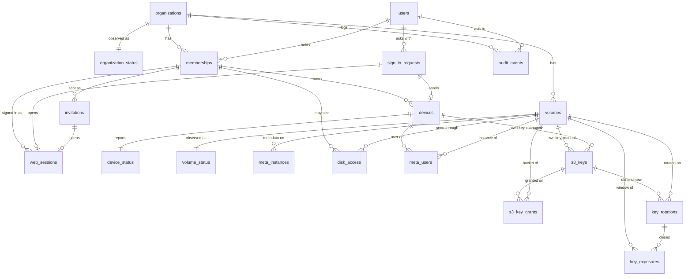

# Database schema

The control plane's data model, in PostgreSQL. **Status: built**: `server/`, models in `server/src/floppy_server/models.py`, migrations `0001_initial`, `0002` and `0003`. `0003` moved the control plane from one Valkey instance and one bucket per organization to one of each per disk, with access per person and per disk (DECISIONS #23, #24); what it changed is listed in [Migration 0003](#migration-0003).

The design started as the paper of ROADMAP 3, written from the team architecture ([architecture.html](architecture.html), sections 06 to 11), the concepts ([concept-d-onboarding](concepts/concept-d-onboarding.html), [concept-e-admin](concepts/concept-e-admin.html)) and the admin web's API contract (`web/src/lib/api/types.ts`, `http.ts`, and the rules the fake in `web/src/lib/api/fake/` keeps). This file changes in the same commit as every migration.

The control plane is AGPL-3.0 (DECISIONS #3), FastAPI with SQLAlchemy 2.0 async and Alembic, and stays off the data path (DECISIONS #2): nothing in these tables is read when a device lists a folder or reads a clip.

## What lives where

| Data | Lives in | Written by | Notes |
|---|---|---|---|
| Organizations, people, invitations, sign-in, sessions, devices, disks as configuration, access per person and disk, S3 key records and grants, rotations, audit log | PostgreSQL, these tables | Control plane | The only store the control plane owns |
| The file tree, attributes, locks, JuiceFS sessions, read-your-writes counters (`ryw<sid>`) | The disk's own Valkey instance, database 1 | JuiceFS on each device | Never copied into PostgreSQL. Database 0 stays empty, the one tools hit by accident |
| The volume format: name, UUID, block size, trash days, bucket, and **the disk's S3 key** in manual mode | The `setting` key of the disk's instance | `juicefs format` and `juicefs config`, run by the control plane | In managed mode the format holds no key ([Storage modes](#storage-modes), DECISIONS #24). PostgreSQL mirrors the non-secret fields; on a mismatch the format wins |
| Valkey ACL users, one per device on each instance it may see | Each disk's instance, ACL | Control plane | Not replicated by Valkey: rebuilt from `devices` and `meta_users` (see [meta_users](#meta_users)) |
| Replicas of the metadata | Each device's VM | Valkey replication | One replica per disk the device may see, a copy of that disk's whole instance (DECISIONS #23) |
| Device token, Valkey password, SMB password, the device's own S3 key (managed) | The device's Keychain; the S3 key also in a `0600` file in the VM for `juicefs mount` | The app | PostgreSQL keeps only hashes of the first two, and of the S3 key only its id at the provider |
| Cache policy (`--cache-expire`) | PostgreSQL, `volumes.cache_expire_days` | Control plane | A mount option, not part of the format: the app reads it from the device configuration |

**The control plane must not become the data path.** It talks to each disk's instance only to create, change and delete ACL users, run `juicefs format` and `juicefs config`, read the counters it shows (space, files) and ping it for health. It never proxies metadata or blocks, and a mounted disk does not need it to be up (architecture.html, Failure modes).

**One instance and one bucket per disk** is what makes access per disk real (DECISIONS #23): a replica copies its whole instance and a key opens its whole bucket, so a device gets a replica, a Valkey user and, in managed mode, a bucket grant only for the disks its person may see. The instances are created by the meta service (DECISIONS #25, [Meta instances](#meta_instances)), never by the control plane starting containers.

## Conventions

**Ids are UUIDv7**, `uuid` columns with the server default `uuidv7()` (PostgreSQL 18). Why: ids go into URLs and the API, so they must not be guessable or enumerable across tenants (a `bigint` is); an organization can move from a self-hosted instance to the hosted service, or back, by copying its rows with the same ids; and unlike UUIDv4 they are ordered by creation time, which keeps B-tree inserts at the right edge and makes the audit log's id a usable tie-breaker in keyset pagination. The cost, the creation time readable from the id, leaks nothing that the rows do not already show. The application may generate them too (Python 3.14 has `uuid.uuid7()`), but the default makes every insert path, `psql` included, produce the same kind.

**Timestamps are `timestamptz`**, stored and returned in UTC; the API serializes them as ISO 8601 with `Z`. The connection sets `TimeZone=UTC` so nothing depends on the server's zone. `created_at` defaults to `now()`; `updated_at` is set by SQLAlchemy (`onupdate`) on the tables that have it.

**Enumerations are `text` with a `CHECK`**, not PostgreSQL `ENUM` types: adding a value to a `CHECK` is one migration, while `ALTER TYPE ... ADD VALUE` cannot be undone and has transaction restrictions that make Alembic migrations awkward.

**Emails are stored lowercased and trimmed**, enforced with a `CHECK (email = lower(btrim(email)))`, so uniqueness works with a plain index and no `citext` extension.

**Constraint names** follow one SQLAlchemy naming convention (`pk_%(table_name)s`, `fk_%(table_name)s_%(column_0_name)s_%(referred_table_name)s`, `uq_...`, `ck_%(table_name)s_%(constraint_name)s`, `ix_...`), so Alembic generates stable names and later migrations can drop them by name.

**Organization-level invariants run under a row lock** on the organization (`SELECT ... FROM organizations WHERE id = :org FOR UPDATE`): the last admin, a disk's name, one rotation applying per disk. A table constraint cannot express "at least one active admin", and the lock serializes two admins acting at once.

**Owed work is a row with `applied_at` null.** What must happen outside PostgreSQL (an ACL user on an instance, a grant at the provider) is first written as the wanted state with `applied_at` null, committed, then applied; a call that fails leaves the row owed and the reconciler retries it. A change is durable before it is effective, and nothing is lost when an instance or the provider does not answer.

### Soft delete

**Nothing is ever deleted with `DELETE`.** The application's database role has no `DELETE` grant on any table (see [First migration](#first-migration)), so the rule holds even against a bug. The tables fall into four kinds:

| Kind | Tables | How a row ends |
|---|---|---|
| Entities: things people manage | `organizations`, `users`, `memberships`, `devices`, `volumes` | `deleted_at` (soft delete: the row disappears from every list and no longer counts for uniqueness). Their domain end states, a removed person or a revoked device, are separate columns (`removed_at`, `revoked_at`) because the admin web keeps showing them |
| Records: facts with a lifecycle that ends in a terminal state | `invitations`, `sign_in_requests`, `web_sessions`, `meta_instances`, `s3_keys`, `key_rotations`, `key_exposures`, `audit_events` | A terminal state with its timestamp (expired, revoked, stopped, retired, closed). No `deleted_at`: "deleting" a fact would rewrite history, and none of them is ever hidden or restored |
| Settings per pair: one row per pair, overwritten | `disk_access`, `meta_users`, `s3_key_grants` | Never end: `none` is a value, not a deletion. Who changed `disk_access` and when is in the audit log |
| Observations: overwritten by the latest report | `organization_status`, `device_status`, `volume_status` | Follow their parent row; one row per parent, updated in place |

**Uniqueness with soft-deleted rows** uses partial unique indexes: `... WHERE deleted_at IS NULL` (plus the domain condition where a removed or revoked row must not block a new one). Some values are unique **forever**, across deleted rows too, because what they name outlives the row: a disk's object prefix and its bucket still hold data after the disk is soft deleted, and reusing them would collide with old objects. Each table says which.

### Multi-tenancy

Every row except `users` and `sign_in_requests` carries `organization_id uuid NOT NULL`. Each tenant table has a `UNIQUE (organization_id, id)` and every reference between tenant tables is a **composite foreign key** `(organization_id, x_id) REFERENCES x (organization_id, id)`, so a row can never point at another organization's row, whatever the application does. The application reaches tenant tables only through repositories that take the session's organization id.

`users` is global because a person is an email address, not a tenant row; `sign_in_requests` is global because it exists before anyone is known. Neither holds organization data: what a user can see comes only through `memberships`.

**Hosted service**: one PostgreSQL database for all organizations, isolated by the scoping above. The files are isolated by infrastructure, not by filters: each disk has its own Valkey instance and its own bucket (DECISIONS #2, #23), enforced here by partial unique indexes on `meta_instances.url` and `volumes (s3_endpoint, s3_bucket)` across every organization. Row-level security on `organization_id` is added as a second wall before the hosted service opens, not in the first migration: sign-in reads across organizations and would need a bypass role from day one ([decision 6](#decisions-taken)).

**Self-hosted**: the same schema with one row in `organizations`, created at first start by a bootstrap command from the environment (organization name, first admin's email, storage mode and the default S3 endpoint). A configuration flag refuses a second organization; nothing in the schema differs, so a self-hosted organization can later be moved to the hosted service row for row.

## Access per disk

(0003) Each person has, on each disk, `none`, `read` or `write` (DECISIONS #23), kept in [disk_access](#disk_access) and decided by admins. A device inherits its person's access; a device that is not active, or whose person is not active, has `none` everywhere. What the access turns into:

| | `none` | `read` | `write` |
|---|---|---|---|
| The device's configuration | The disk is absent: no folder, no replica, no mount | Listed with `access: read`: the app mounts it `--read-only` | Listed with `access: write` |
| The device's Valkey user on the disk's instance | None (deleted, its connections killed) | `ACL_READ`: reads, replication and the patch's probe | `ACL_WRITE`: adds writes, transactions and the scripts |
| Managed: the device's key on the disk's bucket | No grant | Read | Read and write |
| Manual: the disk's key | In the format, which the device never receives | In the format: it can write the bucket, so versioning is recommended | In the format |

The ACL lists are the ones `spike/perdisk.py` verified against a full workload with an empty `ACL LOG` (`server/src/floppy_server/infra/metadata.py`). A read-only user that mounts without `--read-only` fails at session creation (NOPERM), so a tampered app cannot write.

**Defaults** (decided here; DECISIONS does not fix them): a new disk gives `write` to the admin who creates it and `none` to everyone else, unless the creation request lists people; a new person has `none` on every disk, unless the invitation lists disks. Why: access is enforced where the data is, so a default that grants copies a disk's whole tree to every device of the team at the next poll, before an admin had a chance to restrict it; `none` fails closed, and the creation and invitation forms carry the access, so the common case ("everyone on this disk") costs no extra step. A missing `disk_access` row means `none`.

**Changes apply live.** Setting a person's access writes `disk_access`, then the wanted state of each of their active devices on that disk (`meta_users`, and in managed mode `s3_key_grants`) with `applied_at` null, in one transaction; then the control plane applies them: `ACL SETUSER` with the new list (Valkey checks the ACL on every command, so open connections follow at once), the grant changed in place at the provider. Raising access needs nothing else. Lowering `write` to `read` on a mounted disk makes writes fail with an I/O error until the app remounts it read-only: the heartbeat's answer lists each disk with its access, and the app remounts a disk mounted read-write whose access became `read`, unmounts one that is no longer listed, and mounts a new one. Lowering to `none` deletes the user and kills its connections.

**Manual mode and the key window.** In manual mode a device that could see a disk could read its key from the format. Lowering someone to `none` (`access_removed`), removing them (`person_removed`) or revoking one of their devices (`device_revoked`) opens the rotation window **for that disk's key alone** (DECISIONS #18, #24), only when one of their devices had a Valkey user on it. Lowering to `read` opens nothing: the person still sees the disk. In managed mode there is no window: the device's own key loses its grant or is deleted.

## Storage modes

(0003) Each organization stores its files in one of two modes, fixed once a disk exists (DECISIONS #24). The core always speaks plain S3; what changes is who creates each disk's bucket and keys.

| | Manual | Managed |
|---|---|---|
| Who creates the bucket and keys | The admin, in the provider's console: one bucket and one key per disk, the key limited to that bucket | The provider adapter, through the provider's API |
| Providers | Any S3 | Garage is built (the spike and development use it); OVH, AWS and MinIO are refused by the bootstrap until their adapters exist |
| Keys | One per disk (`holder = 'disk'`), pasted when the disk is created, probed first | One per device (`holder = 'device'`), granted per bucket (`s3_key_grants`), plus the control plane's own key (`holder = 'control_plane'`), owner of every bucket it creates |
| What the format holds | The disk's key | No key: each mount brings its own from the environment |
| Where a device gets a key | From the format, through its replica of that disk | From the control plane, once, at registration (the bootstrap answer), into the Keychain |
| Someone leaves, or loses access to a disk | That disk's key window opens; the admin rotates that disk's key (DECISIONS #18) | The device's key loses its grant on that bucket, or is deleted at the provider when the device is revoked; nothing to rotate |
| Bucket versioning | Recommended: the key in the format can write the bucket even for a read-only person. Checked and shown per disk | Set by the adapter where the provider has it |
| Who uses it | Self-hosters with any S3 | The hosted service, always; self-hosters who give the adapter admin credentials |

**Keys outside the format depend on JuiceFS** (checked in the v1.4.1 source and against Garage):

- `juicefs mount` cannot override a key stored in the format: `updateFormat` in `cmd/mount.go` overrides the bucket, the storage type, the storage class, the tag and the bandwidth limits, nothing else.
- `juicefs config` and `juicefs format` on an existing volume change only the flags passed on the command line (`ctx.LocalFlagNames()`); `ACCESS_KEY` and `SECRET_KEY` from the environment count only for a new format, which then stores them. Rotating a disk's key from the control plane would therefore put the secret in argv, visible in `ps`: patch 0003 (in `spike/juicefs-replica/`) makes `config` and `format` take the key from the environment.
- When the format holds **no** access key, the `s3` storage builds its client from the AWS SDK's default chain (`config.LoadDefaultConfig` in `pkg/object/s3.go`): `AWS_ACCESS_KEY_ID` and `AWS_SECRET_ACCESS_KEY` in the mount's environment. This is the managed path: the control plane formats with `--storage s3`, no `--access-key`, and its own key in `AWS_ACCESS_KEY_ID`/`AWS_SECRET_ACCESS_KEY` (never in `ACCESS_KEY`, which a new format would store); each device mounts with its key in the environment of `juicefs mount`, from a `0600` file in the VM that the app writes from the Keychain. Verified against Garage through the real JuiceFS (`server/tests/test_juicefs_s3.py`, `spike/perdisk.py`); OVH is still to try.

Consequences: in managed mode a replica, on a revoked device or anywhere, carries no S3 credential; the SDK reads the key once, so a new key means remounting that device's disks inside the VM; a grant changed in place needs no remount. `juicefs gc`, `fsck` and `dump` run by the control plane use its own key the same way. MinIO is formatted with `--storage s3` too, since `--storage minio` reads `MINIO_ACCESS_KEY` instead.

**Providers**: Garage (admin API: create the bucket, a key per device, allow or deny it per bucket, changed in place) and MinIO (a user or service account per device with a policy listing its buckets) scope keys per bucket. AWS does it with one IAM user per device and a policy listing the buckets, rewritten on every change; IAM's default quota of 5,000 users per account is the ceiling. OVH would need one Public Cloud user per device with an S3 policy: to verify (quota and latency of creating users).

**Bucket versioning** in manual mode. A device that could see a disk may have copied the disk's key, and until the admin deletes it at the provider it can delete blocks. With versioning on, a deleted block stays recoverable for some days: recommended, with a lifecycle rule that expires old versions after 7 days, and a policy on the key that denies `s3:DeleteObjectVersion` and changes to versioning and lifecycle (JuiceFS needs only `DeleteObject`, which with versioning leaves a delete marker). The control plane reads the bucket's versioning and lifecycle with the disk's key (`GetBucketVersioning`, `GetBucketLifecycleConfiguration`) at every probe and shows them per disk; `unknown` when the provider or the key's policy does not answer.

**The mode is chosen when the organization is created** and frozen once a disk exists: moving formats between "a key inside" and "no key" is a migration of its own. The hosted service refuses `manual`.

## Diagram

## Tables

Columns are `NOT NULL` unless the Null column says yes. Every tenant table also has `UNIQUE (organization_id, id)` for the composite foreign keys; it is not repeated below.

### organizations

A tenant: a team, its storage mode and its mail.

| Column | Type | Null | Default | Notes |
|---|---|---|---|---|
| `id` | `uuid` | | `uuidv7()` | Primary key |
| `name` | `text` | | | `CHECK (length(btrim(name)) BETWEEN 1 AND 100)`. Shown in mails ("Floppy · Studio Esempio") |
| `slug` | `text` | | | `CHECK (slug ~ '^[a-z0-9][a-z0-9-]{1,38}[a-z0-9]$')`. For the hosted service's addresses |
| `s3_endpoint` | `text` | | | (0003) The default endpoint of new disks: the one an admin starts from in manual mode, the one the adapter creates buckets on in managed mode. Each disk keeps its own copy |
| `s3_region` | `text` | | | (0003) The default region of new disks, the same way |
| `smtp_host`, `smtp_username`, `smtp_sender` | `text` | yes | | Null: the instance's SMTP from the environment |
| `smtp_port` | `integer` | yes | | `CHECK (smtp_port BETWEEN 1 AND 65535)`; `CHECK ((smtp_host IS NULL) = (smtp_port IS NULL))` |
| `smtp_password_enc` | `bytea` | yes | | Encrypted; write only through the API (`passwordSet` is `smtp_password_enc IS NOT NULL`) |
| `mail_language` | `text` | | `'it'` | (0002) `CHECK IN ('it', 'en')`. The language of every mail sent for this organization: invitations, sign-in links and codes (web and app), the test mail. Set at creation (the bootstrap's `FLOPPY_BOOTSTRAP_MAIL_LANGUAGE`), changed in Settings (`mailLanguage`). A sign-in for an address in no organization uses the request's `Accept-Language`, falling back to `FLOPPY_DEFAULT_MAIL_LANGUAGE` |
| `storage_mode` | `text` | | `'manual'` | (0002) `CHECK IN ('manual', 'managed')`. See [Storage modes](#storage-modes) |
| `storage_provider` | `text` | yes | | (0002) `CHECK IN ('ovh', 'aws', 'minio', 'garage')`; `CHECK ((storage_mode = 'managed') = (storage_provider IS NOT NULL))` |
| `storage_admin_credentials_enc` | `bytea` | yes | | (0002) Encrypted: the adapter's credentials as JSON (a Garage admin token and endpoint; OVH, AWS, MinIO to come). Null in a managed organization means the instance's environment (`FLOPPY_GARAGE_ADMIN_URL`, `FLOPPY_GARAGE_ADMIN_TOKEN`), as in the hosted service. `CHECK (storage_mode = 'managed' OR storage_admin_credentials_enc IS NULL)` |
| `created_at`, `updated_at` | `timestamptz` | | `now()` | |
| `deleted_at` | `timestamptz` | yes | | |

Indexes: `UNIQUE (slug)` over every row (a slug is never reused, so an old link never lands on another team).

(0003) The organization has no bucket and no Valkey instance any more: both are per disk ([volumes](#volumes), [meta_instances](#meta_instances)). `valkey_url`, `valkey_admin_url`, `valkey_admin_username`, `valkey_admin_password_enc`, `valkey_databases`, `s3_bucket` and `storage_key_scope` were dropped with their indexes and checks. There is no `invite_policy`: only admins invite (decided by Simone).

### organization_status

What the control plane last saw of the organization's mail, for `GET /health`. One row per organization, overwritten. (0003) The metadata and storage columns moved to [volume_status](#volume_status), per disk.

| Column | Type | Null | Default | Notes |
|---|---|---|---|---|
| `organization_id` | `uuid` | | | Primary key, foreign key to `organizations` |
| `mail_state` | `text` | | `'unconfigured'` | `CHECK IN ('ok', 'unconfigured', 'failing')` |
| `mail_sent_at` | `timestamptz` | yes | | Last mail accepted by the SMTP server |
| `updated_at` | `timestamptz` | | `now()` | |

Kept in PostgreSQL rather than in process memory because several API processes serve the same organization.

### users

A person, identified by an email address. Global, not per organization.

| Column | Type | Null | Default | Notes |
|---|---|---|---|---|
| `id` | `uuid` | | `uuidv7()` | Primary key. The API's `Person.id` |
| `email` | `text` | | | Lowercased, `CHECK (email = lower(btrim(email)) AND position('@' in email) > 1)` |
| `name` | `text` | yes | | Null until the first sign-in, which fills it from the address (`giulia@...` becomes "Giulia"); `CHECK (length(name) <= 100)` |
| `last_sign_in_at` | `timestamptz` | yes | | |
| `created_at`, `updated_at` | `timestamptz` | | `now()` | |
| `deleted_at` | `timestamptz` | yes | | |

Indexes: `UNIQUE (email) WHERE deleted_at IS NULL`.

A user is created by the first invitation to their address. Users are never hard deleted, so foreign keys from the audit log stay valid; erasing a person's data on request replaces their address and name with a placeholder instead ([decision 14](#decisions-taken)).

### memberships

A user in an organization, with a role. The API's `Person` is a user plus their current membership in the session's organization.

| Column | Type | Null | Default | Notes |
|---|---|---|---|---|
| `id` | `uuid` | | `uuidv7()` | Primary key |
| `organization_id` | `uuid` | | | |
| `user_id` | `uuid` | | | Foreign key to `users` |
| `role` | `text` | | | `CHECK IN ('admin', 'member')` |
| `status` | `text` | | `'invited'` | `CHECK IN ('invited', 'active', 'removed')`, see [State machines](#state-machines) |
| `invited_by_user_id` | `uuid` | yes | | Null only for the bootstrap admin |
| `invited_at` | `timestamptz` | yes | | |
| `activated_at` | `timestamptz` | yes | | First sign-in or accepted invitation |
| `removed_at` | `timestamptz` | yes | | |
| `removed_by_user_id` | `uuid` | yes | | |
| `created_at`, `updated_at` | `timestamptz` | | `now()` | |
| `deleted_at` | `timestamptz` | yes | | Set only when the organization itself is deleted or a person is erased; removal is a status |

Constraints: `CHECK ((status = 'removed') = (removed_at IS NOT NULL))`, `CHECK (status <> 'active' OR activated_at IS NOT NULL)`, `CHECK (status <> 'invited' OR activated_at IS NULL)`.

Indexes: `UNIQUE (organization_id, user_id) WHERE status <> 'removed' AND deleted_at IS NULL`, which backs `already_member`; a removed person invited again gets a new row, and the old one keeps its history (and its `disk_access`: a new membership starts with no access). `(user_id) WHERE status <> 'removed' AND deleted_at IS NULL` for sign-in. `(organization_id, status)`.

The organization must keep one active admin: demoting or removing the last one fails with `last_admin`, checked under the organization's row lock. Members see only their own devices: enforced in the queries (`devices.user_id = session user`), not by a column. A role says what someone manages, not what they see: an admin's access to a disk is in `disk_access` like anyone's.

### invitations

The invitation mails. One row per mail sent: the first invitation and every resend.

| Column | Type | Null | Default | Notes |
|---|---|---|---|---|
| `id` | `uuid` | | `uuidv7()` | Primary key |
| `organization_id` | `uuid` | | | |
| `membership_id` | `uuid` | | | Composite foreign key to `memberships` |
| `token_hash` | `bytea` | | | SHA-256 of the link's token. `UNIQUE`, `CHECK (octet_length(token_hash) = 32)` |
| `state` | `text` | | `'sent'` | `CHECK IN ('sent', 'accepted', 'superseded', 'revoked')`. Expired is derived: `sent` with `expires_at` past |
| `sent_by_user_id` | `uuid` | | | Foreign key to `users` |
| `sent_at` | `timestamptz` | | `now()` | |
| `expires_at` | `timestamptz` | | | `sent_at` plus 7 days (concept-d, step 9); `CHECK (expires_at > sent_at)` |
| `accepted_at`, `superseded_at`, `revoked_at` | `timestamptz` | yes | | One per terminal state, each `CHECK`ed against `state` |

Indexes: `UNIQUE (membership_id) WHERE state = 'sent'`: one live invitation per person, so a resend supersedes the previous link.

### sign_in_requests

A pending sign-in: the magic link and the 6-digit code sent by mail, for the admin web (`kind = 'web'`) or for the app (`kind = 'app'`, with PKCE and a loopback redirect). Global: the address may belong to no organization.

| Column | Type | Null | Default | Notes |
|---|---|---|---|---|
| `id` | `uuid` | | `uuidv7()` | Primary key. The API's `requestId` |
| `kind` | `text` | | | `CHECK IN ('web', 'app')` |
| `email` | `text` | | | Lowercased, as typed |
| `user_id` | `uuid` | yes | | Null when the address has no eligible membership. The row exists anyway, so the answer is the same for everyone and the page never reveals who is a member; the mail says "ask your admin" instead |
| `organization_id` | `uuid` | yes | | The organization the session will act in, resolved when the request is created: the only one the person belongs to ([decision 1](#decisions-taken)) |
| `state` | `text` | | `'pending'` | `CHECK IN ('pending', 'completed', 'locked', 'superseded')`. Expired is derived: `pending` past `expires_at` |
| `link_token_hash` | `bytea` | | | SHA-256 of the link's 256-bit token. `UNIQUE` |
| `code_hmac` | `bytea` | | | HMAC-SHA256 of the 6-digit code (see [Secrets](#secrets)) |
| `code_attempts` | `smallint` | | `0` | `CHECK (code_attempts BETWEEN 0 AND 5)`: the fifth wrong code locks the request, link included |
| `expires_at` | `timestamptz` | | | Creation plus 15 minutes |
| `resend_at` | `timestamptz` | | | Creation plus 60 seconds: when "send another link" turns on |
| `completed_at` | `timestamptz` | yes | | |
| `completed_via` | `text` | yes | | `CHECK IN ('link', 'code')` |
| `locked_at`, `superseded_at` | `timestamptz` | yes | | |
| `device_name` | `text` | yes | | App only: "MacBook Pro di Giulia", shown on the page and in the mail |
| `code_challenge` | `text` | yes | | App only: PKCE S256 challenge, base64url. `UNIQUE` |
| `redirect_uri` | `text` | yes | | App only: `CHECK (redirect_uri ~ '^http://127\.0\.0\.1:[0-9]{1,5}/')`, the loopback port the app chose |
| `auth_code_hash` | `bytea` | yes | | App only: SHA-256 of the one-time code redirected to the loopback after the link. `UNIQUE` |
| `auth_code_expires_at` | `timestamptz` | yes | | 60 seconds after the link is opened |
| `exchanged_at` | `timestamptz` | yes | | When the app traded code and verifier for a device token; single use |
| `created_at` | `timestamptz` | | `now()` | |

Constraints: `CHECK ((kind = 'app') = (code_challenge IS NOT NULL AND redirect_uri IS NOT NULL AND device_name IS NOT NULL))`; `CHECK ((state = 'completed') = (completed_at IS NOT NULL))`.

Indexes: `(email, created_at DESC)` for rate limiting and for superseding: a new request supersedes the address's pending ones of the same kind, so only one code is guessable at a time.

Rules the schema relies on:

- **Polling never grants a session.** `GET /auth/sign-in/{id}` only reads `state`. The session goes to whoever opens the link or types the code; otherwise anyone who started a request with someone else's address would be signed in when the victim clicks.
- **The link is bound to the request, not to a browser cookie** (concept-d): it works when the mail opens in another browser.
- **In the app, the 6-digit code is typed in the app**, which sends it with the PKCE verifier; the request is found by `code_challenge = S256(verifier)`, so the verifier both identifies and authenticates it.
- A request with `user_id` null can never complete: a code answers `invalid_code` and the link `link_invalid`, the same answers as for a wrong code or a used link.
- **An app restarted before it may ask again takes its pending request over.** While a pending app request cannot be resent (the first minute, or the hourly cap), a new app sign-in for the same address gets the same request back with no new mail, and the request takes the new `code_challenge`, `redirect_uri` and device name: the app's new verifier completes it with the code of the mail already sent, and the link redirects to the new loopback. Otherwise an app restarted within the minute could never finish. Whoever knows the address could take a pending request over the same way, which only stops the first app (as starting a new request after the minute already does): the authorization code still lands on the loopback of the machine that opened the link, and the code is in the owner's mail. With the hourly cap reached and nothing pending, the app gets `rate_limited` with the time to wait.

### web_sessions

A signed-in browser of the admin web, behind an HttpOnly cookie. Its name is `__Host-floppy_session` (Secure, `Path=/`, no `Domain`), so no subdomain, such as the disks' `*.meta.<domain>`, can set or overwrite it; plain http in development (`FLOPPY_COOKIE_SECURE=false`) keeps `floppy_session`, since browsers refuse the prefix without Secure.

| Column | Type | Null | Default | Notes |
|---|---|---|---|---|
| `id` | `uuid` | | `uuidv7()` | Primary key |
| `organization_id` | `uuid` | | | |
| `membership_id` | `uuid` | | | Composite foreign key. The role is read from the membership on every request, so a role change applies at once |
| `user_id` | `uuid` | | | Denormalized from the membership for the lookup |
| `sign_in_request_id` | `uuid` | yes | | Foreign key: the sign-in that opened the session |
| `invitation_id` | `uuid` | yes | | Composite foreign key to `invitations`: the invitation link that opened it (`POST /auth/invitation`). `CHECK ((sign_in_request_id IS NULL) <> (invitation_id IS NULL))`: exactly one of the two |
| `token_hash` | `bytea` | | | SHA-256 of the cookie's 256-bit value. `UNIQUE` |
| `created_at` | `timestamptz` | | `now()` | |
| `last_seen_at` | `timestamptz` | | `now()` | Written at most every 5 minutes, not on every request |
| `expires_at` | `timestamptz` | | | Creation plus 30 days; the idle limit is `last_seen_at` plus 14 days |
| `revoked_at` | `timestamptz` | yes | | |
| `revoke_reason` | `text` | yes | | `CHECK IN ('signed_out', 'membership_removed')`; `CHECK ((revoked_at IS NULL) = (revoke_reason IS NULL))` |
| `user_agent` | `text` | yes | | For a future "your sessions" list; truncated to 300 characters |

Indexes: `(membership_id) WHERE revoked_at IS NULL`, to revoke every session of a removed person.

### devices

A device (today a Mac): the app's device token and its one Valkey password (DECISIONS #7), used for a user of the same name on every disk's instance it may see.

| Column | Type | Null | Default | Notes |
|---|---|---|---|---|
| `id` | `uuid` | | `uuidv7()` | Primary key |
| `organization_id` | `uuid` | | | |
| `membership_id` | `uuid` | | | Composite foreign key: the owner's membership, whose access the device inherits |
| `user_id` | `uuid` | | | Denormalized owner, for "members see only their own devices" |
| `name` | `text` | | | From the sign-in request; `CHECK (length(btrim(name)) BETWEEN 1 AND 100)` |
| `state` | `text` | | `'pending'` | `CHECK IN ('pending', 'active', 'revoked')` |
| `sign_in_request_id` | `uuid` | | | Foreign key, `UNIQUE`: one device per app sign-in |
| `token_hash` | `bytea` | | | SHA-256 of the device token (256 bits, in the Keychain). `UNIQUE` |
| `valkey_username` | `text` | | generated | `GENERATED ALWAYS AS ('floppy_d_' \|\| replace(id::text, '-', '')) STORED`: derived, never typed, unique with the id, the same on every instance |
| `valkey_password_sha256` | `bytea` | yes | | SHA-256 of the Valkey password, the same form Valkey keeps in its ACL (`#<hex>`). Null while pending |
| `valkey_user_created_at` | `timestamptz` | yes | | When the current password was issued |
| `activated_at` | `timestamptz` | yes | | |
| `revoked_at` | `timestamptz` | yes | | |
| `revoked_by_user_id` | `uuid` | yes | | |
| `revoke_reason` | `text` | yes | | `CHECK IN ('admin', 'owner', 'member_removed', 'signed_out', 'never_registered')`. The last one is the reconciler's, for a `pending` device that did not register within 24 hours |
| `created_at`, `updated_at` | `timestamptz` | | `now()` | |
| `deleted_at` | `timestamptz` | yes | | Hides a revoked device from the list; no endpoint does it yet |

Constraints: `CHECK ((state = 'revoked') = (revoked_at IS NOT NULL AND revoke_reason IS NOT NULL))`, `CHECK (state <> 'active' OR valkey_password_sha256 IS NOT NULL)`.

Indexes: `(organization_id, user_id) WHERE state <> 'revoked'`. (0003) `valkey_user_deleted_at` and its index were dropped: the cleanup a revocation owes is now one `meta_users` row per instance, each with its own `applied_at`.

**Why the password hash is kept.** Valkey does not replicate ACL users: they live in each instance's configuration. When an instance's datacenter replica is promoted, or its master is rebuilt from a dump, every device's user is missing. With the SHA-256 kept here and the access in `meta_users`, the control plane recreates them (`ACL SETUSER floppy_d_<id> reset on #<hash> <ACL of the access>`) without knowing a single password, and no device has to sign in again. A SHA-256 of a 256-bit random password cannot be reversed, and it is what Valkey itself stores.

**Revocation is durable before it is effective**: `revoked_at` and the device's `meta_users` rows set to `none` are committed first, then each user is deleted on its instance; an instance that does not answer keeps its row owed for the reconciler.

### device_status

What each device last reported in its heartbeat. One row per device, overwritten.

| Column | Type | Null | Default | Notes |
|---|---|---|---|---|
| `device_id` | `uuid` | | | Primary key, composite foreign key to `devices` |
| `organization_id` | `uuid` | | | |
| `last_seen_at` | `timestamptz` | | | `connected` is a heartbeat in the last 2 minutes, computed |
| `app_version`, `macos_version` | `text` | | | `appOutdated` is computed against the latest release the instance knows, not stored |
| `replica_mode` | `text` | yes | | `CHECK IN ('replica', 'master', 'offline')`, from the mounts' `.stats` |
| `replica_lag_ms` | `integer` | yes | | |
| `s3_access_key_tail` | `text` | yes | | Managed: the tail of the key its mounts use, to see that a reissued key arrived. Manual: the tail read from a disk's format on its replica, which counts the devices that picked up a rotation |
| `mounted_volume_ids` | `uuid[]` | | `'{}'` | The disks whose JuiceFS mount is up inside the VM, each a folder of the one share (see [Disks on a device](#disks-on-a-device)). For `Disk.mountedBy`. No foreign key: an observation, replaced at every heartbeat |
| `outdated_logged_version` | `text` | yes | | The version for which `device_seen_outdated` was logged, so it is logged once |
| `updated_at` | `timestamptz` | | `now()` | |

Separate from `devices` on purpose: a heartbeat every 30-60 seconds per device rewrites this row, while `devices` holds credentials and changes rarely. The table is created with `fillfactor = 70` so these updates stay HOT (no index churn). Indexes: `(organization_id, last_seen_at DESC)`, and a GIN index on `mounted_volume_ids`.

### volumes

A disk: a JuiceFS volume with its own bucket and its own Valkey instance. The API's `Disk`.

| Column | Type | Null | Default | Notes |
|---|---|---|---|---|
| `id` | `uuid` | | `uuidv7()` | Primary key |
| `organization_id` | `uuid` | | | |
| `name` | `text` | | | The name people see and the disk's folder in the share: `/Volumes/Floppy/Archivio 2025`. `CHECK (name ~ '^[A-Za-z0-9]([A-Za-z0-9 ._-]{0,58}[A-Za-z0-9])?$')`, see [Disks on a device](#disks-on-a-device). Never renamed: CapCut keeps full paths |
| `volume_name` | `text` | | | JuiceFS's name, which is also the object prefix inside the bucket (JuiceFS writes under `<bucket>/<name>/`). JuiceFS accepts only `CHECK (volume_name ~ '^[a-z0-9][a-z0-9-]{1,61}[a-z0-9]$')`, which is why it is not the display name. Derived once from `name`, never shown, never changed |
| `s3_endpoint`, `s3_region`, `s3_bucket` | `text` | | | (0003) The disk's own bucket: pasted by the admin with its key (manual), or created by the adapter as `floppy-<volume id without hyphens>` on the organization's endpoint (managed). The format holds them |
| `juicefs_uuid` | `uuid` | yes | | Read back from the format after `juicefs format`; null while creating |
| `state` | `text` | | `'creating'` | `CHECK IN ('creating', 'ready', 'failed')` |
| `block_size_kb` | `integer` | | `1024` | Fixed at format time (DECISIONS #15). `CHECK (block_size_kb > 0)` |
| `trash_days` | `integer` | | `7` | Mirrors the format; changed through `juicefs config`. `CHECK (trash_days BETWEEN 0 AND 365)` |
| `cache_expire_days` | `integer` | | `30` | The whole cache policy (decided by Simone): `--cache-expire` for every device at its next mount. `CHECK (cache_expire_days BETWEEN 1 AND 365)` |
| `format_error` | `text` | yes | | Why the creation failed, at most 500 characters, never with a key. `CHECK (state = 'failed' OR format_error IS NULL)` |
| `created_by_user_id` | `uuid` | | | |
| `created_at`, `updated_at` | `timestamptz` | | `now()` | |
| `deleted_at` | `timestamptz` | yes | | Leaves the instance, its metadata and the objects in place: deleting files is a separate, explicit act |

Constraints: `CHECK (state <> 'ready' OR juicefs_uuid IS NOT NULL)`.

Indexes:

- `UNIQUE (organization_id, lower(name)) WHERE deleted_at IS NULL`: backs `disk_name_taken`.
- `UNIQUE (organization_id, volume_name)` over every row: the objects of a deleted disk stay under that prefix, and a new volume there would collide with them (the gotcha of a reinstall with the same `VOLUME_NAME`).
- (0003) `UNIQUE (s3_endpoint, s3_bucket) WHERE state <> 'failed'`, across every organization: one bucket per disk (DECISIONS #23), and a deleted disk's bucket stays taken since its objects are there. A failed creation releases it: its format never reached a device, so the admin can try again with the same bucket.

(0003) `meta_db` and its index were dropped: a disk's metadata is database 1 of its own instance. `s3_key_id` was dropped too: the key a manual disk's format holds is its one `active` key in `s3_keys` (`holder = 'disk'`), which a rotation activates only once `juicefs config` put it there.

**Creating a disk** is an **asynchronous job**. `POST /disks`, under the organization's lock, checks the name, in manual mode probes the pasted bucket and key (a test write, `probe_failed` before anything is written), and inserts the volume `creating`, its key `pending` (manual), its `volume_status` row (manual: with that probe's result as the disk's storage state) and the access the request carries (the creator gets `write` unless listed otherwise); it answers `201` with that row. A background job then: asks the meta service for the disk's instance and records it in `meta_instances`; in managed mode creates the bucket and grants it to the control plane's key, then probes it; runs `juicefs format` on the instance (manual: the disk's key goes into the format; managed: the control plane's key through `AWS_*`, nothing stored); and sets `ready` and `juicefs_uuid`, with the disk's key `active` (manual). Then the devices that may see the disk get their users and grants (see [Access per disk](#access-per-disk)). If a step fails, or the job finds a `creating` row it was interrupted on, the row becomes `failed` with `format_error` and is soft deleted; its key `rejected`, its instance released and wiped (its format never reached a device). `GET /disks/{id}` still shows it, so the web can say why. Its prefix stays burned.

### Disks on a device

A device mounts the disks its person may see (see [Access per disk](#access-per-disk)). Inside the VM each disk is its own JuiceFS mount at `/mnt/drive/<name>`, with its own local replica of the disk's instance; Samba exports `/mnt/drive` as the one `Floppy` share, so the Mac keeps one SMB mount at the fixed `/Volumes/Floppy` and sees each disk as a folder: `/Volumes/Floppy/Progetti`, `/Volumes/Floppy/Archivio 2025` (DECISIONS #20). A new disk, or one the person was given, appears as a new folder at the next configuration poll, without remounting the share; one taken away disappears. `/mnt/drive` itself is `0555` and Samba runs as an unprivileged user: nothing can be written at the top level, where it would land on the VM's disk instead of S3 (`spike/perdisk.py`, t24).

**The folder is the display name, not the slug.** It is what people see in the Finder and what CapCut's "media missing" dialog shows; a slug would put `archivio-2025` in front of someone who typed "Archivio 2025". Since the folder is part of every path CapCut keeps, the name is never changed, and it is unique case-insensitively because macOS compares names that way. It is limited to ASCII letters, digits, spaces, dots, hyphens and underscores, starting and ending with a letter or digit: an accented name could reach the Mac in another Unicode normalization (Linux keeps bytes, the macOS SMB client and Samba may compose or decompose), and a path that changes form breaks exactly the links the fixed name protects. Accents can be allowed once a spike shows the round trip through Samba and CapCut holds.

`device_status.mounted_volume_ids` lists the disks whose mount is up inside the VM; the SMB mount, one for all of them, is the app's own state.

### volume_status

What the control plane last measured of each disk: its instance and its bucket. One row per volume, overwritten by a poller and the probes.

| Column | Type | Null | Default | Notes |
|---|---|---|---|---|
| `volume_id` | `uuid` | | | Primary key, composite foreign key to `volumes` |
| `organization_id` | `uuid` | | | |
| `reachable` | `boolean` | | `true` | The instance answered the last `PING`. `Disk.status`: `online` or `unreachable` |
| `checked_at` | `timestamptz` | yes | | |
| `meta_latency_ms` | `integer` | yes | | (0003) Of the last `PING` |
| `used_bytes`, `file_count` | `bigint` | | `0` | From JuiceFS's counters on the instance (`usedSpace`, `totalInodes`) |
| `trash_bytes` | `bigint` | | `0` | From a periodic scan of `.trash`, slower |
| `last_write_at` | `timestamptz` | yes | | Approximate: the last poll that saw the counters move |
| `storage_state` | `text` | | `'unknown'` | (0003) `CHECK IN ('ok', 'failing', 'unknown')`: the last test write on the disk's bucket, with its key (manual) or the control plane's (managed) |
| `storage_probed_at` | `timestamptz` | yes | | (0003) |
| `bucket_versioning` | `text` | | `'unknown'` | (0003) `CHECK IN ('enabled', 'suspended', 'off', 'unknown')`, read at every probe ([Storage modes](#storage-modes)) |
| `bucket_old_versions_days` | `integer` | yes | | (0003) Days after which the lifecycle rule expires old versions; null when there is none or it could not be read |
| `updated_at` | `timestamptz` | | `now()` | |

### meta_instances

(0003) A disk's Valkey instance, created by the meta service (DECISIONS #25) and used by nothing else. A record: it ends `stopped`.

| Column | Type | Null | Default | Notes |
|---|---|---|---|---|
| `id` | `uuid` | | `uuidv7()` | Primary key |
| `organization_id` | `uuid` | | | |
| `volume_id` | `uuid` | | | Composite foreign key to `volumes` |
| `service_ref` | `text` | | | The meta service's name for the instance, to stop it with. `CHECK (length(service_ref) BETWEEN 1 AND 200)` |
| `url` | `text` | | | The instance as devices reach it, e.g. `rediss://<disk>.meta.example.com:6379`. No credentials: `CHECK (position('@' in url) = 0)` |
| `admin_url` | `text` | yes | | How the control plane reaches the same instance when it differs (a Compose network name); null means `url`. `CHECK (position('@' in admin_url) = 0)` |
| `admin_username` | `text` | yes | | Null: Valkey's `default` user |
| `admin_password_enc` | `bytea` | yes | | Encrypted (see [Secrets](#secrets)), the instance's admin password |
| `state` | `text` | | `'ready'` | `CHECK IN ('ready', 'stopped')` |
| `created_at` | `timestamptz` | | `now()` | |
| `stopped_at` | `timestamptz` | yes | | `CHECK ((state = 'stopped') = (stopped_at IS NOT NULL))` |

Indexes: `UNIQUE (volume_id) WHERE state = 'ready'`: one instance per disk; `UNIQUE (lower(url)) WHERE state = 'ready'` across every organization, the schema form of DECISIONS #2 and #23: a replica copies its whole instance, so two disks must never share one.

The row is written once the meta service answered: creating an instance is idempotent by name (the volume's id), so a job interrupted between the call and the commit finds the same instance again. A disk's metadata is in database 1 of its instance.

**The meta service is an interface** (`server/src/floppy_server/infra/meta.py`): create an instance for a name, release it (keeping its data, or wiping it after a failed creation). `HttpMetaService` is the real one, the `meta` service of DECISIONS #25 (`meta/`, `FLOPPY_META_BACKEND=service`): `service_ref` is the name, `url` is `rediss://<label>.meta.<domain>:443` with an opaque random label (a name, never an IP: a replica sends the name only then, `spike/metatls.py`), and `admin_url` is `redis://<meta host>:<port>` on the private network. Development and most tests use a **pool**: a fixed list of Valkey instances from the Compose file (`meta-1` to `meta-3`, `FLOPPY_META_POOL`), each handed to one disk; the pool marks an instance as taken with a key in its database 0 and never hands out one that is taken or holds data. The tests have a pool of their own (`meta-test-1` to `meta-test-3`, Compose profile `test`), which their fixtures wipe, and a meta service of their own (`meta-test`); the development pool is never touched.

### disk_access

(0003) What each person may do on each disk: the source of truth of [Access per disk](#access-per-disk). One row per pair, overwritten; a missing row is `none`.

| Column | Type | Null | Default | Notes |
|---|---|---|---|---|
| `id` | `uuid` | | `uuidv7()` | Primary key |
| `organization_id` | `uuid` | | | |
| `volume_id` | `uuid` | | | Composite foreign key to `volumes` |
| `membership_id` | `uuid` | | | Composite foreign key to `memberships`: access belongs to a membership, so a person removed and invited again starts from none |
| `access` | `text` | | | `CHECK IN ('none', 'read', 'write')` |
| `set_by_user_id` | `uuid` | yes | | Foreign key to `users`: the admin who set it |
| `created_at`, `updated_at` | `timestamptz` | | `now()` | |

Indexes: `UNIQUE (volume_id, membership_id)`; `(organization_id, membership_id)`.

### meta_users

(0003) The wanted state of each device's Valkey user on each disk's instance, and whether it is applied. One row per (device, disk), overwritten; it is derived from `devices` and `disk_access`, and kept so that what is owed to an instance survives a restart and the reconciler knows what to rebuild.

| Column | Type | Null | Default | Notes |
|---|---|---|---|---|
| `device_id` | `uuid` | | | Primary key with `volume_id`; composite foreign key to `devices` |
| `volume_id` | `uuid` | | | Composite foreign key to `volumes` |
| `organization_id` | `uuid` | | | |
| `access` | `text` | | | `CHECK IN ('none', 'read', 'write')`: the ACL the user must have; `none` is no user |
| `applied_at` | `timestamptz` | yes | | When the instance confirmed this `access` (and the device's current password). Null: owed |
| `updated_at` | `timestamptz` | | `now()` | |

Indexes: `(organization_id) WHERE applied_at IS NULL`, for the reconciler.

A row is written for every active device and ready disk where the wanted access is not `none`, and kept (as `none`) once it was; the wanted access is the person's `disk_access` while the device and the membership are active, else `none`. A new password (a reissue) marks every row of the device owed, so each instance gets the new hash. The reconciler applies the owed rows, then compares each instance's `floppy_d_*` users with the rows: it recreates a missing user or one with the wrong hash or list, and deletes one with no row or `none`, so a revocation or a lowering made while the instance was down still lands, and a restored master gets its users back.

### s3_keys

The organization's S3 keys, one row per key ever pasted or created (DECISIONS #24).

| Column | Type | Null | Default | Notes |
|---|---|---|---|---|
| `id` | `uuid` | | `uuidv7()` | Primary key. The audit log's target for `kind: 'key'` |
| `organization_id` | `uuid` | | | |
| `access_key_id` | `text` | | | Not a secret, needed for `juicefs config` |
| `access_key_tail` | `text` | | generated | `GENERATED ALWAYS AS (right(access_key_id, 5)) STORED`: all the API ever shows |
| `secret_key_enc` | `bytea` | yes | | Encrypted (see [Secrets](#secrets)). Wiped to null when the key is retired or rejected. Never stored for a device's key, which is returned once at registration |
| `holder` | `text` | | | (0003) `CHECK IN ('disk', 'device', 'control_plane')`. `disk`: a disk's key, in its format (manual). `device`: a device's own key, granted per bucket (managed). `control_plane`: in managed mode, the control plane's own key for `juicefs format`, the probe and maintenance, owner of every bucket it creates, never given to a device |
| `volume_id` | `uuid` | yes | | (0003) Composite foreign key to `volumes`; `CHECK ((holder = 'disk') = (volume_id IS NOT NULL))` |
| `device_id` | `uuid` | yes | | Composite foreign key to `devices`; `CHECK ((holder = 'device') = (device_id IS NOT NULL))` |
| `origin` | `text` | | `'pasted'` | `CHECK IN ('pasted', 'provider')`: pasted by an admin, or created by the adapter. (0003) `CHECK ((holder = 'disk') = (origin = 'pasted'))`: a disk's key is pasted (manual), the others come from the adapter (managed) |
| `provider_ref` | `text` | yes | | The provider's id to change and delete the key with (Garage key id, IAM user name, MinIO account). `CHECK ((origin = 'provider') = (provider_ref IS NOT NULL))` |
| `state` | `text` | | `'pending'` | `CHECK IN ('pending', 'active', 'retiring', 'retired', 'rejected')` |
| `created_by_user_id` | `uuid` | yes | | Null when the system created it |
| `created_at` | `timestamptz` | | `now()` | |
| `activated_at`, `retiring_at`, `retired_at`, `rejected_at` | `timestamptz` | yes | | One per state reached |

Constraints: `CHECK ((holder = 'device' OR state IN ('retired', 'rejected')) = (secret_key_enc IS NULL))`: a disk's or the control plane's key keeps its secret until retired, a device's never has one here.

Indexes: (0003) `UNIQUE (volume_id) WHERE holder = 'disk' AND state = 'active'` (one key in a disk's format), `UNIQUE (organization_id) WHERE holder = 'control_plane' AND state = 'active'`, `UNIQUE (device_id) WHERE holder = 'device' AND state IN ('pending', 'active')`, `(organization_id) WHERE origin = 'provider' AND state = 'retiring'` for the reconciler that deletes keys at the provider, and `UNIQUE (organization_id, access_key_id) WHERE state IN ('pending', 'active', 'retiring')`: the same key cannot serve two disks, which would undo the isolation one bucket per disk gives.

For a device's key the states read: `active` in use, `retiring` its device was revoked or got a new key and the deletion at the provider is owed (the adapter does it right after, the reconciler retries), `retired` deleted. A disk's key moves through its rotations (see [State machines](#state-machines)).

The control plane keeps the active disk and control-plane secrets because it needs them without a device in the loop: `juicefs format`, `juicefs config` and the storage probe. A disk's secret also sits in its format, readable by every device with a user on its instance; the copy here is the one an operator's database dump would carry, hence the encryption.

### s3_key_grants

(0003) Managed mode: what each device's key may do on each disk's bucket, and whether the provider has it. One row per (key, disk), overwritten, changed in place when access changes (DECISIONS #24).

| Column | Type | Null | Default | Notes |
|---|---|---|---|---|
| `key_id` | `uuid` | | | Primary key with `volume_id`; composite foreign key to `s3_keys` |
| `volume_id` | `uuid` | | | Composite foreign key to `volumes` |
| `organization_id` | `uuid` | | | |
| `access` | `text` | | | `CHECK IN ('none', 'read', 'write')`: the grant on the bucket (`read`: list and get; `write`: also put and delete) |
| `applied_at` | `timestamptz` | yes | | When the provider confirmed it. Null: owed |
| `updated_at` | `timestamptz` | | `now()` | |

Indexes: `(organization_id) WHERE applied_at IS NULL`.

Rows exist for the live keys of active devices, with the same wanted access as `meta_users`. A key that goes `retiring` keeps its grants until the provider deletes it, which removes them all.

### key_rotations

(0003) A rotation of **one disk's** key, manual mode only: probe write with the new key on the disk's bucket, `juicefs config` on the disk, devices picking it up from their replica, then the old key's deletion at the provider, confirmed by the admin. Managed mode has no rotation: keys are per device.

| Column | Type | Null | Default | Notes |
|---|---|---|---|---|
| `id` | `uuid` | | `uuidv7()` | Primary key |
| `organization_id` | `uuid` | | | |
| `volume_id` | `uuid` | | | (0003) Composite foreign key to `volumes` |
| `old_key_id`, `new_key_id` | `uuid` | | | Composite foreign keys to `s3_keys`; `CHECK (old_key_id <> new_key_id)` |
| `state` | `text` | | `'applying'` | `CHECK IN ('applying', 'awaiting_old_key_deletion', 'failed', 'superseded', 'closed')` |
| `probe_state` | `text` | | `'pending'` | `CHECK IN ('pending', 'running', 'done', 'failed')` |
| `probe_error_code`, `probe_error_request` | `text` | yes | | The provider's answer, e.g. `AccessDenied`, `PUT /<bucket>/floppy-probe-7f3a` |
| `config_state` | `text` | | `'pending'` | (0003) `CHECK IN ('pending', 'running', 'done', 'failed')`: `juicefs config` on the disk |
| `config_error` | `text` | yes | | (0003) JuiceFS's message, never with the key |
| `devices_total` | `integer` | | | (0003, was `macs_total`) Devices connected and seeing the disk when it started; `Rotation.devices.updated` counts those whose `device_status.s3_access_key_tail` shows the new key |
| `started_by_user_id` | `uuid` | | | (0003) Not null again: only an admin starts one |
| `started_at` | `timestamptz` | | `now()` | |
| `applied_at`, `failed_at`, `superseded_at`, `closed_at` | `timestamptz` | yes | | |
| `closed_by_user_id` | `uuid` | yes | | |

Indexes: (0003) `UNIQUE (volume_id) WHERE state = 'applying'` (backs `rotation_in_progress`) and `UNIQUE (volume_id) WHERE state = 'awaiting_old_key_deletion'`.

The row is also the job: a worker takes `applying` rotations with `FOR UPDATE SKIP LOCKED`, so a restart of the control plane resumes a rotation instead of losing it. (0003) `key_rotation_volumes` was dropped, with the `trigger` column (a managed team key rotated by the adapter): a rotation has one disk, and its step is `config_state`.

### key_exposures

Why a disk's key window is open: someone who could read the disk's key from its format no longer has access to it. The API's `window.reasons`, per disk.

| Column | Type | Null | Default | Notes |
|---|---|---|---|---|
| `id` | `uuid` | | `uuidv7()` | Primary key |
| `organization_id` | `uuid` | | | |
| `volume_id` | `uuid` | | | (0003) Composite foreign key to `volumes`: the disk whose key is exposed |
| `kind` | `text` | | | `CHECK IN ('person_removed', 'device_revoked', 'access_removed')` |
| `membership_id` | `uuid` | yes | | Set for `person_removed` and `access_removed` |
| `device_id` | `uuid` | yes | | Set for `device_revoked` |
| `label` | `text` | | | The person's or the device's name at that moment |
| `occurred_at` | `timestamptz` | | `now()` | |
| `closed_at` | `timestamptz` | yes | | |
| `closed_by_rotation_id` | `uuid` | yes | | Composite foreign key to `key_rotations` |

Constraints: `CHECK ((kind IN ('person_removed', 'access_removed')) = (membership_id IS NOT NULL))`, `CHECK ((kind = 'device_revoked') = (device_id IS NOT NULL))`, `CHECK ((closed_at IS NULL) = (closed_by_rotation_id IS NULL))`.

Indexes: (0003) `(organization_id, volume_id) WHERE closed_at IS NULL`. A disk's window is open while one such row exists; `openedAt` is the oldest `occurred_at`.

Exposures exist only in manual mode, where the key sits in the format. Only a device with a Valkey user on the disk's instance could have read it (a `meta_users` row with access not `none`): removing a person with no such device, lowering someone whose devices never had the disk, cancelling an invitation, and revoking a device that never registered open nothing. A person removal opens one row per disk their devices could see, not one per device. A device signing out opens nothing (DECISIONS #18).

### audit_events

The audit log: append only.

| Column | Type | Null | Default | Notes |
|---|---|---|---|---|
| `id` | `uuid` | | `uuidv7()` | Primary key; the pagination tie-breaker |
| `organization_id` | `uuid` | | | |
| `occurred_at` | `timestamptz` | | `now()` | |
| `actor_kind` | `text` | | | `CHECK IN ('person', 'system', 'operator')`. `system` is the control plane itself (a heartbeat, the reconciler); `operator` is whoever runs the hosted service |
| `actor_user_id` | `uuid` | yes | | Foreign key to `users`; `CHECK ((actor_kind = 'person') = (actor_user_id IS NOT NULL))` |
| `actor_label` | `text` | yes | | The actor's name or address at that moment |
| `action` | `text` | | | `CHECK IN (...)` with the list below |
| `category` | `text` | | | `CHECK IN ('access', 'people', 'devices', 'key', 'disks', 'settings')`. Fixed by the action in code; stored to filter with an index |
| `target_kind` | `text` | | | `CHECK IN ('person', 'device', 'disk', 'key', 'organization')` |
| `target_id` | `uuid` | | | The user, device, volume, key or organization id |
| `target_label` | `text` | | | The target's name at that moment: a removed person or a revoked device still reads right years later |
| `detail` | `jsonb` | | `'{}'` | Small facts (`{"role": "member"}`, `{"appVersion": "0.4.0"}`); `CHECK (jsonb_typeof(detail) = 'object')` |

Indexes: `(organization_id, occurred_at DESC, id DESC)` for the list and its keyset cursor; `(organization_id, category, occurred_at DESC)`. The search on names (`q`) is an `ILIKE` on `actor_label` and `target_label` inside an organization and at most 90 days: no trigram index until a hosted organization needs it.

Append only, twice: the application role has only `INSERT` and `SELECT` on this table, and a trigger rejects `UPDATE`, `DELETE` and `TRUNCATE` for every role but the owner.

## Secrets

| Secret | Stored | How | Why this way |
|---|---|---|---|
| A disk's S3 secret (manual), the control plane's (managed) | `s3_keys.secret_key_enc` | Encrypted | The control plane must use it (format, config, probe). Wiped when the key is retired |
| A device's own S3 secret (managed) | Not in PostgreSQL | | Created by the adapter, returned once to the app with the Valkey password; `s3_keys` keeps its id and tail. A lost Keychain means a new key, the old one deleted |
| Valkey admin password of each disk's instance | `meta_instances.admin_password_enc` (0003) | Encrypted | Used to manage ACL users and run `juicefs` |
| SMTP password | `organizations.smtp_password_enc` | Encrypted | Used to send. Null: the environment's |
| Storage adapter's admin credentials | `organizations.storage_admin_credentials_enc` | Encrypted | Used to create buckets and keys, change grants and delete keys. Null in a managed organization: the environment's |
| Valkey password of each device | `devices.valkey_password_sha256` | SHA-256, the form Valkey keeps | Generated by the control plane, returned once to the app, never stored in clear. The hash rebuilds ACL users (see [devices](#devices)) |
| Device token | `devices.token_hash` | SHA-256 | 256 random bits: a fast hash is enough, nobody can guess the preimage |
| Session cookie | `web_sessions.token_hash` | SHA-256 | Same |
| Magic link token, invitation token, app authorization code | `*_hash` columns | SHA-256 | Same, and single use |
| 6-digit code | `sign_in_requests.code_hmac` | HMAC-SHA256 with a server key, over the request id and the code | One million values: any plain or slow hash is reversed in seconds from a dump. Keyed, a dump alone reveals nothing; online guessing is bounded by 5 attempts and 15 minutes |
| SMB password | Not in PostgreSQL | | Between the Mac and its own VM only |

**Encryption**: AES-256-GCM with a random 96-bit nonce, stored as one `bytea`: a format byte, a key id, the nonce, the ciphertext with its tag. The additional authenticated data is `table.column:row id`, so a ciphertext copied into another row or column fails to decrypt. The key comes from `FLOPPY_SECRET_KEY` (32 random bytes, base64), from the environment or a Docker secret, never from the database. A key ring (`FLOPPY_SECRET_KEYS`, id to key) allows rotating it: new writes use the newest key, a command re-encrypts old rows, then the old key is dropped. The HMAC key for codes is derived from the same secret with HKDF and its own label, so a self-hoster manages one secret.

**Losing `FLOPPY_SECRET_KEY` is recoverable**: each disk's key is still in its format in manual mode (the admin rotates it, or an operator reads it back with `juicefs config`); in managed mode devices keep their keys, the adapter's credentials are typed again and a new control-plane key is created; the instances' admin passwords are known to the meta service; the SMTP password is typed again, and pending codes expire in 15 minutes. Nothing about the files depends on it. The hosted service starts with the same environment key, from the operator's secret store, and moves to envelope encryption with a KMS before it hosts paying customers ([decision 4](#decisions-taken)).

**Never in the audit log, a log line or an API answer**: secrets, tokens, codes, passwords or hashes of them. The audit's `detail` is built from an allowlist of keys per action; keys appear only as `access_key_tail`.

## Audit log

What it records, the `CHECK` list after `0003`:

| Action | Category | Actor | Target | Detail |
|---|---|---|---|---|
| `organization_created` | settings | operator or system | organization | `{storageMode, provider}`: the bootstrap or the hosted service's command |
| `signed_in` | access | person | person | `{via: "link" \| "code" \| "invitation", kind: "web" \| "app"}` |
| `sign_in_locked` | access | system | person | `{}`: five wrong codes on a known address |
| `person_invited`, `invite_resent` | people | person | person | `{role}` |
| `invite_accepted` | people | person | person | `{}` |
| `role_changed` | people | person | person | `{from, to}` |
| `person_removed` | people | person | person | `{devices}` |
| `disk_access_changed` (0003) | disks | person | disk | `{person, from, to}`: an admin set someone's access, at creation, invitation or later |
| `device_registered` | devices | person | device | `{appVersion, macosVersion}`, plus `{reissued: 1}` when an active device got new credentials |
| `key_created` | key | person or system | key | `{holder, accessKeyTail, for}`, `for` the disk's or the device's name |
| `key_deleted` | key | system | key | `{holder, accessKeyTail, by: "adapter"}`: a device's key deleted at the provider |
| `device_revoked` | devices | person or system | device | `{reason}` |
| `device_signed_out` | devices | person | device | `{}`: "Esci" in the app, no key window |
| `device_seen_outdated` | devices | system | device | `{appVersion}` |
| `key_rotation_started` | key | person | key | `{disk, newKeyTail, oldKeyTail}` |
| `key_rotated` | key | system | key | `{disk}`: the disk configured |
| `key_rotation_failed` | key | system | key | `{disk, step, code}` |
| `key_window_closed` | key | person | key | `{disk, oldKeyTail, reasons}` |
| `disk_created`, `disk_updated` | disks | person | disk | `{blockSize}`; `{trashDays: [old, new]}` and `{cacheExpireDays: [old, new]}` for what changed |
| `settings_updated` | settings | person | organization | `{fields: [...]}`: the names of what changed, never values of secrets |

Sign-in attempts on unknown addresses are not recorded: they belong to no organization, and logging them would store addresses of people who are not users.

**Retention**: self-hosted, for the life of the organization (thousands of rows a year); the contract's filter reaches 90 days, but the log is the only record of who had access when. Hosted: 13 months, purged by a scheduled job running as the owner role, the one deletion this schema allows ([decision 3](#decisions-taken)).

## State machines

Any transition not listed is refused with `409`. Every transition writes its timestamp in the same transaction as its audit event.

**Membership**

| From | To | When |
|---|---|---|
| (none) | `invited` | `POST /people`; with a new `invitations` row and the access the request lists |
| `invited` | `active` | First completed sign-in, or the invitation link opened while valid |
| `invited` | `removed` | `DELETE /people/{id}`: the invitation is revoked; no device, no window |
| `active` | `removed` | `DELETE /people/{id}`: devices revoked (`member_removed`), sessions revoked, in manual mode one exposure per disk their devices could see |

`removed` is terminal; a new invitation creates a new membership, with no access. An `invited` membership whose latest invitation expired stays `invited` but cannot sign in until a resend.

**Invitation**: `sent` to `accepted` (link opened before `expires_at`, or first sign-in), `sent` to `superseded` (resend), `sent` to `revoked` (person removed). Expired is `sent` past `expires_at`, with no write.

**Sign-in request**

| From | To | When |
|---|---|---|
| `pending` | `completed` | Link opened or right code, before `expires_at`, with `user_id` set and an eligible membership |
| `pending` | `locked` | Fifth wrong code; the link dies with it |
| `pending` | `superseded` | A new request for the same address and kind |

Expired is `pending` past `expires_at` (the API's `expired`; `superseded` is also reported as `expired`). For `kind = 'app'`, `completed` also issues the authorization code; `exchanged_at` is set once, within 60 seconds.

**Device enrolment and revocation**

| From | To | When |
|---|---|---|
| (none) | `pending` | The app exchanges code and verifier: a device row and its token |
| `pending` | `active` | The app registers: a password, the `meta_users` (and managed, the key and its grants) of the disks its person may see, applied after the commit; the password and the managed key are returned once |
| `active` | `active` | Credentials reissued (Keychain lost): new password, every `meta_users` row owed again; managed, a new key and the old one `retiring` |
| `pending`, `active` | `revoked` | By an admin (`admin`), by its owner from the web (`owner`, a lost device), by a person's removal (`member_removed`), from the app ("Esci", `signed_out`), or by the reconciler for a `pending` device older than 24 hours (`never_registered`) |

`revoked` is terminal: the same Mac signing in again is a new device. A revocation sets the device's `meta_users` to `none` (each user deleted on its instance after the commit). What it does to S3 depends on the mode:

- **Manual**: every revocation of a device that had a user on a disk's instance opens that disk's window (`device_revoked`), except `signed_out`: the device is in its owner's hands, wiped by the app, and its owner still has access. A person's removal opens `person_removed` instead, one per disk.
- **Managed**: the device's key goes `retiring` in the same transaction, and the adapter deletes it at the provider right after (`retired`, `key_deleted`); the reconciler retries if the provider does not answer. No exposure.

**Access** (`disk_access.access`): any value to any other, by an admin (`PUT /disks/{id}/access/{personId}`). Lowering to `none` in manual mode opens `access_removed` on that disk when the person had a device with a user on it.

**Disk key** (manual): `pending` (pasted with the disk, or for a rotation) to `active` (the format holds it), `pending` to `rejected` (probe or format failed; secret wiped), `active` to `retiring` (a rotation made another key active), `retiring` to `retired` (the admin confirmed its deletion at the provider; secret wiped).

**Rotation** (one disk, manual)

| From | To | When |
|---|---|---|
| (none) | `applying` | `POST /key/rotations` with the disk and the new key: new key `pending` |
| `applying` | `awaiting_old_key_deletion` | Probe done and `juicefs config` done: new key `active`, old key `retiring`. The devices count is shown, not waited for: a device switched off would block the rotation forever |
| `applying` | `failed` | Probe failed (new key `rejected`) or `juicefs config` failed |
| `awaiting_old_key_deletion` | `closed` | `POST /key/rotations/{id}/close`: the disk's `retiring` keys become `retired`, its exposures before the start closed |
| `awaiting_old_key_deletion` | `superseded` | A new rotation of the same disk starts before the close: its keys stay `retiring` until the new one closes |

A rotation that failed at `juicefs config` leaves the disk on the old key: starting again with the same access key reuses its `pending` row; `juicefs config` is idempotent.

**Key window** (per disk): an exposure is closed by the first rotation of its disk closed whose `started_at` is after the exposure's `occurred_at`. One that happened while a rotation was applying stays open: the device may already have read the new key from its replica.

## API endpoints and tables

The admin web's contract, under `/api/v1`. The OpenAPI document and its pages (`/api/v1/openapi.json`, `/api/v1/docs`) are for development and are off in production.

| Endpoint | Reads | Writes |
|---|---|---|
| `POST /auth/sign-in` | `users`, `memberships`, `invitations` | `sign_in_requests` (`kind = 'web'`; supersedes pending ones), the mail |
| `GET /auth/sign-in/{id}` | `sign_in_requests` | |
| `POST /auth/sign-in/{id}/code` | `sign_in_requests` | `code_attempts` or `completed`; `users.last_sign_in_at` and `name`; membership `invited` to `active`; `invitations`; `web_sessions`; `audit_events` |
| `POST /auth/magic-link` | `sign_in_requests` by `link_token_hash` | As above, `completed_via = 'link'` |
| `POST /auth/invitation` `{token}` | `invitations` by `token_hash`, `memberships` | Invitation `accepted`, membership `active`, `users.name` if empty, `web_sessions` with `invitation_id`, `audit_events` (`invite_accepted`, `signed_in` via `invitation`) |
| `GET /session` | `web_sessions`, `memberships`, `users`, `organizations`, counts of `volumes`, `memberships`, `devices` | `web_sessions.last_seen_at`, at most every 5 minutes |
| `DELETE /session` | | `web_sessions.revoked_at` |
| `GET /people` (admin) | `memberships` (latest per user), `users`, `invitations`, count of non-revoked `devices` | |
| `POST /people` (admin) `{email, role, disks?: [{diskId, access}]}` | `users` by email, `memberships`, live `volumes` | `users` if new, `memberships`, `invitations`, (0003) `disk_access` for the listed disks, `audit_events`, the mail |
| `PATCH /people/{id}` (admin) | `memberships` under the organization lock | `memberships.role`, `audit_events` |
| `DELETE /people/{id}` (admin) | `memberships`, `devices`, `meta_users` under the organization lock | `memberships`, `devices`, `web_sessions`, `invitations`, `meta_users`, `key_exposures` (manual) or the devices' keys (managed), `audit_events`; then each instance's `ACL DELUSER`, `CLIENT KILL`, the provider. Answers `{person, revokedDevices, key}` |
| `POST /people/{id}/resend` (admin) | `memberships`, `invitations` | Old invitation `superseded`, new one, `audit_events`, the mail |
| (0003) `GET /access` (admin) | live `volumes` and memberships, `disk_access`, owed `meta_users` and `s3_key_grants` | Answers every (disk, person) pair: `{diskId, personId, access, applied}`, `applied` false while a device's user or grant is owed |
| (0003) `PUT /disks/{diskId}/access/{personId}` (admin) `{access}` | `volumes`, `memberships`, `devices` | `disk_access`, `meta_users`, `s3_key_grants`, `key_exposures` (manual, lowered to `none`), `audit_events`; then the instance and the provider. Answers `{diskId, personId, access, applied}` |
| `GET /devices` | `devices`, `device_status`, `users`; members only `user_id = me` | |
| `POST /devices/{id}/revoke` | `devices` (a member only their own) | `devices`, `meta_users`, `key_exposures` (manual) or the device's key (managed), `audit_events`; then the instances and the provider. Answers `{device, key}`, `key` null for a member |
| `GET /disks` (admin) | `volumes`, `volume_status`, `meta_instances`, count of `device_status` with the disk mounted and connected | |
| `GET /disks/{id}` (admin) | The same for one disk, a recently failed one included with its `format_error` | |
| `POST /disks` (admin) `{name, trashDays, storage?, access?}` | `organizations` under lock, `volumes`, `memberships` | (0003) Manual: `storage {endpoint?, region?, bucket, accessKeyId, secretKey}` probed first (`probe_failed`), the disk's key `pending`. Managed: no `storage`. `volumes` (`creating`), `volume_status`, `disk_access` (the creator `write` unless listed), `audit_events`; answers `201`, then the job creates the instance, the bucket (managed), the format |
| `PATCH /disks/{id}` (admin) | `volumes`, `meta_instances` | `juicefs config --trash-days` first, then `volumes`; `audit_events` |
| (0003) `POST /disks/{id}/probe` (admin) | `volumes`, the disk's or the control plane's key | `volume_status.storage_*` and versioning; `probe_failed` when the write fails |
| `GET /key` (admin) | `s3_keys`, `key_rotations` not closed, open `key_exposures`, `volume_status` | (0003) `{storageMode, storageProvider, controlPlaneKeyTail, disks: [{diskId, diskName, bucket, accessKeyTail, rotatedAt, window, rotation, versioning}], keys: [the devices' keys, live or owed]}` |
| `POST /key/rotations` (admin, manual) `{diskId, accessKeyId, secretKey}` | `key_rotations` under the organization lock | `s3_keys`, `key_rotations`, `audit_events`; the worker then writes the probe, the instance (`juicefs config`), the keys' states, `volume_status`. Managed: `invalid_state` |
| `GET /key/rotations/{id}` (admin) | `key_rotations`, `device_status` | |
| `POST /key/rotations/{id}/close` (admin) | `key_rotations` | `key_rotations`, `s3_keys`, `key_exposures`, `audit_events` |
| `GET /audit` (admin) | `audit_events` | |
| `GET /health` (admin) | `organization_status`, `volume_status` | (0003) `metadata` and `storage` summarize every disk (the worst state, the highest latency); `disks[]` gives each one |
| `GET /settings`, `PATCH /settings` (admin) | `organizations`, live `volumes` (the default endpoint is frozen once a disk exists: `storage_in_use`, and `storageLocked` says so) | `organizations`, `audit_events`. `storage {endpoint, region}`; `storageMode`, `storageProvider` are shown, set only at creation |
| `POST /settings/mail/test` (admin) | `organizations` | `organization_status.mail_*` |
| `POST /settings/storage/probe` (admin, manual) `{endpoint, region, bucket, accessKeyId, secretKey}` | | Nothing: a test write with a bucket and key before creating a disk |

The app's API, not in the admin web's contract:

| Endpoint | Writes |
|---|---|
| `POST /auth/app/sign-in`: email, `code_challenge`, `redirect_uri`, device name | `sign_in_requests` (`kind = 'app'`) |
| `GET /auth/app/link?token=` | Nothing: a page served by the server with one button, so a mail scanner that prefetches the link does not consume the token |
| `POST /auth/app/link/continue` (the button, a form) | `completed`, `auth_code_hash`; answers `303` to the app's loopback with the authorization code, `410` with a page when the link is used or expired |
| `POST /auth/app/link` `{token}` | The same, answering `{redirectTo}` as JSON |
| `POST /auth/app/token`: verifier plus authorization code or 6-digit code | `exchanged_at`; `devices` (`pending`) with its token |
| `POST /device/register` (device token): the bootstrap | `devices` `active` with `valkey_password_sha256`, `meta_users`, managed the device's key and `s3_key_grants`, `audit_events` `device_registered`; then the instances and the provider. Answers once `{valkeyUsername, valkeyPassword, storageMode, s3, metaCa, organization, user, disks}` (`metaCa` as in `GET /device/config`): (0003) `s3 {accessKeyId, secretKey}` is the device's own key in managed mode, null in manual mode (the key is in each disk's format); `organization {id, name}` and `user {email, name}` for the app to name them; `disks` are only those the device may see |
| `GET /device/config` | Nothing: `{valkeyUsername, storageMode, s3AccessKeyTail, metaCa, organization, user, disks}`, `metaCa` the PEM of the private CA the disks' metadata TLS uses (`FLOPPY_META_CA_PEM` or `FLOPPY_META_CA_FILE`, checked at startup), null when the certificate is public; each disk `{id, name, volumeName, access, metaUrl, cacheExpireDays, mountPath}`, `metaUrl` the disk's instance and database (`rediss://host:port/1`, no credentials: the app adds its user and password) |
| `POST /device/heartbeat` | `device_status`; answers `{state, disks: [{id, access}]}`: `revoked` makes the app stop every disk and clear cache and replicas; `disks` tells it to remount read-only a disk mounted read-write whose access became `read`, to unmount one no longer listed, to fetch the configuration for a new one |
| `POST /device/sign-out` | `devices` `revoked` with `signed_out` |

**A device token refused** answers `401 unauthorized` with `details.reason`, so the app can word it: `token_unknown` (no such token, or none sent), `device_revoked` (revoked by an admin, its owner from the web, a person's removal or the reconciler), `device_signed_out` ("Esci" in the app), `device_not_registered` (still `pending`). The heartbeat of a revoked or signed-out device answers `200 {state: "revoked"}` instead, the app's cue to stop every disk and clear its cache and replicas.

**Error codes** beyond the contract's: `invalid_state` (409, an action the current state does not allow), `mail_failed` (503, the SMTP server refused; the request is not recorded as sent), `metadata_unavailable` (503, a disk's instance did not answer an action that needs it), `meta_unavailable` (the meta service could not give a disk an instance: lands in the disk's `format_error`), `format_failed` (502, JuiceFS refused a `juicefs config`; a failed `juicefs format` lands in `format_error` instead), `probe_failed` (422, a test write failed; `details.code` and `details.request`), `bucket_taken` (409, another disk uses this bucket), `provider_failed` (502, the storage adapter's call to the provider failed; `details.reason` says why) and `rate_limited` (429 with `Retry-After`).

**Rate limits**, per client address and per rule, in memory: `sign-in` (`POST /auth/sign-in`, `/auth/app/sign-in`) 10 a minute and 60 an hour, `code` (`/auth/sign-in/{id}/code`, `/auth/app/token`) 30 a minute, `link` (`/auth/magic-link`, `/auth/invitation`, the app's link routes) 30 a minute; each configurable, 0 turns it off. Separately, more than 10 sign-ins an hour for one address return the latest request unchanged instead of mailing again.

**Bootstrap** (`floppy-server bootstrap --from-env`): `FLOPPY_BOOTSTRAP_ORGANIZATION_NAME`, `_ORGANIZATION_SLUG`, `_ADMIN_EMAIL`, `_S3_ENDPOINT` and `_S3_REGION` (the defaults of new disks), `_MAIL_LANGUAGE`, `_STORAGE_MODE`, `_STORAGE_PROVIDER`, `_STORAGE_ADMIN_CREDENTIALS` (JSON). (0003) A manual organization starts with no key (each disk brings its own); a managed one gets the control plane's key from the adapter. The Valkey address and bucket are gone from the bootstrap: both are per disk.

## First migration

Built: `server/migrations/versions/0001_initial.py`. One Alembic revision, written from autogenerate and then edited by hand: partial indexes, generated columns, expression indexes, the trigger and the grants are not things autogenerate gets right.

1. **Check the server**: refuse to run on PostgreSQL older than 18 (`server_version_num < 180000`), which lacks `uuidv7()`. The Compose file pins `postgres:18`.
2. **Tables in dependency order**, each tenant table with its `UNIQUE (organization_id, id)` in the same `create_table`, before anything references it.
3. **Indexes**: the partial and expression ones, created in the same revision (the tables are empty, so no `CONCURRENTLY`).
4. **Append-only trigger**: a function `audit_events_append_only()` raising on `UPDATE` and `DELETE`, and a `BEFORE TRUNCATE` trigger.
5. **Storage parameter**: `ALTER TABLE device_status SET (fillfactor = 70)`.
6. **Grants**: the migration runs as the owner role; the application connects as a separate role (`FLOPPY_DB_APP_ROLE`, created by the Compose init script) with `SELECT, INSERT, UPDATE` on every table, no `DELETE` or `TRUNCATE` anywhere, and only `SELECT, INSERT` on `audit_events`. Skipped with a warning when the role does not exist, so a development database with one role still migrates.
7. **No data**: the organization and its first admin come from the bootstrap command, which needs secrets a migration must not see.

`downgrade()` drops everything in reverse order and exists for development only.

## Migration 0002

Built: `server/migrations/versions/0002_storage_modes_and_mail_language.py`: the storage modes with team, person and device key scopes (DECISIONS #22, superseded), bucket versioning, the mail language, and Mac renamed device in the audit log and the exposures. `0003` replaced most of its storage part.

## Migration 0003

Built: `server/migrations/versions/0003_per_disk.py`, for one Valkey instance and one bucket per disk with access per person and disk (DECISIONS #23, #24). **It refuses a database that holds organizations**, in both directions: an organization of `0002` has one Valkey instance and one bucket that this model splits per disk, and its keys' secrets are sealed per row, out of a migration's reach (there is no production data; a development database is recreated, or the bootstrap run again on a fresh one). On an empty database it upgrades and downgrades cleanly (`server/tests/test_migrations.py`).

1. `organizations`: drops `valkey_url`, `valkey_admin_url`, `valkey_admin_username`, `valkey_admin_password_enc`, `valkey_databases`, `s3_bucket`, `storage_key_scope`, their checks and `uq_organizations_valkey_url`, `uq_organizations_s3_endpoint_s3_bucket`.
2. `organization_status`: drops the metadata and storage columns, which `volume_status` takes per disk (`meta_latency_ms`, `storage_state`, `storage_probed_at`, `bucket_versioning`, `bucket_old_versions_days`).
3. `devices`: drops `valkey_user_deleted_at` and `ix_devices_organization_id_cleanup_owed`.
4. `volumes`: drops `meta_db`, `s3_key_id` and their constraints; adds `uq_volumes_s3_endpoint_s3_bucket`.
5. New tables: `meta_instances`, `disk_access`, `meta_users`, `s3_key_grants`, with their grants to the application role.
6. `s3_keys`: `holder` becomes `disk`, `device` or `control_plane` (no default); `membership_id` is dropped, `volume_id` added with its foreign key; the origin checks and the per-holder unique indexes replace the team and person ones.
7. `key_rotations`: `volume_id`; `macs_total` renamed `devices_total`; `config_state`, `config_error`; `trigger` dropped, `started_by_user_id` not null again; the unique indexes move from the organization to the disk. `key_rotation_volumes` is dropped.
8. `key_exposures`: `volume_id`, the kind `access_removed` and its check; the open index per disk.
9. `audit_events`: `disk_access_changed` joins the actions.

`downgrade()` reverses it on an empty database.

## Decisions taken

The questions the sources left open, decided by Simone on 17/10/2026. The ones that bind beyond this file are also in DECISIONS.md.

1. **One person, one organization, for now.** The schema allows several (`users` is global, `memberships` per organization), but the contract's `Session` has one organization and sign-in does not ask which: until the hosted service opens, a second live membership for the same address is refused. An organization picker and `POST /session/organization` come with the hosted service.
2. **Access per person and per disk, on one instance and one bucket per disk** (DECISIONS #23, which superseded #19's users per organization). A replica copies its whole instance and a key opens its whole bucket, so access is enforced where the data is.
3. **Audit retention**: forever in self-hosted; 13 months in the hosted service, purged by a job running as the owner role, documented as the only deletion.
4. **Encryption key**: one `FLOPPY_SECRET_KEY` from the environment for self-hosters, with the recovery path in [Secrets](#secrets); the hosted service uses the same from the operator's secret store, and a KMS with a data key per organization before it hosts paying customers (DECISIONS #17).
5. **No `deleted_at` on record tables** (invitations, sign-in requests, sessions, instances, keys, rotations, exposures, audit): records end in a terminal state, and soft delete is for entities (DECISIONS #16).
6. **Row-level security** before the hosted service opens, not in `0001`: composite foreign keys and scoped repositories hold from the start, and sign-in reads across organizations.
7. **Signing out from the app opens no key window**: the owner keeps access anyway, and the app wipes cache and replicas. A member revoking their own lost device from the web does open one (DECISIONS #18).
8. **Several disks are folders of the one share**, `/Volumes/Floppy/<name>`, the display name as folder name (see [Disks on a device](#disks-on-a-device), DECISIONS #20).
9. **The default endpoint is frozen once a disk exists**, like the storage mode: `PATCH /settings` answers `storage_in_use`. Each disk keeps its own bucket and endpoint anyway.
10. **No limit on disks from the schema**: each disk has its own instance, so the limit is what the meta service can run (its port range, 1,000 by default, and the host's memory; the pool in development has three).
11. **An expired invitation blocks the first sign-in**: an invited person who never accepted cannot sign in after 7 days, and the admin resends.
12. **Lifetimes**: web sessions 14 days idle and 30 days absolute; device tokens without expiry, ended only by revocation, since a non-technical person cannot be asked to sign in again at random. A `pending` device that does not register within 24 hours is revoked by the reconciler (`never_registered`).
13. **Stale devices stay until an admin revokes them**: the list shows the last contact; a Mac on holiday is not a lost Mac, so nothing is revoked automatically.
14. **Erasing a person** (a GDPR request, hosted): the user is soft deleted and their address, name and labels in the audit log are replaced with a placeholder, through the owner role; the audit rows stay.
15. **Operators of the hosted service** create organizations with a command running as the owner role; operator accounts come later if needed. The audit log already has `actor_kind = 'operator'`.
