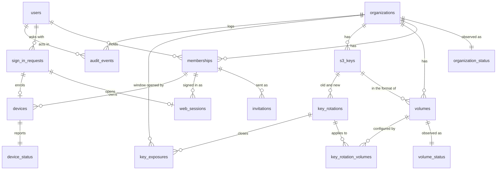

# Database schema

The control plane's data model, in PostgreSQL. **Status: proposal, not built.** It is the design on paper of ROADMAP 3, written from the team architecture ([architecture.html](architecture.html), sections 06 to 11), the concepts ([concept-d-onboarding](concepts/concept-d-onboarding.html), [concept-e-admin](concepts/concept-e-admin.html)) and the admin web's API contract (`web/src/lib/api/types.ts`, `http.ts`, and the rules the fake in `web/src/lib/api/fake/` keeps). Once the first migration exists, this file changes in the same commit as every migration.

The control plane is AGPL-3.0 (DECISIONS #3), FastAPI with SQLAlchemy 2.0 async and Alembic, and stays off the data path (DECISIONS #2): nothing in these tables is read when a Mac lists a folder or reads a clip.

## What lives where

| Data | Lives in | Written by | Notes |
|---|---|---|---|
| Organizations, people, invitations, sign-in, sessions, Macs, disks as configuration, S3 key records, rotations, audit log | PostgreSQL, these tables | Control plane | The only store the control plane owns |
| The file tree, attributes, locks, JuiceFS sessions, read-your-writes counters (`ryw<sid>`) | Central Valkey, one database per disk (`meta_db`) | JuiceFS on each Mac | Never copied into PostgreSQL |
| The volume format: name, UUID, block size, trash days, bucket, **the S3 key** | Central Valkey, the `setting` key of each disk's database | `juicefs format` and `juicefs config`, run by the control plane | The S3 key reaches Macs only from here (DECISIONS #4). PostgreSQL mirrors the non-secret fields; on a mismatch the format wins |
| Valkey ACL users, one per Mac | Central Valkey, ACL | Control plane | Not replicated by Valkey: rebuilt from `devices` (see [devices](#devices)) |
| Replicas of the metadata | Each Mac's VM | Valkey replication | Copies of the whole instance, every disk of the organization (DECISIONS #2, #5) |
| Device token, Valkey password, SMB password | The Mac's Keychain | The app | PostgreSQL keeps only hashes of the first two |
| Cache policy (`--cache-expire`) | PostgreSQL, `volumes.cache_expire_days` | Control plane | A mount option, not part of the format: the app reads it from the device configuration |

**The control plane must not become the data path.** It talks to Valkey only to create and delete ACL users, run `juicefs format` and `juicefs config`, read the counters it shows (space, files) and ping it for health. It never proxies metadata or blocks, and a mounted disk does not need it to be up (architecture.html, Failure modes).

## Conventions

**Ids are UUIDv7**, `uuid` columns with the server default `uuidv7()` (PostgreSQL 18). Why: ids go into URLs and the API, so they must not be guessable or enumerable across tenants (a `bigint` is); an organization can move from a self-hosted instance to the hosted service, or back, by copying its rows with the same ids; and unlike UUIDv4 they are ordered by creation time, which keeps B-tree inserts at the right edge and makes the audit log's id a usable tie-breaker in keyset pagination. The cost, the creation time readable from the id, leaks nothing that the rows do not already show. The application may generate them too (Python 3.14 has `uuid.uuid7()`), but the default makes every insert path, `psql` included, produce the same kind.

**Timestamps are `timestamptz`**, stored and returned in UTC; the API serializes them as ISO 8601 with `Z`. The connection sets `TimeZone=UTC` so nothing depends on the server's zone. `created_at` defaults to `now()`; `updated_at` is set by SQLAlchemy (`onupdate`) on the tables that have it.

**Enumerations are `text` with a `CHECK`**, not PostgreSQL `ENUM` types: adding a value to a `CHECK` is one migration, while `ALTER TYPE ... ADD VALUE` cannot be undone and has transaction restrictions that make Alembic migrations awkward.

**Emails are stored lowercased and trimmed**, enforced with a `CHECK (email = lower(btrim(email)))`, so uniqueness works with a plain index and no `citext` extension.

**Constraint names** follow one SQLAlchemy naming convention (`pk_%(table_name)s`, `fk_%(table_name)s_%(column_0_name)s_%(referred_table_name)s`, `uq_...`, `ck_%(table_name)s_%(constraint_name)s`, `ix_...`), so Alembic generates stable names and later migrations can drop them by name.

**Organization-level invariants run under a row lock** on the organization (`SELECT ... FROM organizations WHERE id = :org FOR UPDATE`): the last admin, one rotation applying at a time, allocating a disk's Valkey database. A table constraint cannot express "at least one active admin", and the lock serializes two admins acting at once.

### Soft delete

**Nothing is ever deleted with `DELETE`.** The application's database role has no `DELETE` grant on any table (see [First migration](#first-migration)), so the rule holds even against a bug. The tables fall into three kinds:

| Kind | Tables | How a row ends |
|---|---|---|
| Entities: things people manage | `organizations`, `users`, `memberships`, `devices`, `volumes` | `deleted_at` (soft delete: the row disappears from every list and no longer counts for uniqueness). Their domain end states, a removed person or a revoked Mac, are separate columns (`removed_at`, `revoked_at`) because the admin web keeps showing them |
| Records: facts with a lifecycle that ends in a terminal state | `invitations`, `sign_in_requests`, `web_sessions`, `s3_keys`, `key_rotations`, `key_rotation_volumes`, `key_exposures`, `audit_events` | A terminal state with its timestamp (expired, revoked, retired, closed). No `deleted_at`: "deleting" a fact would rewrite history, and none of them is ever hidden or restored |
| Observations: overwritten by the latest report | `organization_status`, `device_status`, `volume_status` | Follow their parent row; one row per parent, updated in place |

**Uniqueness with soft-deleted rows** uses partial unique indexes: `... WHERE deleted_at IS NULL` (plus the domain condition where a removed or revoked row must not block a new one). Some values are unique **forever**, across deleted rows too, because what they name outlives the row: a disk's Valkey database number and its object prefix still hold data after the disk is soft deleted, and reusing them would mount an old tree or collide with old objects. Each table says which.

### Multi-tenancy

Every row except `users` and `sign_in_requests` carries `organization_id uuid NOT NULL`. Each tenant table has a `UNIQUE (organization_id, id)` and every reference between tenant tables is a **composite foreign key** `(organization_id, x_id) REFERENCES x (organization_id, id)`, so a row can never point at another organization's row, whatever the application does. The application reaches tenant tables only through repositories that take the session's organization id.

`users` is global because a person is an email address, not a tenant row; `sign_in_requests` is global because it exists before anyone is known. Neither holds organization data: what a user can see comes only through `memberships`.

**Hosted service**: one PostgreSQL database for all organizations, isolated by the scoping above. The files are isolated by infrastructure, not by filters: each organization has its own Valkey instance and its own bucket (DECISIONS #2), enforced here by partial unique indexes on `organizations.valkey_url` and `(s3_endpoint, s3_bucket)`. Row-level security as a second wall is an [open question](#open-questions).

**Self-hosted**: the same schema with one row in `organizations`, created at first start by a bootstrap command from the environment (organization name, first admin's email, S3 endpoint, bucket and key, Valkey address). A configuration flag refuses a second organization; nothing in the schema differs, so a self-hosted organization can later be moved to the hosted service row for row.

## Diagram

## Tables

Columns are `NOT NULL` unless the Null column says yes. Every tenant table also has `UNIQUE (organization_id, id)` for the composite foreign keys; it is not repeated below.

### organizations

A tenant: a team with its bucket and its Valkey instance.

| Column | Type | Null | Default | Notes |
|---|---|---|---|---|
| `id` | `uuid` | | `uuidv7()` | Primary key |
| `name` | `text` | | | `CHECK (length(btrim(name)) BETWEEN 1 AND 100)`. Shown in mails ("Floppy · Studio Esempio") |
| `slug` | `text` | | | `CHECK (slug ~ '^[a-z0-9][a-z0-9-]{1,38}[a-z0-9]$')`. For the hosted service's addresses |
| `s3_endpoint` | `text` | | | The organization's S3 endpoint |
| `s3_region` | `text` | | | |
| `s3_bucket` | `text` | | | One bucket per organization; disks are prefixes inside it |
| `valkey_url` | `text` | | | The central Valkey as Macs reach it, e.g. `rediss://meta.example.com:6379`. No credentials: `CHECK (position('@' in valkey_url) = 0)` |
| `valkey_admin_url` | `text` | yes | | How the control plane reaches the same instance when it differs (a Compose network name); null means `valkey_url` |
| `valkey_admin_username` | `text` | yes | | Null: taken from the instance environment (self-hosted) |
| `valkey_admin_password_enc` | `bytea` | yes | | Encrypted (see [Secrets](#secrets)). Null: from the environment |
| `valkey_databases` | `integer` | | `16` | The instance's `databases` setting: database 0 is left empty, so at most `valkey_databases - 1` disks. `CHECK (valkey_databases BETWEEN 2 AND 1024)` |
| `smtp_host`, `smtp_username`, `smtp_sender` | `text` | yes | | Null: the instance's SMTP from the environment |
| `smtp_port` | `integer` | yes | | `CHECK (smtp_port BETWEEN 1 AND 65535)`; `CHECK ((smtp_host IS NULL) = (smtp_port IS NULL))` |
| `smtp_password_enc` | `bytea` | yes | | Encrypted; write only through the API (`passwordSet` is `smtp_password_enc IS NOT NULL`) |
| `created_at`, `updated_at` | `timestamptz` | | `now()` | |
| `deleted_at` | `timestamptz` | yes | | |

Indexes: `UNIQUE (slug)` over every row (a slug is never reused, so an old link never lands on another team); `UNIQUE (lower(valkey_url)) WHERE deleted_at IS NULL` and `UNIQUE (s3_endpoint, s3_bucket) WHERE deleted_at IS NULL`, the schema form of DECISIONS #2: a replica copies its whole instance, so two organizations must never share one.

There is no `invite_policy`: only admins invite (decided by Simone). The S3 key is not a column: it has its own history in [s3_keys](#s3_keys).

### organization_status

What the control plane last saw of the organization's services, for `GET /health`. One row per organization, overwritten.

| Column | Type | Null | Default | Notes |
|---|---|---|---|---|
| `organization_id` | `uuid` | | | Primary key, foreign key to `organizations` |
| `metadata_state` | `text` | | `'ok'` | `CHECK IN ('ok', 'down')` |
| `metadata_latency_ms` | `integer` | yes | | Of the last `PING` |
| `metadata_checked_at` | `timestamptz` | yes | | |
| `storage_state` | `text` | | `'ok'` | `CHECK IN ('ok', 'failing')` |
| `storage_probed_at` | `timestamptz` | yes | | Last test write: settings probe, rotation probe or the periodic one |
| `mail_state` | `text` | | `'unconfigured'` | `CHECK IN ('ok', 'unconfigured', 'failing')` |
| `mail_sent_at` | `timestamptz` | yes | | Last mail accepted by the SMTP server |
| `updated_at` | `timestamptz` | | `now()` | |

Kept in PostgreSQL rather than in process memory because several API processes serve the same organization.

### users

A person, identified by an email address. Global, not per organization.

| Column | Type | Null | Default | Notes |
|---|---|---|---|---|
| `id` | `uuid` | | `uuidv7()` | Primary key. The API's `Person.id` |
| `email` | `text` | | | Lowercased, `CHECK (email = lower(btrim(email)) AND position('@' in email) > 1)` |
| `name` | `text` | yes | | Null until the first sign-in, which fills it from the address (`giulia@...` becomes "Giulia"); `CHECK (length(name) <= 100)` |
| `last_sign_in_at` | `timestamptz` | yes | | |
| `created_at`, `updated_at` | `timestamptz` | | `now()` | |
| `deleted_at` | `timestamptz` | yes | | |

Indexes: `UNIQUE (email) WHERE deleted_at IS NULL`.

A user is created by the first invitation to their address. Users are never hard deleted, so foreign keys from the audit log stay valid; erasing a person's data on request is an [open question](#open-questions).

### memberships

A user in an organization, with a role. The API's `Person` is a user plus their current membership in the session's organization.

| Column | Type | Null | Default | Notes |
|---|---|---|---|---|
| `id` | `uuid` | | `uuidv7()` | Primary key |
| `organization_id` | `uuid` | | | |
| `user_id` | `uuid` | | | Foreign key to `users` |
| `role` | `text` | | | `CHECK IN ('admin', 'member')` |
| `status` | `text` | | `'invited'` | `CHECK IN ('invited', 'active', 'removed')`, see [State machines](#state-machines) |
| `invited_by_user_id` | `uuid` | yes | | Null only for the bootstrap admin |
| `invited_at` | `timestamptz` | yes | | |
| `activated_at` | `timestamptz` | yes | | First sign-in or accepted invitation |
| `removed_at` | `timestamptz` | yes | | |
| `removed_by_user_id` | `uuid` | yes | | |
| `created_at`, `updated_at` | `timestamptz` | | `now()` | |
| `deleted_at` | `timestamptz` | yes | | Set only when the organization itself is deleted or a person is erased; removal is a status |

Constraints: `CHECK ((status = 'removed') = (removed_at IS NOT NULL))`, `CHECK (status <> 'active' OR activated_at IS NOT NULL)`, `CHECK (status <> 'invited' OR activated_at IS NULL)`.

Indexes: `UNIQUE (organization_id, user_id) WHERE status <> 'removed' AND deleted_at IS NULL`, which backs `already_member`; a removed person invited again gets a new row, and the old one keeps its history. `(user_id) WHERE status <> 'removed' AND deleted_at IS NULL` for sign-in. `(organization_id, status)`.

The organization must keep one active admin: demoting or removing the last one fails with `last_admin`, checked under the organization's row lock. Members see only their own Macs: enforced in the queries (`devices.user_id = session user`), not by a column.

### invitations

The invitation mails. One row per mail sent: the first invitation and every resend.

| Column | Type | Null | Default | Notes |
|---|---|---|---|---|
| `id` | `uuid` | | `uuidv7()` | Primary key |
| `organization_id` | `uuid` | | | |
| `membership_id` | `uuid` | | | Composite foreign key to `memberships` |
| `token_hash` | `bytea` | | | SHA-256 of the link's token. `UNIQUE`, `CHECK (octet_length(token_hash) = 32)` |
| `state` | `text` | | `'sent'` | `CHECK IN ('sent', 'accepted', 'superseded', 'revoked')`. Expired is derived: `sent` with `expires_at` past |
| `sent_by_user_id` | `uuid` | | | Foreign key to `users` |
| `sent_at` | `timestamptz` | | `now()` | |
| `expires_at` | `timestamptz` | | | `sent_at` plus 7 days (concept-d, step 9); `CHECK (expires_at > sent_at)` |
| `accepted_at`, `superseded_at`, `revoked_at` | `timestamptz` | yes | | One per terminal state, each `CHECK`ed against `state` |

Indexes: `UNIQUE (membership_id) WHERE state = 'sent'`: one live invitation per person, so a resend supersedes the previous link.

### sign_in_requests

A pending sign-in: the magic link and the 6-digit code sent by mail, for the admin web (`kind = 'web'`) or for the app (`kind = 'app'`, with PKCE and a loopback redirect). Global: the address may belong to no organization.

| Column | Type | Null | Default | Notes |
|---|---|---|---|---|
| `id` | `uuid` | | `uuidv7()` | Primary key. The API's `requestId` |
| `kind` | `text` | | | `CHECK IN ('web', 'app')` |
| `email` | `text` | | | Lowercased, as typed |
| `user_id` | `uuid` | yes | | Null when the address has no eligible membership. The row exists anyway, so the answer is the same for everyone and the page never reveals who is a member; the mail says "ask your admin" instead |
| `organization_id` | `uuid` | yes | | The organization the session will act in, resolved when the request is created (see open questions on several organizations) |
| `state` | `text` | | `'pending'` | `CHECK IN ('pending', 'completed', 'locked', 'superseded')`. Expired is derived: `pending` past `expires_at` |
| `link_token_hash` | `bytea` | | | SHA-256 of the link's 256-bit token. `UNIQUE` |
| `code_hmac` | `bytea` | | | HMAC-SHA256 of the 6-digit code (see [Secrets](#secrets)) |
| `code_attempts` | `smallint` | | `0` | `CHECK (code_attempts BETWEEN 0 AND 5)`: the fifth wrong code locks the request, link included |
| `expires_at` | `timestamptz` | | | Creation plus 15 minutes |
| `resend_at` | `timestamptz` | | | Creation plus 60 seconds: when "send another link" turns on |
| `completed_at` | `timestamptz` | yes | | |
| `completed_via` | `text` | yes | | `CHECK IN ('link', 'code')` |
| `locked_at`, `superseded_at` | `timestamptz` | yes | | |
| `device_name` | `text` | yes | | App only: "MacBook Pro di Giulia", shown on the page and in the mail |
| `code_challenge` | `text` | yes | | App only: PKCE S256 challenge, base64url. `UNIQUE` |
| `redirect_uri` | `text` | yes | | App only: `CHECK (redirect_uri ~ '^http://127\.0\.0\.1:[0-9]{1,5}/')`, the loopback port the app chose |
| `auth_code_hash` | `bytea` | yes | | App only: SHA-256 of the one-time code redirected to the loopback after the link. `UNIQUE` |
| `auth_code_expires_at` | `timestamptz` | yes | | 60 seconds after the link is opened |
| `exchanged_at` | `timestamptz` | yes | | When the app traded code and verifier for a device token; single use |
| `created_at` | `timestamptz` | | `now()` | |

Constraints: `CHECK ((kind = 'app') = (code_challenge IS NOT NULL AND redirect_uri IS NOT NULL AND device_name IS NOT NULL))`; `CHECK ((state = 'completed') = (completed_at IS NOT NULL))`.

Indexes: `(email, created_at DESC)` for rate limiting and for superseding: a new request supersedes the address's pending ones of the same kind, so only one code is guessable at a time.

Rules the schema relies on:

- **Polling never grants a session.** `GET /auth/sign-in/{id}` only reads `state`. The session goes to whoever opens the link or types the code; otherwise anyone who started a request with someone else's address would be signed in when the victim clicks.
- **The link is bound to the request, not to a browser cookie** (concept-d): it works when the mail opens in another browser.
- **In the app, the 6-digit code is typed in the app**, which sends it with the PKCE verifier; the request is found by `code_challenge = S256(verifier)`, so the verifier both identifies and authenticates it.
- A request with `user_id` null can never complete: a code answers `invalid_code` and the link `link_invalid`, the same answers as for a wrong code or a used link.

### web_sessions

A signed-in browser of the admin web, behind an HttpOnly cookie.

| Column | Type | Null | Default | Notes |
|---|---|---|---|---|
| `id` | `uuid` | | `uuidv7()` | Primary key |
| `organization_id` | `uuid` | | | |
| `membership_id` | `uuid` | | | Composite foreign key. The role is read from the membership on every request, so a role change applies at once |
| `user_id` | `uuid` | | | Denormalized from the membership for the lookup |
| `sign_in_request_id` | `uuid` | | | Foreign key: how the session was opened |
| `token_hash` | `bytea` | | | SHA-256 of the cookie's 256-bit value. `UNIQUE` |
| `created_at` | `timestamptz` | | `now()` | |
| `last_seen_at` | `timestamptz` | | `now()` | Written at most every 5 minutes, not on every request |
| `expires_at` | `timestamptz` | | | Absolute limit; the idle limit is `last_seen_at` plus a configured window |
| `revoked_at` | `timestamptz` | yes | | |
| `revoke_reason` | `text` | yes | | `CHECK IN ('signed_out', 'membership_removed')`; `CHECK ((revoked_at IS NULL) = (revoke_reason IS NULL))` |
| `user_agent` | `text` | yes | | For a future "your sessions" list; truncated to 300 characters |

Indexes: `(membership_id) WHERE revoked_at IS NULL`, to revoke every session of a removed person.

### devices

A Mac: the app's device token and the Mac's own Valkey user (DECISIONS #7). The API's `Mac`.

| Column | Type | Null | Default | Notes |
|---|---|---|---|---|
| `id` | `uuid` | | `uuidv7()` | Primary key |
| `organization_id` | `uuid` | | | |
| `membership_id` | `uuid` | | | Composite foreign key: the owner's membership |
| `user_id` | `uuid` | | | Denormalized owner, for "members see only their own Macs" |
| `name` | `text` | | | From the sign-in request; `CHECK (length(btrim(name)) BETWEEN 1 AND 100)` |
| `state` | `text` | | `'pending'` | `CHECK IN ('pending', 'active', 'revoked')` |
| `sign_in_request_id` | `uuid` | | | Foreign key, `UNIQUE`: one Mac per app sign-in |
| `token_hash` | `bytea` | | | SHA-256 of the device token (256 bits, in the Keychain). `UNIQUE` |
| `valkey_username` | `text` | | generated | `GENERATED ALWAYS AS ('floppy_d_' \|\| replace(id::text, '-', '')) STORED`: derived, never typed, unique with the id |
| `valkey_password_sha256` | `bytea` | yes | | SHA-256 of the Valkey password, the same form Valkey keeps in its ACL (`#<hex>`). Null while pending |
| `valkey_user_created_at` | `timestamptz` | yes | | |
| `valkey_user_deleted_at` | `timestamptz` | yes | | When `ACL DELUSER` and `CLIENT KILL` succeeded. Revoked with this null means the cleanup is still owed |
| `activated_at` | `timestamptz` | yes | | |
| `revoked_at` | `timestamptz` | yes | | |
| `revoked_by_user_id` | `uuid` | yes | | |
| `revoke_reason` | `text` | yes | | `CHECK IN ('admin', 'owner', 'member_removed', 'signed_out')` |
| `created_at`, `updated_at` | `timestamptz` | | `now()` | |
| `deleted_at` | `timestamptz` | yes | | Hides a revoked Mac from the list; no endpoint does it yet |

Constraints: `CHECK ((state = 'revoked') = (revoked_at IS NOT NULL AND revoke_reason IS NOT NULL))`, `CHECK (state <> 'active' OR valkey_password_sha256 IS NOT NULL)`.

Indexes: `(organization_id, user_id) WHERE state <> 'revoked'`; `(organization_id) WHERE state = 'revoked' AND valkey_user_deleted_at IS NULL` for the reconciler.

**Why the password hash is kept.** Valkey does not replicate ACL users: they live in each instance's configuration. When the datacenter replica is promoted, or the master is rebuilt from a dump, every Mac's user is missing. With the SHA-256 kept here, the control plane recreates them (`ACL SETUSER floppy_d_<id> on #<hash> ...`) without knowing a single password, and no Mac has to sign in again. A SHA-256 of a 256-bit random password cannot be reversed, and it is what Valkey itself stores. The same reconciler, at start and every few minutes, makes the master's `floppy_d_*` users match the active rows: it creates the missing ones and deletes the ones whose Mac is revoked, so a revocation made while Valkey was down still lands.

**Revocation is durable before it is effective**: `revoked_at` is committed first, then the ACL user is deleted; if Valkey does not answer, the Mac cannot write anyway, and the reconciler finishes the job.

### device_status

What each Mac last reported in its heartbeat. One row per device, overwritten.

| Column | Type | Null | Default | Notes |
|---|---|---|---|---|
| `device_id` | `uuid` | | | Primary key, composite foreign key to `devices` |
| `organization_id` | `uuid` | | | |
| `last_seen_at` | `timestamptz` | | | `connected` is a heartbeat in the last 2 minutes, computed |
| `app_version`, `macos_version` | `text` | | | `appOutdated` is computed against the latest release the instance knows, not stored |
| `replica_mode` | `text` | yes | | `CHECK IN ('replica', 'master', 'offline')`, from the mount's `.stats` |
| `replica_lag_ms` | `integer` | yes | | |
| `s3_access_key_tail` | `text` | yes | | The key its mounts use, read from the format on its replica: counts the Macs that picked up a rotation |
| `mounted_volume_ids` | `uuid[]` | | `'{}'` | For `Disk.mountedBy`. No foreign key: an observation, replaced at every heartbeat |
| `outdated_logged_version` | `text` | yes | | The version for which `mac_seen_outdated` was logged, so it is logged once |
| `updated_at` | `timestamptz` | | `now()` | |

Separate from `devices` on purpose: a heartbeat every 30-60 seconds per Mac rewrites this row, while `devices` holds credentials and changes rarely. The table is created with `fillfactor = 70` so these updates stay HOT (no index churn). Indexes: `(organization_id, last_seen_at DESC)`, and a GIN index on `mounted_volume_ids`.

### volumes

A disk: a JuiceFS volume, a prefix in the organization's bucket and a database on its Valkey. The API's `Disk`.

| Column | Type | Null | Default | Notes |
|---|---|---|---|---|
| `id` | `uuid` | | `uuidv7()` | Primary key |
| `organization_id` | `uuid` | | | |
| `name` | `text` | | | The name people see, e.g. "Archivio 2025". `CHECK (length(btrim(name)) BETWEEN 1 AND 60)`. Never renamed: CapCut keeps full paths |
| `volume_name` | `text` | | | JuiceFS's name, which is also the object prefix inside the bucket (JuiceFS writes under `<bucket>/<name>/`). JuiceFS accepts only `CHECK (volume_name ~ '^[a-z0-9][a-z0-9-]{1,61}[a-z0-9]$')`, which is why it is not the display name |
| `s3_endpoint`, `s3_region`, `s3_bucket` | `text` | | | Copied from the organization at creation: the format holds them, and they do not follow later settings |
| `meta_db` | `integer` | | | The Valkey database number. `CHECK (meta_db >= 1)`: database 0 stays empty, the one tools hit by accident |
| `juicefs_uuid` | `uuid` | yes | | Read back from the format after `juicefs format`; null while creating |
| `s3_key_id` | `uuid` | yes | | Composite foreign key to `s3_keys`: the key this volume's format holds now. Null only while creating. During a rotation volumes move one by one |
| `state` | `text` | | `'creating'` | `CHECK IN ('creating', 'ready', 'failed')` |
| `block_size_kb` | `integer` | | `1024` | Fixed at format time (DECISIONS #15). `CHECK (block_size_kb > 0)` |
| `trash_days` | `integer` | | `7` | Mirrors the format; changed through `juicefs config`. `CHECK (trash_days BETWEEN 0 AND 365)` |
| `cache_expire_days` | `integer` | | `30` | The whole cache policy (decided by Simone): `--cache-expire` for every Mac at its next mount. `CHECK (cache_expire_days BETWEEN 1 AND 365)` |
| `created_by_user_id` | `uuid` | | | |
| `created_at`, `updated_at` | `timestamptz` | | `now()` | |
| `deleted_at` | `timestamptz` | yes | | Leaves the metadata and the objects in place: deleting files is a separate, explicit act |

Indexes:

- `UNIQUE (organization_id, lower(name)) WHERE deleted_at IS NULL`: backs `disk_name_taken`.
- `UNIQUE (organization_id, volume_name)` over every row: the objects of a deleted disk stay under that prefix, and a new volume there would collide with them (the gotcha of a reinstall with the same `VOLUME_NAME`).
- `UNIQUE (organization_id, meta_db)` over every row: a deleted disk's tree stays in its database; reusing the number would hand a new disk an old tree.

Creating a disk: under the organization's lock, allocate the lowest `meta_db` never used (at most `valkey_databases - 1`), insert as `creating`, run `juicefs format`, then set `ready`, `juicefs_uuid` and `s3_key_id`. If the format fails the row becomes `failed` and soft deleted, and its number and prefix stay burned: a half-written format must never be reused.

### volume_status

What the control plane last measured of each disk. One row per volume, overwritten by a poller.

| Column | Type | Null | Default | Notes |
|---|---|---|---|---|
| `volume_id` | `uuid` | | | Primary key, composite foreign key to `volumes` |
| `organization_id` | `uuid` | | | |
| `reachable` | `boolean` | | `true` | `Disk.status`: `online` or `unreachable` |
| `checked_at` | `timestamptz` | yes | | |
| `used_bytes`, `file_count` | `bigint` | | `0` | From JuiceFS's counters in the volume's database (`usedSpace`, `totalInodes`) |
| `trash_bytes` | `bigint` | | `0` | From a periodic scan of `.trash`, slower |
| `last_write_at` | `timestamptz` | yes | | Approximate: the last poll that saw the counters move |
| `updated_at` | `timestamptz` | | `now()` | |

### s3_keys

The organization's S3 keys, one row per key ever pasted (DECISIONS #4).

| Column | Type | Null | Default | Notes |
|---|---|---|---|---|
| `id` | `uuid` | | `uuidv7()` | Primary key. The audit log's target for `kind: 'key'` |
| `organization_id` | `uuid` | | | |
| `access_key_id` | `text` | | | Not a secret, needed for `juicefs config` |
| `access_key_tail` | `text` | | generated | `GENERATED ALWAYS AS (right(access_key_id, 5)) STORED`: all the API ever shows |
| `secret_key_enc` | `bytea` | yes | | Encrypted (see [Secrets](#secrets)). Wiped to null when the key is retired or rejected: the provider deleted it, and nothing needs it again |
| `state` | `text` | | `'pending'` | `CHECK IN ('pending', 'active', 'retiring', 'retired', 'rejected')` |
| `created_by_user_id` | `uuid` | yes | | Null for the bootstrap key |
| `created_at` | `timestamptz` | | `now()` | |
| `activated_at`, `retiring_at`, `retired_at`, `rejected_at` | `timestamptz` | yes | | One per state reached |

Constraints: `CHECK ((state IN ('retired', 'rejected')) = (secret_key_enc IS NULL))`.

Indexes: `UNIQUE (organization_id) WHERE state = 'active'`: one key in use; `UNIQUE (organization_id, access_key_id) WHERE state IN ('pending', 'active', 'retiring')`.

The control plane keeps the active secret because it needs it twice without a Mac in the loop: `juicefs format` of a new disk and the storage probe. The same secret sits in every volume's format, readable by every Mac with a Valkey user; the copy here is not the weakest one, but it is the one an operator's database dump would carry, hence the encryption.

### key_rotations

A rotation: probe write with the new key, `juicefs config` on each disk, Macs picking it up, then the admin confirms the old key is deleted at the provider.

| Column | Type | Null | Default | Notes |
|---|---|---|---|---|
| `id` | `uuid` | | `uuidv7()` | Primary key |
| `organization_id` | `uuid` | | | |
| `old_key_id`, `new_key_id` | `uuid` | | | Composite foreign keys to `s3_keys`; `CHECK (old_key_id <> new_key_id)` |
| `state` | `text` | | `'applying'` | `CHECK IN ('applying', 'awaiting_old_key_deletion', 'failed', 'superseded', 'closed')` |
| `probe_state` | `text` | | `'pending'` | `CHECK IN ('pending', 'running', 'done', 'failed')` |
| `probe_error_code`, `probe_error_request` | `text` | yes | | The provider's answer, e.g. `AccessDenied`, `PUT /<bucket>/floppy-probe-7f3a` |
| `macs_total` | `integer` | | | Macs connected when it started; `Rotation.macs.updated` counts those whose `device_status.s3_access_key_tail` shows the new key |
| `started_by_user_id` | `uuid` | | | |
| `started_at` | `timestamptz` | | `now()` | |
| `applied_at`, `failed_at`, `superseded_at`, `closed_at` | `timestamptz` | yes | | |
| `closed_by_user_id` | `uuid` | yes | | |

Indexes: `UNIQUE (organization_id) WHERE state = 'applying'` (backs `rotation_in_progress`) and `UNIQUE (organization_id) WHERE state = 'awaiting_old_key_deletion'`.

The row is also the job: a worker takes `applying` rotations with `FOR UPDATE SKIP LOCKED`, so a restart of the control plane resumes a rotation instead of losing it.

### key_rotation_volumes

One step of a rotation: `juicefs config` on one disk.

| Column | Type | Null | Default | Notes |
|---|---|---|---|---|
| `rotation_id` | `uuid` | | | Composite foreign key to `key_rotations` |
| `volume_id` | `uuid` | | | Composite foreign key to `volumes` |
| `organization_id` | `uuid` | | | |
| `state` | `text` | | `'pending'` | `CHECK IN ('pending', 'running', 'done', 'failed')` |
| `error` | `text` | yes | | JuiceFS's message, never with the key |
| `started_at`, `finished_at` | `timestamptz` | yes | | |

Primary key `(rotation_id, volume_id)`. Rows are created for every `ready` volume when the rotation starts.

### key_exposures

Why the key window is open: someone who could read the key no longer has access. The API's `KeyStatus.window.reasons`.

| Column | Type | Null | Default | Notes |
|---|---|---|---|---|
| `id` | `uuid` | | `uuidv7()` | Primary key |
| `organization_id` | `uuid` | | | |
| `kind` | `text` | | | `CHECK IN ('person_removed', 'mac_revoked')` |
| `membership_id` | `uuid` | yes | | Set for `person_removed` |
| `device_id` | `uuid` | yes | | Set for `mac_revoked` |
| `label` | `text` | | | The person's or the Mac's name at that moment |
| `occurred_at` | `timestamptz` | | `now()` | |
| `closed_at` | `timestamptz` | yes | | |
| `closed_by_rotation_id` | `uuid` | yes | | Composite foreign key to `key_rotations` |

Constraints: `CHECK ((kind = 'person_removed') = (membership_id IS NOT NULL))`, `CHECK ((kind = 'mac_revoked') = (device_id IS NOT NULL))`, `CHECK ((closed_at IS NULL) = (closed_by_rotation_id IS NULL))`.

Indexes: `(organization_id) WHERE closed_at IS NULL`. The window is open while one such row exists; `openedAt` is the oldest `occurred_at`.

Only a Mac ever held the key, since it lives in the metadata: removing a person with no active Mac, cancelling an invitation, and revoking a Mac that never got its Valkey user open nothing. A person removal opens one row for the person, not one per Mac.

### audit_events

The audit log: append only.

| Column | Type | Null | Default | Notes |
|---|---|---|---|---|
| `id` | `uuid` | | `uuidv7()` | Primary key; the pagination tie-breaker |
| `organization_id` | `uuid` | | | |
| `occurred_at` | `timestamptz` | | `now()` | |
| `actor_kind` | `text` | | | `CHECK IN ('person', 'system', 'operator')`. `system` is the control plane itself (a heartbeat, the reconciler); `operator` is whoever runs the hosted service |
| `actor_user_id` | `uuid` | yes | | Foreign key to `users`; `CHECK ((actor_kind = 'person') = (actor_user_id IS NOT NULL))` |
| `actor_label` | `text` | yes | | The actor's name or address at that moment |
| `action` | `text` | | | `CHECK IN (...)` with the list below |
| `category` | `text` | | | `CHECK IN ('access', 'people', 'macs', 'key', 'disks', 'settings')`. Fixed by the action in code; stored to filter with an index |
| `target_kind` | `text` | | | `CHECK IN ('person', 'mac', 'disk', 'key', 'organization')` |
| `target_id` | `uuid` | | | The user, device, volume, key or organization id |
| `target_label` | `text` | | | The target's name at that moment: a removed person or a revoked Mac still reads right years later |
| `detail` | `jsonb` | | `'{}'` | Small facts (`{"role": "member"}`, `{"appVersion": "0.4.0"}`); `CHECK (jsonb_typeof(detail) = 'object')` |

Indexes: `(organization_id, occurred_at DESC, id DESC)` for the list and its keyset cursor; `(organization_id, category, occurred_at DESC)`. The search on names (`q`) is an `ILIKE` on `actor_label` and `target_label` inside an organization and at most 90 days: no trigram index until a hosted organization needs it.

Append only, twice: the application role has only `INSERT` and `SELECT` on this table, and a trigger rejects `UPDATE`, `DELETE` and `TRUNCATE` for every role but the owner.

## Secrets

| Secret | Stored | How | Why this way |
|---|---|---|---|
| S3 secret key | `s3_keys.secret_key_enc` | Encrypted | The control plane must use it (format, probe). Wiped when the key is retired |
| Valkey admin password (hosted) | `organizations.valkey_admin_password_enc` | Encrypted | Used to manage ACL users and run `juicefs`. Self-hosted: null, taken from the environment |
| SMTP password | `organizations.smtp_password_enc` | Encrypted | Used to send. Null: the environment's |
| Valkey password of each Mac | `devices.valkey_password_sha256` | SHA-256, the form Valkey keeps | Generated by the control plane, returned once to the app, never stored in clear. The hash rebuilds ACL users (see [devices](#devices)) |
| Device token | `devices.token_hash` | SHA-256 | 256 random bits: a fast hash is enough, nobody can guess the preimage |
| Session cookie | `web_sessions.token_hash` | SHA-256 | Same |
| Magic link token, invitation token, app authorization code | `*_hash` columns | SHA-256 | Same, and single use |
| 6-digit code | `sign_in_requests.code_hmac` | HMAC-SHA256 with a server key, over the request id and the code | One million values: any plain or slow hash is reversed in seconds from a dump. Keyed, a dump alone reveals nothing; online guessing is bounded by 5 attempts and 15 minutes |
| SMB password | Not in PostgreSQL | | Between the Mac and its own VM only |

**Encryption**: AES-256-GCM with a random 96-bit nonce, stored as one `bytea`: a format byte, a key id, the nonce, the ciphertext with its tag. The additional authenticated data is `table.column:row id`, so a ciphertext copied into another row or column fails to decrypt. The key comes from `FLOPPY_SECRET_KEY` (32 random bytes, base64), from the environment or a Docker secret, never from the database. A key ring (`FLOPPY_SECRET_KEYS`, id to key) allows rotating it: new writes use the newest key, a command re-encrypts old rows, then the old key is dropped. The HMAC key for codes is derived from the same secret with HKDF and its own label, so a self-hoster manages one secret.

**Losing `FLOPPY_SECRET_KEY` is recoverable**: the S3 secret is still in every volume's format (the admin rotates to a new key, or an operator reads it back with `juicefs config`), the SMTP password is typed again, and pending codes expire in 15 minutes. Nothing about the files depends on it. Key management for the hosted service is an [open question](#open-questions).

**Never in the audit log, a log line or an API answer**: secrets, tokens, codes, passwords or hashes of them. The audit's `detail` is built from an allowlist of keys per action; keys appear only as `access_key_tail`.

## Audit log

What it records, the contract's `AuditAction` plus the ones this design needs (marked new, to add to the contract):

| Action | Category | Actor | Target | Detail |
|---|---|---|---|---|
| `signed_in` | access | person | person | `{via: "link" \| "code", kind: "web" \| "app"}` |
| `sign_in_locked` (new) | access | system | person | `{}`: five wrong codes on a known address |
| `person_invited`, `invite_resent` | people | person | person | `{role}` |
| `invite_accepted` (new) | people | person | person | `{}` |
| `role_changed` | people | person | person | `{from, to}` |
| `person_removed` | people | person | person | `{macs}` |
| `mac_registered` | macs | person | mac | `{appVersion, macosVersion}` |
| `mac_revoked` | macs | person or system | mac | `{reason}` |
| `mac_signed_out` (new) | macs | person | mac | `{}`: "Esci" in the app, no key window |
| `mac_seen_outdated` | macs | system | mac | `{appVersion}` |
| `key_rotation_started` (new) | key | person | key | `{newKeyTail, oldKeyTail}` |
| `key_rotated` | key | system | key | `{disks}`: every disk configured |
| `key_rotation_failed` (new) | key | system | key | `{step, code}` |
| `key_window_closed` | key | person | key | `{oldKeyTail, reasons}` |
| `disk_created`, `disk_updated` | disks | person | disk | `{blockSize}`, `{field: [from, to]}` |
| `settings_updated` | settings | person | organization | `{fields: [...]}`: the names of what changed, never values of secrets |

Sign-in attempts on unknown addresses are not recorded: they belong to no organization, and logging them would store addresses of people who are not users.

**Retention**: kept for the life of the organization in this proposal; the contract's filter reaches 90 days, but the log is the only record of who had access when. See [open questions](#open-questions).

## State machines

Any transition not listed is refused with `409`. Every transition writes its timestamp in the same transaction as its audit event.

**Membership**

| From | To | When |
|---|---|---|
| (none) | `invited` | `POST /people`; with a new `invitations` row |
| `invited` | `active` | First completed sign-in, or the invitation link opened while valid |
| `invited` | `removed` | `DELETE /people/{id}`: the invitation is revoked; no Mac, no window |
| `active` | `removed` | `DELETE /people/{id}`: Macs revoked (`member_removed`), sessions revoked, one exposure if a Mac had credentials |

`removed` is terminal; a new invitation creates a new membership. An `invited` membership whose latest invitation expired stays `invited` but cannot sign in until a resend.

**Invitation**: `sent` to `accepted` (link opened before `expires_at`, or first sign-in), `sent` to `superseded` (resend), `sent` to `revoked` (person removed). Expired is `sent` past `expires_at`, with no write.

**Sign-in request**

| From | To | When |
|---|---|---|
| `pending` | `completed` | Link opened or right code, before `expires_at`, with `user_id` set and an eligible membership |
| `pending` | `locked` | Fifth wrong code; the link dies with it |
| `pending` | `superseded` | A new request for the same address and kind |

Expired is `pending` past `expires_at` (the API's `expired`; `superseded` is also reported as `expired`). For `kind = 'app'`, `completed` also issues the authorization code; `exchanged_at` is set once, within 60 seconds.

**Mac enrolment and revocation**

| From | To | When |
|---|---|---|
| (none) | `pending` | The app exchanges code and verifier: a device row and its token |
| `pending` | `active` | The app registers: the ACL user is created and its password returned once |
| `active` | `active` | Credentials reissued (Keychain lost): new password, `ACL SETUSER ... resetpass`, new hash |
| `pending`, `active` | `revoked` | By an admin (`admin`), by its owner from the web (`owner`, a lost Mac), by a person's removal (`member_removed`), or from the app ("Esci", `signed_out`) |

`revoked` is terminal: the same Mac signing in again is a new device. Every revocation of an `active` Mac opens a key exposure except `signed_out`: the Mac is in its owner's hands, wiped by the app, and its owner still has access.

**S3 key**: `pending` to `active` (its rotation configured every disk), `pending` to `rejected` (probe failed; secret wiped), `active` to `retiring` (another key became active), `retiring` to `retired` (the admin confirmed its deletion at the provider; secret wiped). The bootstrap key is inserted as `active` after a probe.

**Rotation**

| From | To | When |
|---|---|---|
| (none) | `applying` | `POST /key/rotations`: new key `pending`, one step per `ready` disk |
| `applying` | `awaiting_old_key_deletion` | Probe done and every disk `done`: new key `active`, old key `retiring`. The Macs count is shown, not waited for: a Mac switched off would block the rotation forever |
| `applying` | `failed` | Probe failed (new key `rejected`) or a disk failed |
| `awaiting_old_key_deletion` | `closed` | `POST /key/rotations/{id}/close`: every `retiring` key becomes `retired`, exposures closed |
| `awaiting_old_key_deletion` | `superseded` | A new rotation starts before the close: its keys stay `retiring` until the new one closes |

A rotation that failed after some disks were configured leaves those disks on the new key (`volumes.s3_key_id` says which): starting again with the same access key reuses its `pending` row and configures the rest; `juicefs config` is idempotent.

**Key window**: an exposure is closed by the first rotation closed whose `started_at` is after the exposure's `occurred_at`. One that happened while a rotation was applying stays open: the revoked Mac may already have read the new key from its replica.

## API endpoints and tables

The admin web's contract (`web/src/lib/api/http.ts`, under `/api/v1`):

| Endpoint | Reads | Writes |
|---|---|---|
| `POST /auth/sign-in` | `users`, `memberships`, `invitations` | `sign_in_requests` (`kind = 'web'`; supersedes pending ones), the mail |
| `GET /auth/sign-in/{id}` | `sign_in_requests` | |
| `POST /auth/sign-in/{id}/code` | `sign_in_requests` | `code_attempts` or `completed`; `users.last_sign_in_at` and `name`; membership `invited` to `active`; `invitations`; `web_sessions`; `audit_events` |
| `POST /auth/magic-link` | `sign_in_requests` by `link_token_hash` | As above, `completed_via = 'link'` |
| `GET /session` | `web_sessions`, `memberships`, `users`, `organizations`, counts of `volumes`, `memberships`, `devices` | `web_sessions.last_seen_at`, at most every 5 minutes |
| `DELETE /session` | | `web_sessions.revoked_at` |
| `GET /people` (admin) | `memberships` (latest per user), `users`, `invitations`, count of non-revoked `devices` | |
| `POST /people` (admin) | `users` by email, `memberships` | `users` if new, `memberships`, `invitations`, `audit_events`, the mail |
| `PATCH /people/{id}` (admin) | `memberships` under the organization lock | `memberships.role`, `audit_events` |
| `DELETE /people/{id}` (admin) | `memberships`, `devices` under the organization lock | `memberships`, `devices`, `web_sessions`, `invitations`, `key_exposures`, `audit_events`; then Valkey `ACL DELUSER`, `CLIENT KILL` |
| `POST /people/{id}/resend` (admin) | `memberships`, `invitations` | Old invitation `superseded`, new one, `audit_events`, the mail |
| `GET /macs` | `devices`, `device_status`, `users`; members only `user_id = me` | |
| `POST /macs/{id}/revoke` | `devices` (a member only their own) | `devices`, `key_exposures`, `audit_events`; Valkey |
| `GET /disks` (admin) | `volumes`, `volume_status`, count of `device_status` with the disk mounted and connected | |
| `POST /disks` (admin) | `organizations` under lock, `volumes`, active `s3_keys` | `volumes`, `volume_status`, `audit_events`; Valkey `juicefs format` |
| `PATCH /disks/{id}` (admin) | `volumes` | `juicefs config --trash-days` first, then `volumes`; `audit_events` |
| `GET /key` (admin) | `s3_keys`, `key_rotations` not closed, open `key_exposures` | |
| `POST /key/rotations` (admin) | `key_rotations` under the organization lock | `s3_keys`, `key_rotations`, `key_rotation_volumes`, `audit_events`; the worker then writes the probe, Valkey (`juicefs config`), `volumes.s3_key_id`, `organization_status` |
| `GET /key/rotations/{id}` (admin) | `key_rotations`, `key_rotation_volumes`, `device_status` | |
| `POST /key/rotations/{id}/close` (admin) | `key_rotations` | `key_rotations`, `s3_keys`, `key_exposures`, `audit_events` |
| `GET /audit` (admin) | `audit_events` | |
| `GET /health` (admin) | `organization_status` | |
| `GET /settings`, `PATCH /settings` (admin) | `organizations` | `organizations`, `audit_events` |
| `POST /settings/mail/test` (admin) | `organizations` | `organization_status.mail_*` |
| `POST /settings/storage/probe` (admin) | active `s3_keys` | `organization_status.storage_*` |

The app's API is not in the contract yet. What the schema expects it to be:

| Endpoint (proposed) | Writes |
|---|---|
| `POST /auth/app/sign-in`: email, `code_challenge`, `redirect_uri`, device name | `sign_in_requests` (`kind = 'app'`) |
| The link page for an app request | `completed`, `auth_code_hash`; redirects to the loopback instead of opening a session |
| `POST /auth/app/token`: verifier plus authorization code or 6-digit code | `exchanged_at`; `devices` (`pending`) with its token |
| `POST /device/register` (device token) | ACL user; `devices` `active` with `valkey_password_sha256`; `audit_events` `mac_registered`. Returns the Valkey user and password once |
| `GET /device/config` | Nothing: Valkey address, the disks (`volume_name`, `meta_db`, `cache_expire_days`) |
| `POST /device/heartbeat` | `device_status`; answers `revoked` so the app stops the disk and clears cache and replica |
| `POST /device/sign-out` | `devices` `revoked` with `signed_out` |

## First migration

One Alembic revision, `0001_initial`, written from autogenerate and then edited by hand: partial indexes, generated columns, expression indexes, the trigger and the grants are not things autogenerate gets right.

1. **Check the server**: refuse to run on PostgreSQL older than 18 (`server_version_num < 180000`), which lacks `uuidv7()`. The Compose file pins `postgres:18`.
2. **Tables in dependency order**: `organizations`, `organization_status`, `users`, `memberships`, `invitations`, `sign_in_requests`, `web_sessions`, `devices`, `device_status`, `s3_keys`, `volumes`, `volume_status`, `key_rotations`, `key_rotation_volumes`, `key_exposures`, `audit_events`. Each tenant table gets its `UNIQUE (organization_id, id)` in the same `create_table`, before anything references it.
3. **Indexes**: the partial and expression ones listed above, created in the same revision (the tables are empty, so no `CONCURRENTLY`).
4. **Append-only trigger**: a function `audit_events_append_only()` raising on `UPDATE` and `DELETE`, and a `BEFORE TRUNCATE` trigger.
5. **Storage parameter**: `ALTER TABLE device_status SET (fillfactor = 70)`.
6. **Grants**: the migration runs as the owner role; the application connects as a separate role (`FLOPPY_DB_APP_ROLE`, created by the Compose init script) with `SELECT, INSERT, UPDATE` on every table, no `DELETE` or `TRUNCATE` anywhere, and only `SELECT, INSERT` on `audit_events`. Skipped with a warning when the role does not exist, so a development database with one role still migrates.
7. **No data**: the organization, its first admin and its first S3 key come from the bootstrap command, which needs secrets a migration must not see.

`downgrade()` drops everything in reverse order and exists for development only. Nothing migrates from the test package: its volumes live in SQLite inside each tester's VM, and the first instance creates its volumes fresh (architecture.html, Deployments).

## Open questions

Choices the sources do not settle, each with a proposal.

1. **One person in several organizations (hosted).** The schema allows it (`users` global, `memberships` per organization), but the contract's `Session` has one organization and sign-in does not ask which. Proposal: allow it in the schema now; the first sign-in resolves the only organization, and an organization picker plus `POST /session/organization` come when the hosted service opens. Until then, a second membership for the same address is refused.
2. **Valkey users per organization or per disk.** Replication settles it today: a Mac's replica copies the whole instance, every disk included, so a disk-level user would restrict writes but not what the Mac can read, the S3 key included. Proposal: one user per Mac per organization, as designed. Per-disk access would need one Valkey instance per disk, a decision with its own cost.
3. **Audit retention**, and with it the one exception to "never delete". Proposal: keep everything in self-hosted (thousands of rows a year); for the hosted service, 13 months, purged by a job running as the owner role, documented as the only deletion. Alternatively keep forever and archive.
4. **Encryption key management.** Self-hosted: one `FLOPPY_SECRET_KEY` in the environment, with the recovery path above; acceptable? Hosted: the same from the operator's secret store, or envelope encryption with a KMS and a data key per organization. Proposal: the environment key for both at first, a KMS before hosting paying customers.
5. **No `deleted_at` on record tables** (invitations, sign-in requests, sessions, keys, rotations, exposures, audit). Proposal as written: records end in a terminal state, and soft delete is for entities. Confirm, or add the column everywhere for uniformity.
6. **Row-level security for the hosted service.** Composite foreign keys and scoped repositories are in from the start. Proposal: add RLS policies on `organization_id` before the hosted service opens, not in `0001` (sign-in reads across organizations and would need a bypass role from day one).
7. **Signing out from the app.** Proposed: a `signed_out` revocation opens no key window, because the owner keeps access anyway. A member revoking their own lost Mac from the web does open one.
8. **Several disks on one Mac.** The mount point is fixed at `/Volumes/Floppy` (CLAUDE.md), yet an organization has several disks and `Disk.mountedBy` counts Macs per disk. How they appear in the Finder (one share each, `/Volumes/<name>`, or folders inside one) decides whether a disk's display name is part of CapCut's paths and how `mounted_volume_ids` is reported.
9. **Changing the storage settings after the first disk.** A volume's bucket and endpoint are in its format and do not follow the settings. Proposal: refuse `PATCH /settings` storage changes while any live disk exists (`storage_in_use`), since a second bucket breaks "one bucket per organization" and the key's scope.
10. **Disk limit.** With Valkey's default `databases 16` and database 0 left empty, an organization has at most 15 disks. Proposal: keep the default, raise `valkey_databases` per instance when a team needs more, and return `disk_limit_reached`.
11. **Invitation expiry.** Proposed: an invited person who never accepted cannot complete a first sign-in after 7 days; the admin resends. The alternative is that the invitation link expires but sign-in by address keeps working.
12. **Lifetimes.** Proposed: web sessions 14 days idle and 30 days absolute; device tokens without expiry, ended only by revocation (the app cannot ask a non-technical person to sign in again at random). Pending devices that never register in 24 hours are revoked by the reconciler.
13. **Stale Macs.** A Mac not seen for months keeps a working Valkey user. Proposal: show it in the list ("last seen 94 days ago") and leave revocation to the admin; no automatic revocation, since a Mac on holiday is not a lost Mac.
14. **Erasing a person** (GDPR request, hosted). Proposal: soft delete the user and replace `email` and `name` with a placeholder, and the person's labels in the audit log with the same, through the owner role; the audit rows stay.
15. **Operators of the hosted service**: who creates organizations and how (a CLI with the owner role, or operator accounts). Out of scope for `0001`; the audit log already has `actor_kind = 'operator'`.
