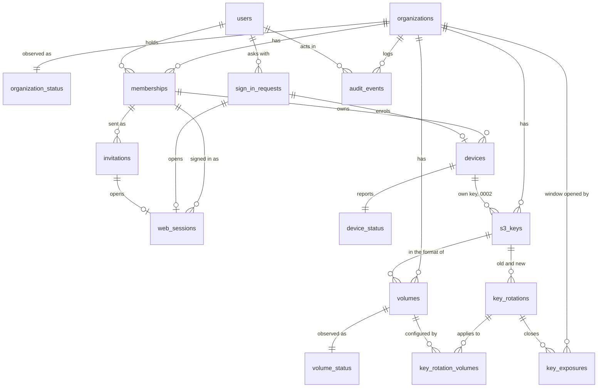

# Database schema

The control plane's data model, in PostgreSQL. **Status: built (phases 1 and 2)**: `server/`, models in `server/src/floppy_server/models.py`, migrations `0001_initial` and `0002`. What `0002` added is marked (0002) and listed in [Migration 0002](#migration-0002).

**Being verified, and will change parts of this file**: per-disk permissions, which need one Valkey instance and one bucket per disk instead of one per organization. Today a Mac's replica copies the whole instance and a key reaches the whole bucket, so access is all or nothing (DECISIONS #19); if per-disk access lands, `volumes` takes over the bucket and the Valkey instance that `organizations` holds now, and Valkey users and keys become per disk.

The design started as the paper of ROADMAP 3, written from the team architecture ([architecture.html](architecture.html), sections 06 to 11), the concepts ([concept-d-onboarding](concepts/concept-d-onboarding.html), [concept-e-admin](concepts/concept-e-admin.html)) and the admin web's API contract (`web/src/lib/api/types.ts`, `http.ts`, and the rules the fake in `web/src/lib/api/fake/` keeps). Once the first migration exists, this file changes in the same commit as every migration.

The control plane is AGPL-3.0 (DECISIONS #3), FastAPI with SQLAlchemy 2.0 async and Alembic, and stays off the data path (DECISIONS #2): nothing in these tables is read when a Mac lists a folder or reads a clip.

## What lives where

| Data | Lives in | Written by | Notes |
|---|---|---|---|
| Organizations, people, invitations, sign-in, sessions, Macs, disks as configuration, S3 key records, rotations, audit log | PostgreSQL, these tables | Control plane | The only store the control plane owns |
| The file tree, attributes, locks, JuiceFS sessions, read-your-writes counters (`ryw<sid>`) | Central Valkey, one database per disk (`meta_db`) | JuiceFS on each Mac | Never copied into PostgreSQL |
| The volume format: name, UUID, block size, trash days, bucket, and **the team's S3 key** where the mode uses one | Central Valkey, the `setting` key of each disk's database | `juicefs format` and `juicefs config`, run by the control plane | With a team key, it reaches Macs only from here; with per-person or per-Mac keys the format holds none ([Storage modes](#storage-modes), DECISIONS #22). PostgreSQL mirrors the non-secret fields; on a mismatch the format wins |
| Valkey ACL users, one per Mac | Central Valkey, ACL | Control plane | Not replicated by Valkey: rebuilt from `devices` (see [devices](#devices)) |
| Replicas of the metadata | Each Mac's VM | Valkey replication | Copies of the whole instance, every disk of the organization (DECISIONS #2, #5) |
| Device token, Valkey password, SMB password, the S3 key of the Mac or of its person (`device` or `person` scope) | The Mac's Keychain; the S3 key also in a `0600` file in the VM for `juicefs mount` | The app | PostgreSQL keeps only hashes of the first two, and of the S3 key only its id at the provider |
| Cache policy (`--cache-expire`) | PostgreSQL, `volumes.cache_expire_days` | Control plane | A mount option, not part of the format: the app reads it from the device configuration |

**The control plane must not become the data path.** It talks to Valkey only to create and delete ACL users, run `juicefs format` and `juicefs config`, read the counters it shows (space, files) and ping it for health. It never proxies metadata or blocks, and a mounted disk does not need it to be up (architecture.html, Failure modes).

## Conventions

**Ids are UUIDv7**, `uuid` columns with the server default `uuidv7()` (PostgreSQL 18). Why: ids go into URLs and the API, so they must not be guessable or enumerable across tenants (a `bigint` is); an organization can move from a self-hosted instance to the hosted service, or back, by copying its rows with the same ids; and unlike UUIDv4 they are ordered by creation time, which keeps B-tree inserts at the right edge and makes the audit log's id a usable tie-breaker in keyset pagination. The cost, the creation time readable from the id, leaks nothing that the rows do not already show. The application may generate them too (Python 3.14 has `uuid.uuid7()`), but the default makes every insert path, `psql` included, produce the same kind.

**Timestamps are `timestamptz`**, stored and returned in UTC; the API serializes them as ISO 8601 with `Z`. The connection sets `TimeZone=UTC` so nothing depends on the server's zone. `created_at` defaults to `now()`; `updated_at` is set by SQLAlchemy (`onupdate`) on the tables that have it.

**Enumerations are `text` with a `CHECK`**, not PostgreSQL `ENUM` types: adding a value to a `CHECK` is one migration, while `ALTER TYPE ... ADD VALUE` cannot be undone and has transaction restrictions that make Alembic migrations awkward.

**Emails are stored lowercased and trimmed**, enforced with a `CHECK (email = lower(btrim(email)))`, so uniqueness works with a plain index and no `citext` extension.

**Constraint names** follow one SQLAlchemy naming convention (`pk_%(table_name)s`, `fk_%(table_name)s_%(column_0_name)s_%(referred_table_name)s`, `uq_...`, `ck_%(table_name)s_%(constraint_name)s`, `ix_...`), so Alembic generates stable names and later migrations can drop them by name.

**Organization-level invariants run under a row lock** on the organization (`SELECT ... FROM organizations WHERE id = :org FOR UPDATE`): the last admin, one rotation applying at a time, allocating a disk's Valkey database. A table constraint cannot express "at least one active admin", and the lock serializes two admins acting at once.

### Soft delete

**Nothing is ever deleted with `DELETE`.** The application's database role has no `DELETE` grant on any table (see [First migration](#first-migration)), so the rule holds even against a bug. The tables fall into three kinds:

| Kind | Tables | How a row ends |
|---|---|---|
| Entities: things people manage | `organizations`, `users`, `memberships`, `devices`, `volumes` | `deleted_at` (soft delete: the row disappears from every list and no longer counts for uniqueness). Their domain end states, a removed person or a revoked Mac, are separate columns (`removed_at`, `revoked_at`) because the admin web keeps showing them |
| Records: facts with a lifecycle that ends in a terminal state | `invitations`, `sign_in_requests`, `web_sessions`, `s3_keys`, `key_rotations`, `key_rotation_volumes`, `key_exposures`, `audit_events` | A terminal state with its timestamp (expired, revoked, retired, closed). No `deleted_at`: "deleting" a fact would rewrite history, and none of them is ever hidden or restored |
| Observations: overwritten by the latest report | `organization_status`, `device_status`, `volume_status` | Follow their parent row; one row per parent, updated in place |

**Uniqueness with soft-deleted rows** uses partial unique indexes: `... WHERE deleted_at IS NULL` (plus the domain condition where a removed or revoked row must not block a new one). Some values are unique **forever**, across deleted rows too, because what they name outlives the row: a disk's Valkey database number and its object prefix still hold data after the disk is soft deleted, and reusing them would mount an old tree or collide with old objects. Each table says which.

### Multi-tenancy

Every row except `users` and `sign_in_requests` carries `organization_id uuid NOT NULL`. Each tenant table has a `UNIQUE (organization_id, id)` and every reference between tenant tables is a **composite foreign key** `(organization_id, x_id) REFERENCES x (organization_id, id)`, so a row can never point at another organization's row, whatever the application does. The application reaches tenant tables only through repositories that take the session's organization id.

`users` is global because a person is an email address, not a tenant row; `sign_in_requests` is global because it exists before anyone is known. Neither holds organization data: what a user can see comes only through `memberships`.

**Hosted service**: one PostgreSQL database for all organizations, isolated by the scoping above. The files are isolated by infrastructure, not by filters: each organization has its own Valkey instance and its own bucket (DECISIONS #2), enforced here by partial unique indexes on `organizations.valkey_url` and `(s3_endpoint, s3_bucket)`. Row-level security on `organization_id` is added as a second wall before the hosted service opens, not in the first migration: sign-in reads across organizations and would need a bypass role from day one ([decision 6](#decisions-taken)).

**Self-hosted**: the same schema with one row in `organizations`, created at first start by a bootstrap command from the environment (organization name, first admin's email, S3 endpoint, bucket and key, Valkey address). A configuration flag refuses a second organization; nothing in the schema differs, so a self-hosted organization can later be moved to the hosted service row for row.

## Storage modes

(0002) Each organization stores its files in one of two modes, and within each mode keys have a scope (DECISIONS #22). The core always speaks plain S3; what changes is who creates the bucket and the keys, and how far one key reaches.

| | Manual | Managed |
|---|---|---|
| Who creates the bucket and keys | The admin, in the provider's console | An optional provider adapter, through the provider's API |
| Providers | Any S3 | Garage is built (the spike and development use it); OVH, AWS and MinIO are designed and refused by the bootstrap until their adapters exist |
| Key scopes (`storage_key_scope`) | `team`: one key, simple, rotated by hand when someone leaves. `person`: one key per person, created by the admin, limited to the bucket by a policy, pasted when inviting | `device`: one key per Mac, the default. `person` where per-Mac keys are too many for the provider's quotas. `team` where the provider cannot scope keys at all, rotated by the adapter |
| What the metadata holds | `team`: the key. `person`: none | `device`, `person`: none. `team`: the key |
| Where a Mac gets its key | `team`: the volume's format, through the replica. `person`: from the control plane at registration and at every change, into the Keychain | The same, by scope |
| Someone leaves | `team`: the key window opens, the admin rotates (DECISIONS #18). `person`: the admin deletes that person's key at the provider and confirms; no rotation | The adapter deletes the Mac's or the person's key, or rotates the team key, by itself |
| A person loses one of two Macs | `team`: the window opens. `person`: only that person's key changes: the admin pastes a new one, the other Mac picks it up, the old one is deleted | `device`: only that Mac's key is deleted. `person`: the adapter replaces the person's key |
| Bucket versioning | Recommended with `team`, checked and shown by the control plane (below) | Set by the adapter when it creates the bucket |
| Who uses it | Self-hosters with any S3 | The hosted service, always; self-hosters who give the adapter admin credentials |

**Keys outside the format depend on JuiceFS** (checked in the v1.4.1 source and, by the backend, against Garage):

- `juicefs mount` cannot override a key stored in the format: `updateFormat` in `cmd/mount.go` overrides the bucket, the storage type, the storage class, the tag and the bandwidth limits, nothing else.
- `juicefs config` and `juicefs format` on an existing volume change only the flags passed on the command line (`ctx.LocalFlagNames()` in `cmd/config.go` and `cmd/format.go`); `ACCESS_KEY` and `SECRET_KEY` from the environment count only for a new format, which then stores them. Rotating a team key from the control plane would therefore put the secret in argv, visible in `ps`: patch 0003 (in `spike/juicefs-replica/`) makes `config` and `format` take the key from the environment.
- When the format holds **no** access key, the `s3` storage builds its client from the AWS SDK's default chain (`config.LoadDefaultConfig` in `pkg/object/s3.go`): `AWS_ACCESS_KEY_ID` and `AWS_SECRET_ACCESS_KEY` in the mount's environment, or a shared credentials file. This is the path for `person` and `device` keys: the control plane formats with `--storage s3`, no `--access-key`, and its own key in `AWS_ACCESS_KEY_ID`/`AWS_SECRET_ACCESS_KEY` (never in `ACCESS_KEY`, which a new format would store); each Mac mounts with its key in the environment of `juicefs mount`, from a `0600` file in the VM that the app writes from the Keychain. A format with no key, made this way, is tested against Garage through the real JuiceFS (`server/tests/test_juicefs_s3.py`); a mount that reads its key from the environment is still to prove on the Mac's side, against Garage and OVH, and if it does not hold a patch 0004 makes `juicefs mount` take it. **Per-person and per-Mac keys reach the Macs only once that is proven.** Patch 0003 is built: `juicefs config` and `format` take the key from the environment, so a team rotation keeps it out of argv.

Consequences: with `person` or `device` keys a replica, on a revoked Mac or anywhere, carries no S3 credential; the SDK reads the key once, so a new key means remounting that Mac's disks inside the VM, which the app does when no file is open; `juicefs gc`, `fsck` and `dump` run by the control plane use its own key the same way. MinIO is formatted with `--storage s3` too, since `--storage minio` reads `MINIO_ACCESS_KEY` instead.

**Providers**: Garage (admin API: create the bucket, a key per Mac, allow it on the bucket) and MinIO (a user or service account per Mac with a policy on the bucket) scope keys per Mac. AWS does it with one IAM user per Mac or per person, a policy limited to the bucket and an access key; IAM's default quota of 5,000 users per account is the ceiling. OVH would need one Public Cloud user per Mac or per person with an S3 policy on the bucket: to verify in phase 2 (quota and latency of creating users), and until then OVH runs with a team key rotated by the adapter.

**Bucket versioning with a team key.** A revoked Mac may have copied the team key, and until the admin deletes it at the provider it can delete blocks. With versioning on, a deleted block stays recoverable for some days, at the cost of storing it: recommended, with a lifecycle rule that expires old versions after 7 days, and a policy on the team key that denies `s3:DeleteObjectVersion` and changes to versioning and lifecycle, or the copied key could erase the versions too (JuiceFS needs only `DeleteObject`, which with versioning leaves a delete marker). The control plane reads the bucket's versioning and lifecycle with its key (`GetBucketVersioning`, `GetBucketLifecycleConfiguration`) at every probe and shows them in Health and in the key page; `unknown` when the provider or the key's policy does not answer. Managed buckets get the same settings from the adapter.

**Mode and scope are chosen when the organization is created** and frozen once a disk exists, like the storage settings: moving formats between "a key inside" and "no key" is a migration of its own. The hosted service refuses `manual`.

## Diagram

## Tables

Columns are `NOT NULL` unless the Null column says yes. Every tenant table also has `UNIQUE (organization_id, id)` for the composite foreign keys; it is not repeated below.

### organizations

A tenant: a team with its bucket and its Valkey instance.

| Column | Type | Null | Default | Notes |
|---|---|---|---|---|
| `id` | `uuid` | | `uuidv7()` | Primary key |
| `name` | `text` | | | `CHECK (length(btrim(name)) BETWEEN 1 AND 100)`. Shown in mails ("Floppy · Studio Esempio") |
| `slug` | `text` | | | `CHECK (slug ~ '^[a-z0-9][a-z0-9-]{1,38}[a-z0-9]$')`. For the hosted service's addresses |
| `s3_endpoint` | `text` | | | The organization's S3 endpoint |
| `s3_region` | `text` | | | |
| `s3_bucket` | `text` | | | One bucket per organization; disks are prefixes inside it |
| `valkey_url` | `text` | | | The central Valkey as Macs reach it, e.g. `rediss://meta.example.com:6379`. No credentials: `CHECK (position('@' in valkey_url) = 0)` |
| `valkey_admin_url` | `text` | yes | | How the control plane reaches the same instance when it differs (a Compose network name); null means `valkey_url` |
| `valkey_admin_username` | `text` | yes | | Null: taken from the instance environment (self-hosted) |
| `valkey_admin_password_enc` | `bytea` | yes | | Encrypted (see [Secrets](#secrets)). Null: from the environment |
| `valkey_databases` | `integer` | | `16` | The instance's `databases` setting: database 0 is left empty, so at most `valkey_databases - 1` disks. `CHECK (valkey_databases BETWEEN 2 AND 1024)` |
| `smtp_host`, `smtp_username`, `smtp_sender` | `text` | yes | | Null: the instance's SMTP from the environment |
| `smtp_port` | `integer` | yes | | `CHECK (smtp_port BETWEEN 1 AND 65535)`; `CHECK ((smtp_host IS NULL) = (smtp_port IS NULL))` |
| `smtp_password_enc` | `bytea` | yes | | Encrypted; write only through the API (`passwordSet` is `smtp_password_enc IS NOT NULL`) |
| `mail_language` | `text` | | `'it'` | (0002) `CHECK IN ('it', 'en')`. The language of every mail sent for this organization: invitations, sign-in links and codes (web and app), the test mail. Set at creation (the bootstrap's `FLOPPY_BOOTSTRAP_MAIL_LANGUAGE`, the creator's choice in the hosted service), changed in Settings (`mailLanguage`). A sign-in for an address in no organization uses the request's `Accept-Language` (Italian or English), falling back to `FLOPPY_DEFAULT_MAIL_LANGUAGE` |
| `storage_mode` | `text` | | `'manual'` | (0002) `CHECK IN ('manual', 'managed')`. See [Storage modes](#storage-modes) |
| `storage_provider` | `text` | yes | | (0002) `CHECK IN ('ovh', 'aws', 'minio', 'garage')`; `CHECK ((storage_mode = 'managed') = (storage_provider IS NOT NULL))` |
| `storage_key_scope` | `text` | | `'team'` | (0002) `CHECK IN ('team', 'person', 'device')`; `CHECK (storage_mode = 'managed' OR storage_key_scope IN ('team', 'person'))`. Chosen by the admin in manual mode, from what the adapter can do in managed mode, at creation; stored so it never changes under existing formats |
| `storage_admin_credentials_enc` | `bytea` | yes | | (0002) Encrypted like the other secrets: the adapter's credentials as JSON (OVH application key, secret and consumer key with the project id; an AWS key allowed to manage IAM users and the bucket; a MinIO admin user; a Garage admin token and endpoint). Null in a managed organization means the instance's environment (`FLOPPY_GARAGE_ADMIN_URL` and `FLOPPY_GARAGE_ADMIN_TOKEN` for Garage), as in the hosted service where the operator's account serves every organization. `CHECK (storage_mode = 'managed' OR storage_admin_credentials_enc IS NULL)` |
| `created_at`, `updated_at` | `timestamptz` | | `now()` | |
| `deleted_at` | `timestamptz` | yes | | |

Indexes: `UNIQUE (slug)` over every row (a slug is never reused, so an old link never lands on another team); `UNIQUE (lower(valkey_url)) WHERE deleted_at IS NULL` and `UNIQUE (s3_endpoint, s3_bucket) WHERE deleted_at IS NULL`, the schema form of DECISIONS #2: a replica copies its whole instance, so two organizations must never share one.

There is no `invite_policy`: only admins invite (decided by Simone). The S3 keys are not columns: they have their own history in [s3_keys](#s3_keys). In a managed organization the adapter creates the bucket and fills `s3_endpoint`, `s3_region` and `s3_bucket` at creation.

### organization_status

What the control plane last saw of the organization's services, for `GET /health`. One row per organization, overwritten.

| Column | Type | Null | Default | Notes |
|---|---|---|---|---|
| `organization_id` | `uuid` | | | Primary key, foreign key to `organizations` |
| `metadata_state` | `text` | | `'ok'` | `CHECK IN ('ok', 'down')` |
| `metadata_latency_ms` | `integer` | yes | | Of the last `PING` |
| `metadata_checked_at` | `timestamptz` | yes | | |
| `storage_state` | `text` | | `'ok'` | `CHECK IN ('ok', 'failing')` |
| `storage_probed_at` | `timestamptz` | yes | | Last test write: settings probe, rotation probe or the periodic one |
| `bucket_versioning` | `text` | | `'unknown'` | (0002) `CHECK IN ('enabled', 'suspended', 'off', 'unknown')`, read at every probe ([Storage modes](#storage-modes)) |
| `bucket_old_versions_days` | `integer` | yes | | (0002) Days after which the lifecycle rule expires old versions; null when there is none or it could not be read |
| `mail_state` | `text` | | `'unconfigured'` | `CHECK IN ('ok', 'unconfigured', 'failing')` |
| `mail_sent_at` | `timestamptz` | yes | | Last mail accepted by the SMTP server |
| `updated_at` | `timestamptz` | | `now()` | |

Kept in PostgreSQL rather than in process memory because several API processes serve the same organization.

### users

A person, identified by an email address. Global, not per organization.

| Column | Type | Null | Default | Notes |
|---|---|---|---|---|
| `id` | `uuid` | | `uuidv7()` | Primary key. The API's `Person.id` |
| `email` | `text` | | | Lowercased, `CHECK (email = lower(btrim(email)) AND position('@' in email) > 1)` |
| `name` | `text` | yes | | Null until the first sign-in, which fills it from the address (`giulia@...` becomes "Giulia"); `CHECK (length(name) <= 100)` |
| `last_sign_in_at` | `timestamptz` | yes | | |
| `created_at`, `updated_at` | `timestamptz` | | `now()` | |
| `deleted_at` | `timestamptz` | yes | | |

Indexes: `UNIQUE (email) WHERE deleted_at IS NULL`.

A user is created by the first invitation to their address. Users are never hard deleted, so foreign keys from the audit log stay valid; erasing a person's data on request replaces their address and name with a placeholder instead ([decision 14](#decisions-taken)).

### memberships

A user in an organization, with a role. The API's `Person` is a user plus their current membership in the session's organization.

| Column | Type | Null | Default | Notes |
|---|---|---|---|---|
| `id` | `uuid` | | `uuidv7()` | Primary key |
| `organization_id` | `uuid` | | | |
| `user_id` | `uuid` | | | Foreign key to `users` |
| `role` | `text` | | | `CHECK IN ('admin', 'member')` |
| `status` | `text` | | `'invited'` | `CHECK IN ('invited', 'active', 'removed')`, see [State machines](#state-machines) |
| `invited_by_user_id` | `uuid` | yes | | Null only for the bootstrap admin |
| `invited_at` | `timestamptz` | yes | | |
| `activated_at` | `timestamptz` | yes | | First sign-in or accepted invitation |
| `removed_at` | `timestamptz` | yes | | |
| `removed_by_user_id` | `uuid` | yes | | |
| `created_at`, `updated_at` | `timestamptz` | | `now()` | |
| `deleted_at` | `timestamptz` | yes | | Set only when the organization itself is deleted or a person is erased; removal is a status |

Constraints: `CHECK ((status = 'removed') = (removed_at IS NOT NULL))`, `CHECK (status <> 'active' OR activated_at IS NOT NULL)`, `CHECK (status <> 'invited' OR activated_at IS NULL)`.

Indexes: `UNIQUE (organization_id, user_id) WHERE status <> 'removed' AND deleted_at IS NULL`, which backs `already_member`; a removed person invited again gets a new row, and the old one keeps its history. `(user_id) WHERE status <> 'removed' AND deleted_at IS NULL` for sign-in. `(organization_id, status)`.

The organization must keep one active admin: demoting or removing the last one fails with `last_admin`, checked under the organization's row lock. Members see only their own Macs: enforced in the queries (`devices.user_id = session user`), not by a column.

### invitations

The invitation mails. One row per mail sent: the first invitation and every resend.

| Column | Type | Null | Default | Notes |
|---|---|---|---|---|
| `id` | `uuid` | | `uuidv7()` | Primary key |
| `organization_id` | `uuid` | | | |
| `membership_id` | `uuid` | | | Composite foreign key to `memberships` |
| `token_hash` | `bytea` | | | SHA-256 of the link's token. `UNIQUE`, `CHECK (octet_length(token_hash) = 32)` |
| `state` | `text` | | `'sent'` | `CHECK IN ('sent', 'accepted', 'superseded', 'revoked')`. Expired is derived: `sent` with `expires_at` past |
| `sent_by_user_id` | `uuid` | | | Foreign key to `users` |
| `sent_at` | `timestamptz` | | `now()` | |
| `expires_at` | `timestamptz` | | | `sent_at` plus 7 days (concept-d, step 9); `CHECK (expires_at > sent_at)` |
| `accepted_at`, `superseded_at`, `revoked_at` | `timestamptz` | yes | | One per terminal state, each `CHECK`ed against `state` |

Indexes: `UNIQUE (membership_id) WHERE state = 'sent'`: one live invitation per person, so a resend supersedes the previous link.

### sign_in_requests

A pending sign-in: the magic link and the 6-digit code sent by mail, for the admin web (`kind = 'web'`) or for the app (`kind = 'app'`, with PKCE and a loopback redirect). Global: the address may belong to no organization.

| Column | Type | Null | Default | Notes |
|---|---|---|---|---|
| `id` | `uuid` | | `uuidv7()` | Primary key. The API's `requestId` |
| `kind` | `text` | | | `CHECK IN ('web', 'app')` |
| `email` | `text` | | | Lowercased, as typed |
| `user_id` | `uuid` | yes | | Null when the address has no eligible membership. The row exists anyway, so the answer is the same for everyone and the page never reveals who is a member; the mail says "ask your admin" instead |
| `organization_id` | `uuid` | yes | | The organization the session will act in, resolved when the request is created: the only one the person belongs to ([decision 1](#decisions-taken)) |
| `state` | `text` | | `'pending'` | `CHECK IN ('pending', 'completed', 'locked', 'superseded')`. Expired is derived: `pending` past `expires_at` |
| `link_token_hash` | `bytea` | | | SHA-256 of the link's 256-bit token. `UNIQUE` |
| `code_hmac` | `bytea` | | | HMAC-SHA256 of the 6-digit code (see [Secrets](#secrets)) |
| `code_attempts` | `smallint` | | `0` | `CHECK (code_attempts BETWEEN 0 AND 5)`: the fifth wrong code locks the request, link included |
| `expires_at` | `timestamptz` | | | Creation plus 15 minutes |
| `resend_at` | `timestamptz` | | | Creation plus 60 seconds: when "send another link" turns on |
| `completed_at` | `timestamptz` | yes | | |
| `completed_via` | `text` | yes | | `CHECK IN ('link', 'code')` |
| `locked_at`, `superseded_at` | `timestamptz` | yes | | |
| `device_name` | `text` | yes | | App only: "MacBook Pro di Giulia", shown on the page and in the mail |
| `code_challenge` | `text` | yes | | App only: PKCE S256 challenge, base64url. `UNIQUE` |
| `redirect_uri` | `text` | yes | | App only: `CHECK (redirect_uri ~ '^http://127\.0\.0\.1:[0-9]{1,5}/')`, the loopback port the app chose |
| `auth_code_hash` | `bytea` | yes | | App only: SHA-256 of the one-time code redirected to the loopback after the link. `UNIQUE` |
| `auth_code_expires_at` | `timestamptz` | yes | | 60 seconds after the link is opened |
| `exchanged_at` | `timestamptz` | yes | | When the app traded code and verifier for a device token; single use |
| `created_at` | `timestamptz` | | `now()` | |

Constraints: `CHECK ((kind = 'app') = (code_challenge IS NOT NULL AND redirect_uri IS NOT NULL AND device_name IS NOT NULL))`; `CHECK ((state = 'completed') = (completed_at IS NOT NULL))`.

Indexes: `(email, created_at DESC)` for rate limiting and for superseding: a new request supersedes the address's pending ones of the same kind, so only one code is guessable at a time.

Rules the schema relies on:

- **Polling never grants a session.** `GET /auth/sign-in/{id}` only reads `state`. The session goes to whoever opens the link or types the code; otherwise anyone who started a request with someone else's address would be signed in when the victim clicks.
- **The link is bound to the request, not to a browser cookie** (concept-d): it works when the mail opens in another browser.
- **In the app, the 6-digit code is typed in the app**, which sends it with the PKCE verifier; the request is found by `code_challenge = S256(verifier)`, so the verifier both identifies and authenticates it.
- A request with `user_id` null can never complete: a code answers `invalid_code` and the link `link_invalid`, the same answers as for a wrong code or a used link.

### web_sessions

A signed-in browser of the admin web, behind an HttpOnly cookie.

| Column | Type | Null | Default | Notes |
|---|---|---|---|---|
| `id` | `uuid` | | `uuidv7()` | Primary key |
| `organization_id` | `uuid` | | | |
| `membership_id` | `uuid` | | | Composite foreign key. The role is read from the membership on every request, so a role change applies at once |
| `user_id` | `uuid` | | | Denormalized from the membership for the lookup |
| `sign_in_request_id` | `uuid` | yes | | Foreign key: the sign-in that opened the session |
| `invitation_id` | `uuid` | yes | | Composite foreign key to `invitations`: the invitation link that opened it (`POST /auth/invitation`). `CHECK ((sign_in_request_id IS NULL) <> (invitation_id IS NULL))`: exactly one of the two |
| `token_hash` | `bytea` | | | SHA-256 of the cookie's 256-bit value. `UNIQUE` |
| `created_at` | `timestamptz` | | `now()` | |
| `last_seen_at` | `timestamptz` | | `now()` | Written at most every 5 minutes, not on every request |
| `expires_at` | `timestamptz` | | | Creation plus 30 days; the idle limit is `last_seen_at` plus 14 days |
| `revoked_at` | `timestamptz` | yes | | |
| `revoke_reason` | `text` | yes | | `CHECK IN ('signed_out', 'membership_removed')`; `CHECK ((revoked_at IS NULL) = (revoke_reason IS NULL))` |
| `user_agent` | `text` | yes | | For a future "your sessions" list; truncated to 300 characters |

Indexes: `(membership_id) WHERE revoked_at IS NULL`, to revoke every session of a removed person.

### devices

A Mac: the app's device token and the Mac's own Valkey user (DECISIONS #7). The API calls it a device (`DeviceOut`, `/devices`), since `0002`; the prose here says Mac for the machine.

| Column | Type | Null | Default | Notes |
|---|---|---|---|---|
| `id` | `uuid` | | `uuidv7()` | Primary key |
| `organization_id` | `uuid` | | | |
| `membership_id` | `uuid` | | | Composite foreign key: the owner's membership |
| `user_id` | `uuid` | | | Denormalized owner, for "members see only their own Macs" |
| `name` | `text` | | | From the sign-in request; `CHECK (length(btrim(name)) BETWEEN 1 AND 100)` |
| `state` | `text` | | `'pending'` | `CHECK IN ('pending', 'active', 'revoked')` |
| `sign_in_request_id` | `uuid` | | | Foreign key, `UNIQUE`: one Mac per app sign-in |
| `token_hash` | `bytea` | | | SHA-256 of the device token (256 bits, in the Keychain). `UNIQUE` |
| `valkey_username` | `text` | | generated | `GENERATED ALWAYS AS ('floppy_d_' \|\| replace(id::text, '-', '')) STORED`: derived, never typed, unique with the id |
| `valkey_password_sha256` | `bytea` | yes | | SHA-256 of the Valkey password, the same form Valkey keeps in its ACL (`#<hex>`). Null while pending |
| `valkey_user_created_at` | `timestamptz` | yes | | |
| `valkey_user_deleted_at` | `timestamptz` | yes | | When `ACL DELUSER` and `CLIENT KILL` succeeded. Revoked with this null means the cleanup is still owed |
| `activated_at` | `timestamptz` | yes | | |
| `revoked_at` | `timestamptz` | yes | | |
| `revoked_by_user_id` | `uuid` | yes | | |
| `revoke_reason` | `text` | yes | | `CHECK IN ('admin', 'owner', 'member_removed', 'signed_out', 'never_registered')`. The last one is the reconciler's, for a `pending` Mac that did not register within 24 hours |
| `created_at`, `updated_at` | `timestamptz` | | `now()` | |
| `deleted_at` | `timestamptz` | yes | | Hides a revoked Mac from the list; no endpoint does it yet |

Constraints: `CHECK ((state = 'revoked') = (revoked_at IS NOT NULL AND revoke_reason IS NOT NULL))`, `CHECK (state <> 'active' OR valkey_password_sha256 IS NOT NULL)`.

Indexes: `(organization_id, user_id) WHERE state <> 'revoked'`; `(organization_id) WHERE state = 'revoked' AND valkey_user_deleted_at IS NULL` for the reconciler.

**Why the password hash is kept.** Valkey does not replicate ACL users: they live in each instance's configuration. When the datacenter replica is promoted, or the master is rebuilt from a dump, every Mac's user is missing. With the SHA-256 kept here, the control plane recreates them (`ACL SETUSER floppy_d_<id> on #<hash> ...`) without knowing a single password, and no Mac has to sign in again. A SHA-256 of a 256-bit random password cannot be reversed, and it is what Valkey itself stores. The same reconciler, at start and every few minutes, makes the master's `floppy_d_*` users match the active rows: it creates the missing ones and deletes the ones whose Mac is revoked, so a revocation made while Valkey was down still lands.

**Revocation is durable before it is effective**: `revoked_at` is committed first, then the ACL user is deleted; if Valkey does not answer, the Mac cannot write anyway, and the reconciler finishes the job.

### device_status

What each Mac last reported in its heartbeat. One row per device, overwritten.

| Column | Type | Null | Default | Notes |
|---|---|---|---|---|
| `device_id` | `uuid` | | | Primary key, composite foreign key to `devices` |
| `organization_id` | `uuid` | | | |
| `last_seen_at` | `timestamptz` | | | `connected` is a heartbeat in the last 2 minutes, computed |
| `app_version`, `macos_version` | `text` | | | `appOutdated` is computed against the latest release the instance knows, not stored |
| `replica_mode` | `text` | yes | | `CHECK IN ('replica', 'master', 'offline')`, from the mount's `.stats` |
| `replica_lag_ms` | `integer` | yes | | |
| `s3_access_key_tail` | `text` | yes | | The key its mounts use: with a team key, read from the format on its replica, and it counts the Macs that picked up a rotation; with `person` or `device` scope, the tail of the key it was given |
| `mounted_volume_ids` | `uuid[]` | | `'{}'` | The disks whose JuiceFS mount is up inside the VM, each a folder of the one share (see [Disks on a Mac](#disks-on-a-mac)). For `Disk.mountedBy`. No foreign key: an observation, replaced at every heartbeat |
| `outdated_logged_version` | `text` | yes | | The version for which `device_seen_outdated` was logged, so it is logged once |
| `updated_at` | `timestamptz` | | `now()` | |

Separate from `devices` on purpose: a heartbeat every 30-60 seconds per Mac rewrites this row, while `devices` holds credentials and changes rarely. The table is created with `fillfactor = 70` so these updates stay HOT (no index churn). Indexes: `(organization_id, last_seen_at DESC)`, and a GIN index on `mounted_volume_ids`.

### volumes

A disk: a JuiceFS volume, a prefix in the organization's bucket and a database on its Valkey. The API's `Disk`.

| Column | Type | Null | Default | Notes |
|---|---|---|---|---|
| `id` | `uuid` | | `uuidv7()` | Primary key |
| `organization_id` | `uuid` | | | |
| `name` | `text` | | | The name people see and the disk's folder in the share: `/Volumes/Floppy/Archivio 2025`. `CHECK (name ~ '^[A-Za-z0-9]([A-Za-z0-9 ._-]{0,58}[A-Za-z0-9])?$')`, see [Disks on a Mac](#disks-on-a-mac). Never renamed: CapCut keeps full paths |
| `volume_name` | `text` | | | JuiceFS's name, which is also the object prefix inside the bucket (JuiceFS writes under `<bucket>/<name>/`). JuiceFS accepts only `CHECK (volume_name ~ '^[a-z0-9][a-z0-9-]{1,61}[a-z0-9]$')`, which is why it is not the display name. Derived once from `name` (lowercased, every other character a hyphen, a short suffix if the result is taken), never shown, never changed |
| `s3_endpoint`, `s3_region`, `s3_bucket` | `text` | | | Copied from the organization at creation: the format holds them, and they do not follow later settings |
| `meta_db` | `integer` | | | The Valkey database number. `CHECK (meta_db >= 1)`: database 0 stays empty, the one tools hit by accident |
| `juicefs_uuid` | `uuid` | yes | | Read back from the format after `juicefs format`; null while creating |
| `s3_key_id` | `uuid` | yes | | Composite foreign key to `s3_keys`: the team key this volume's format holds now. Null while creating, and always null with `person` or `device` scope, where the format holds none. During a rotation volumes move one by one |
| `state` | `text` | | `'creating'` | `CHECK IN ('creating', 'ready', 'failed')` |
| `block_size_kb` | `integer` | | `1024` | Fixed at format time (DECISIONS #15). `CHECK (block_size_kb > 0)` |
| `trash_days` | `integer` | | `7` | Mirrors the format; changed through `juicefs config`. `CHECK (trash_days BETWEEN 0 AND 365)` |
| `cache_expire_days` | `integer` | | `30` | The whole cache policy (decided by Simone): `--cache-expire` for every Mac at its next mount. `CHECK (cache_expire_days BETWEEN 1 AND 365)` |
| `format_error` | `text` | yes | | JuiceFS's message when the format failed, at most 500 characters, never with a key. `CHECK (state = 'failed' OR format_error IS NULL)` |
| `created_by_user_id` | `uuid` | | | |
| `created_at`, `updated_at` | `timestamptz` | | `now()` | |
| `deleted_at` | `timestamptz` | yes | | Leaves the metadata and the objects in place: deleting files is a separate, explicit act |

Indexes:

- `UNIQUE (organization_id, lower(name)) WHERE deleted_at IS NULL`: backs `disk_name_taken`.
- `UNIQUE (organization_id, volume_name)` over every row: the objects of a deleted disk stay under that prefix, and a new volume there would collide with them (the gotcha of a reinstall with the same `VOLUME_NAME`).
- `UNIQUE (organization_id, meta_db)` over every row: a deleted disk's tree stays in its database; reusing the number would hand a new disk an old tree.

Constraints also include `CHECK (state <> 'ready' OR (s3_key_id IS NOT NULL AND juicefs_uuid IS NOT NULL))`; (0002) it becomes `CHECK (state <> 'ready' OR juicefs_uuid IS NOT NULL)`, since with `person` or `device` scope a volume is ready with no key in its format.

Creating a disk is an **asynchronous job**: under the organization's lock, allocate the lowest `meta_db` never used (at most `valkey_databases - 1`, otherwise `disk_limit_reached`) and insert as `creating`; `POST /disks` answers `201` with that row. A background job then runs `juicefs format` and sets `ready`, `juicefs_uuid` and, with a team key, `s3_key_id`. If the format fails, or the job finds a `creating` row it was interrupted on, the row becomes `failed` with `format_error` and is soft deleted; `GET /disks/{id}` still shows it, so the web can say why. Its number and prefix stay burned: a half-written format must never be reused.

### Disks on a Mac

Every Mac mounts every disk of its organization (permissions are all or nothing, and its replica holds every disk's tree anyway). Inside the VM each disk is its own JuiceFS mount at `/mnt/drive/<name>`; Samba exports `/mnt/drive` as the one `Floppy` share, so the Mac keeps one SMB mount at the fixed `/Volumes/Floppy` and sees each disk as a folder: `/Volumes/Floppy/Progetti`, `/Volumes/Floppy/Archivio 2025` (DECISIONS #20). A new disk appears as a new folder at the next configuration poll, without remounting the share. `/mnt/drive` itself belongs to root with mode `0555`: nothing can be written at the top level, where it would land on the VM's disk instead of S3.

**The folder is the display name, not the slug.** It is what people see in the Finder and what CapCut's "media missing" dialog shows; a slug would put `archivio-2025` in front of someone who typed "Archivio 2025". Since the folder is part of every path CapCut keeps, the name is never changed, and it is unique case-insensitively because macOS compares names that way. It is limited to ASCII letters, digits, spaces, dots, hyphens and underscores, starting and ending with a letter or digit: an accented name could reach the Mac in another Unicode normalization (Linux keeps bytes, the macOS SMB client and Samba may compose or decompose), and a path that changes form breaks exactly the links the fixed name protects. Accents can be allowed once a spike shows the round trip through Samba and CapCut holds.

`device_status.mounted_volume_ids` lists the disks whose mount is up inside the VM; the SMB mount, one for all of them, is the app's own state.

### volume_status

What the control plane last measured of each disk. One row per volume, overwritten by a poller.

| Column | Type | Null | Default | Notes |
|---|---|---|---|---|
| `volume_id` | `uuid` | | | Primary key, composite foreign key to `volumes` |
| `organization_id` | `uuid` | | | |
| `reachable` | `boolean` | | `true` | `Disk.status`: `online` or `unreachable` |
| `checked_at` | `timestamptz` | yes | | |
| `used_bytes`, `file_count` | `bigint` | | `0` | From JuiceFS's counters in the volume's database (`usedSpace`, `totalInodes`) |
| `trash_bytes` | `bigint` | | `0` | From a periodic scan of `.trash`, slower |
| `last_write_at` | `timestamptz` | yes | | Approximate: the last poll that saw the counters move |
| `updated_at` | `timestamptz` | | `now()` | |

### s3_keys

The organization's S3 keys, one row per key ever pasted or created (DECISIONS #22).

| Column | Type | Null | Default | Notes |
|---|---|---|---|---|
| `id` | `uuid` | | `uuidv7()` | Primary key. The audit log's target for `kind: 'key'` |
| `organization_id` | `uuid` | | | |
| `access_key_id` | `text` | | | Not a secret, needed for `juicefs config` |
| `access_key_tail` | `text` | | generated | `GENERATED ALWAYS AS (right(access_key_id, 5)) STORED`: all the API ever shows |
| `secret_key_enc` | `bytea` | yes | | Encrypted (see [Secrets](#secrets)). Wiped to null when the key is retired or rejected: the provider deleted it, and nothing needs it again. (0002) Kept for a person's key, which every new Mac of that person receives; never stored for a Mac's own key, which is returned once at registration |
| `holder` | `text` | | `'team'` | (0002) `CHECK IN ('team', 'person', 'device', 'control_plane')`. `team`: the key in the formats. `person`: one person's key, given to each of their Macs. `device`: one Mac's own key. `control_plane`: with `person` or `device` scope, the control plane's own key for `juicefs format`, the probe and maintenance, never given to a Mac |
| `membership_id` | `uuid` | yes | | (0002) Composite foreign key to `memberships`; `CHECK ((holder = 'person') = (membership_id IS NOT NULL))` |
| `device_id` | `uuid` | yes | | (0002) Composite foreign key to `devices`; `CHECK ((holder = 'device') = (device_id IS NOT NULL))` |
| `origin` | `text` | | `'pasted'` | (0002) `CHECK IN ('pasted', 'provider')`: pasted by an admin, or created by the adapter |
| `provider_ref` | `text` | yes | | (0002) The provider's id to delete the key with (Garage key id, IAM user name, MinIO account, OVH user id). `CHECK ((origin = 'provider') = (provider_ref IS NOT NULL))` |
| `state` | `text` | | `'pending'` | `CHECK IN ('pending', 'active', 'retiring', 'retired', 'rejected')` |
| `created_by_user_id` | `uuid` | yes | | Null for the bootstrap key |
| `created_at` | `timestamptz` | | `now()` | |
| `activated_at`, `retiring_at`, `retired_at`, `rejected_at` | `timestamptz` | yes | | One per state reached |

Constraints: `CHECK ((state IN ('retired', 'rejected')) = (secret_key_enc IS NULL))`; (0002) it becomes `CHECK ((holder = 'device' OR state IN ('retired', 'rejected')) = (secret_key_enc IS NULL))`: a person's key keeps its secret until retired, a Mac's never has one here.

Indexes: `UNIQUE (organization_id) WHERE state = 'active'`: one key in use; `UNIQUE (organization_id, access_key_id) WHERE state IN ('pending', 'active', 'retiring')`. (0002) The first becomes `UNIQUE (organization_id) WHERE state = 'active' AND holder IN ('team', 'control_plane')`, joined by `UNIQUE (device_id) WHERE holder = 'device' AND state IN ('pending', 'active')` and `UNIQUE (membership_id) WHERE holder = 'person' AND state IN ('pending', 'active')` (one live key per Mac or person) and `(organization_id) WHERE origin = 'provider' AND state = 'retiring'`, for the reconciler that deletes keys at the provider.

For a Mac's or a person's key the states read: `pending` created or pasted and not yet probed, `active` in use, `retiring` its Mac or person lost access, or it was replaced, and the deletion at the provider is owed (by the admin in manual mode, who confirms it; by the adapter in managed mode), `retired` deleted. A `retiring` person or Mac key is what the admin web shows as "delete this key at the provider": the key window of those scopes, one key wide. Manual `person` keys are pasted with `origin = 'pasted'` and no `provider_ref`.

The control plane keeps the active team or control-plane secret because it needs it without a Mac in the loop: `juicefs format` of a new disk and the storage probe. A team secret also sits in every volume's format, readable by every Mac with a Valkey user; the copy here is not the weakest one, but it is the one an operator's database dump would carry, hence the encryption.

### key_rotations

A rotation of the team key: probe write with the new key, `juicefs config` on each disk, Macs picking it up, then the old key's deletion at the provider, confirmed by the admin (manual) or done by the adapter (managed, team scope). With `person` or `device` scope there is no team key and no rotation.

| Column | Type | Null | Default | Notes |
|---|---|---|---|---|
| `id` | `uuid` | | `uuidv7()` | Primary key |
| `organization_id` | `uuid` | | | |
| `old_key_id`, `new_key_id` | `uuid` | | | Composite foreign keys to `s3_keys`; `CHECK (old_key_id <> new_key_id)` |
| `state` | `text` | | `'applying'` | `CHECK IN ('applying', 'awaiting_old_key_deletion', 'failed', 'superseded', 'closed')` |
| `probe_state` | `text` | | `'pending'` | `CHECK IN ('pending', 'running', 'done', 'failed')` |
| `probe_error_code`, `probe_error_request` | `text` | yes | | The provider's answer, e.g. `AccessDenied`, `PUT /<bucket>/floppy-probe-7f3a` |
| `macs_total` | `integer` | | | Macs connected when it started; `Rotation.macs.updated` counts those whose `device_status.s3_access_key_tail` shows the new key |
| `started_by_user_id` | `uuid` | yes | | (0002) nullable: null when the adapter starts it after a revocation |
| `trigger` | `text` | | `'admin'` | (0002) `CHECK IN ('admin', 'revocation')`; `CHECK ((trigger = 'admin') = (started_by_user_id IS NOT NULL))` |
| `started_at` | `timestamptz` | | `now()` | |
| `applied_at`, `failed_at`, `superseded_at`, `closed_at` | `timestamptz` | yes | | |
| `closed_by_user_id` | `uuid` | yes | | Null when the adapter deleted the old key and closed it |

Indexes: `UNIQUE (organization_id) WHERE state = 'applying'` (backs `rotation_in_progress`) and `UNIQUE (organization_id) WHERE state = 'awaiting_old_key_deletion'`.

The row is also the job: a worker takes `applying` rotations with `FOR UPDATE SKIP LOCKED`, so a restart of the control plane resumes a rotation instead of losing it.

### key_rotation_volumes

One step of a rotation: `juicefs config` on one disk.

| Column | Type | Null | Default | Notes |
|---|---|---|---|---|
| `rotation_id` | `uuid` | | | Composite foreign key to `key_rotations` |
| `volume_id` | `uuid` | | | Composite foreign key to `volumes` |
| `organization_id` | `uuid` | | | |
| `state` | `text` | | `'pending'` | `CHECK IN ('pending', 'running', 'done', 'failed')` |
| `error` | `text` | yes | | JuiceFS's message, never with the key |
| `started_at`, `finished_at` | `timestamptz` | yes | | |

Primary key `(rotation_id, volume_id)`. Rows are created for every `ready` volume when the rotation starts.

### key_exposures

Why the key window is open: someone who could read the key no longer has access. The API's `KeyStatus.window.reasons`.

| Column | Type | Null | Default | Notes |
|---|---|---|---|---|
| `id` | `uuid` | | `uuidv7()` | Primary key |
| `organization_id` | `uuid` | | | |
| `kind` | `text` | | | `CHECK IN ('person_removed', 'device_revoked')`; `mac_revoked` until `0002`, which rewrote the rows |
| `membership_id` | `uuid` | yes | | Set for `person_removed` |
| `device_id` | `uuid` | yes | | Set for `device_revoked` |
| `label` | `text` | | | The person's or the Mac's name at that moment |
| `occurred_at` | `timestamptz` | | `now()` | |
| `closed_at` | `timestamptz` | yes | | |
| `closed_by_rotation_id` | `uuid` | yes | | Composite foreign key to `key_rotations` |

Constraints: `CHECK ((kind = 'person_removed') = (membership_id IS NOT NULL))`, `CHECK ((kind = 'device_revoked') = (device_id IS NOT NULL))`, `CHECK ((closed_at IS NULL) = (closed_by_rotation_id IS NULL))`.

Indexes: `(organization_id) WHERE closed_at IS NULL`. The window is open while one such row exists; `openedAt` is the oldest `occurred_at`.

Exposures exist only where a team key sits in the formats (`team` scope); with `person` or `device` scope a revocation retires the key it reached, and what is owed is that key's deletion (see [s3_keys](#s3_keys)). Only a Mac ever held the team key, since it lives in the metadata: removing a person with no active Mac, cancelling an invitation, and revoking a Mac that never got its Valkey user open nothing. A person removal opens one row for the person, not one per Mac.

### audit_events

The audit log: append only.

| Column | Type | Null | Default | Notes |
|---|---|---|---|---|
| `id` | `uuid` | | `uuidv7()` | Primary key; the pagination tie-breaker |
| `organization_id` | `uuid` | | | |
| `occurred_at` | `timestamptz` | | `now()` | |
| `actor_kind` | `text` | | | `CHECK IN ('person', 'system', 'operator')`. `system` is the control plane itself (a heartbeat, the reconciler); `operator` is whoever runs the hosted service |
| `actor_user_id` | `uuid` | yes | | Foreign key to `users`; `CHECK ((actor_kind = 'person') = (actor_user_id IS NOT NULL))` |
| `actor_label` | `text` | yes | | The actor's name or address at that moment |
| `action` | `text` | | | `CHECK IN (...)` with the list below |
| `category` | `text` | | | `CHECK IN ('access', 'people', 'devices', 'key', 'disks', 'settings')` (`macs` until `0002`). Fixed by the action in code; stored to filter with an index |
| `target_kind` | `text` | | | `CHECK IN ('person', 'device', 'disk', 'key', 'organization')` (`mac` until `0002`) |
| `target_id` | `uuid` | | | The user, device, volume, key or organization id |
| `target_label` | `text` | | | The target's name at that moment: a removed person or a revoked Mac still reads right years later |
| `detail` | `jsonb` | | `'{}'` | Small facts (`{"role": "member"}`, `{"appVersion": "0.4.0"}`); `CHECK (jsonb_typeof(detail) = 'object')` |

Indexes: `(organization_id, occurred_at DESC, id DESC)` for the list and its keyset cursor; `(organization_id, category, occurred_at DESC)`. The search on names (`q`) is an `ILIKE` on `actor_label` and `target_label` inside an organization and at most 90 days: no trigram index until a hosted organization needs it.

Append only, twice: the application role has only `INSERT` and `SELECT` on this table, and a trigger rejects `UPDATE`, `DELETE` and `TRUNCATE` for every role but the owner.

## Secrets

| Secret | Stored | How | Why this way |
|---|---|---|---|
| S3 secret key | `s3_keys.secret_key_enc` | Encrypted | The control plane must use it (format, probe). Wiped when the key is retired |
| Valkey admin password (hosted) | `organizations.valkey_admin_password_enc` | Encrypted | Used to manage ACL users and run `juicefs`. Self-hosted: null, taken from the environment |
| SMTP password | `organizations.smtp_password_enc` | Encrypted | Used to send. Null: the environment's |
| Storage adapter's admin credentials | `organizations.storage_admin_credentials_enc` (0002) | Encrypted | Used to create buckets and keys and delete them. Null in a managed organization: the environment's |
| A person's S3 secret | `s3_keys.secret_key_enc` (0002) | Encrypted | Each new Mac of that person receives it. Wiped when retired |
| A Mac's own S3 secret | Not in PostgreSQL (0002) | | Created by the adapter, returned once to the app with the Valkey password; `s3_keys` keeps its id and tail. A lost Keychain means a new key, the old one deleted |
| Valkey password of each Mac | `devices.valkey_password_sha256` | SHA-256, the form Valkey keeps | Generated by the control plane, returned once to the app, never stored in clear. The hash rebuilds ACL users (see [devices](#devices)) |
| Device token | `devices.token_hash` | SHA-256 | 256 random bits: a fast hash is enough, nobody can guess the preimage |
| Session cookie | `web_sessions.token_hash` | SHA-256 | Same |
| Magic link token, invitation token, app authorization code | `*_hash` columns | SHA-256 | Same, and single use |
| 6-digit code | `sign_in_requests.code_hmac` | HMAC-SHA256 with a server key, over the request id and the code | One million values: any plain or slow hash is reversed in seconds from a dump. Keyed, a dump alone reveals nothing; online guessing is bounded by 5 attempts and 15 minutes |
| SMB password | Not in PostgreSQL | | Between the Mac and its own VM only |

**Encryption**: AES-256-GCM with a random 96-bit nonce, stored as one `bytea`: a format byte, a key id, the nonce, the ciphertext with its tag. The additional authenticated data is `table.column:row id`, so a ciphertext copied into another row or column fails to decrypt. The key comes from `FLOPPY_SECRET_KEY` (32 random bytes, base64), from the environment or a Docker secret, never from the database. A key ring (`FLOPPY_SECRET_KEYS`, id to key) allows rotating it: new writes use the newest key, a command re-encrypts old rows, then the old key is dropped. The HMAC key for codes is derived from the same secret with HKDF and its own label, so a self-hoster manages one secret.

**Losing `FLOPPY_SECRET_KEY` is recoverable**: a team S3 secret is still in every volume's format (the admin rotates to a new key, or an operator reads it back with `juicefs config`); with `person` or `device` scope the Macs keep their keys, the adapter's credentials or the person keys are typed again, and a new control-plane key is created or pasted; the SMTP password is typed again, and pending codes expire in 15 minutes. Nothing about the files depends on it. The hosted service starts with the same environment key, from the operator's secret store, and moves to envelope encryption with a KMS before it hosts paying customers ([decision 4](#decisions-taken)).

**Never in the audit log, a log line or an API answer**: secrets, tokens, codes, passwords or hashes of them. The audit's `detail` is built from an allowlist of keys per action; keys appear only as `access_key_tail`.

## Audit log

What it records, the `CHECK` list after `0002` (which renamed the Mac actions to device ones and rewrote existing rows, `person_removed`'s `{macs}` included):

| Action | Category | Actor | Target | Detail |
|---|---|---|---|---|
| `organization_created` (0002) | settings | operator or system | organization | `{storageMode, provider}`: the bootstrap or the hosted service's command |
| `signed_in` | access | person | person | `{via: "link" \| "code" \| "invitation", kind: "web" \| "app"}` |
| `sign_in_locked` | access | system | person | `{}`: five wrong codes on a known address |
| `person_invited`, `invite_resent` | people | person | person | `{role}` |
| `invite_accepted` | people | person | person | `{}` |
| `role_changed` | people | person | person | `{from, to}` |
| `person_removed` | people | person | person | `{devices}` |
| `device_registered` | devices | person | device | `{appVersion, macosVersion}`, plus `{reissued: 1}` when an active Mac got new credentials |
| `key_created` (0002) | key | person or system | key | `{holder, accessKeyTail, for}`, `for` the person's or the Mac's name: a person's key pasted or created, a Mac's key created |
| `key_deleted` (0002) | key | person or system | key | `{holder, accessKeyTail, by: "admin" \| "adapter"}`: a person's or a Mac's key deleted at the provider, confirmed by the admin or done by the adapter |
| `device_revoked` | devices | person or system | device | `{reason}` |
| `device_signed_out` | devices | person | device | `{}`: "Esci" in the app, no key window |
| `device_seen_outdated` | devices | system | device | `{appVersion}` |
| `key_rotation_started` | key | person, or system (0002) | key | `{newKeyTail, oldKeyTail}`, plus `{trigger: "revocation"}` when the adapter starts it (0002) |
| `key_rotated` | key | system | key | `{disks}`: every disk configured |
| `key_rotation_failed` | key | system | key | `{step, code}` |
| `key_window_closed` | key | person, or system when the adapter deleted the old key | key | `{oldKeyTail, reasons}` |
| `disk_created`, `disk_updated` | disks | person | disk | `{blockSize}`; `{trashDays: [old, new]}` and `{cacheExpireDays: [old, new]}` for what changed |
| `settings_updated` | settings | person | organization | `{fields: [...]}`: the names of what changed, never values of secrets |

Sign-in attempts on unknown addresses are not recorded: they belong to no organization, and logging them would store addresses of people who are not users.

**Retention**: self-hosted, for the life of the organization (thousands of rows a year); the contract's filter reaches 90 days, but the log is the only record of who had access when. Hosted: 13 months, purged by a scheduled job running as the owner role, the one deletion this schema allows ([decision 3](#decisions-taken)).

## State machines

Any transition not listed is refused with `409`. Every transition writes its timestamp in the same transaction as its audit event.

**Membership**

| From | To | When |
|---|---|---|
| (none) | `invited` | `POST /people`; with a new `invitations` row |
| `invited` | `active` | First completed sign-in, or the invitation link opened while valid |
| `invited` | `removed` | `DELETE /people/{id}`: the invitation is revoked; no Mac, no window |
| `active` | `removed` | `DELETE /people/{id}`: Macs revoked (`member_removed`), sessions revoked, one exposure if a Mac had credentials |

`removed` is terminal; a new invitation creates a new membership. An `invited` membership whose latest invitation expired stays `invited` but cannot sign in until a resend.

**Invitation**: `sent` to `accepted` (link opened before `expires_at`, or first sign-in), `sent` to `superseded` (resend), `sent` to `revoked` (person removed). Expired is `sent` past `expires_at`, with no write.

**Sign-in request**

| From | To | When |
|---|---|---|
| `pending` | `completed` | Link opened or right code, before `expires_at`, with `user_id` set and an eligible membership |
| `pending` | `locked` | Fifth wrong code; the link dies with it |
| `pending` | `superseded` | A new request for the same address and kind |

Expired is `pending` past `expires_at` (the API's `expired`; `superseded` is also reported as `expired`). For `kind = 'app'`, `completed` also issues the authorization code; `exchanged_at` is set once, within 60 seconds.

**Mac enrolment and revocation**

| From | To | When |
|---|---|---|
| (none) | `pending` | The app exchanges code and verifier: a device row and its token |
| `pending` | `active` | The app registers: the ACL user is created and its password returned once |
| `active` | `active` | Credentials reissued (Keychain lost): new password, `ACL SETUSER ... resetpass`, new hash |
| `pending`, `active` | `revoked` | By an admin (`admin`), by its owner from the web (`owner`, a lost Mac), by a person's removal (`member_removed`), from the app ("Esci", `signed_out`), or by the reconciler for a `pending` Mac older than 24 hours (`never_registered`) |

`revoked` is terminal: the same Mac signing in again is a new device. What a revocation does to S3 depends on the mode:

- **`team` scope, manual or managed**: every revocation of an `active` Mac opens a key exposure except `signed_out`: the Mac is in its owner's hands, wiped by the app, and its owner still has access.
- **(0002) `device` scope**: the Mac's own key goes `retiring` in the same transaction as the revocation, and the adapter deletes it at the provider right after the Valkey user (`retired`, `key_deleted`). If the provider does not answer, the reconciler retries; the format holds no key, so the revoked Mac's replica gives nothing. No exposure, `signed_out` included. Registering creates the Mac's key at the provider (`pending`, then `active` when returned); a reissue creates a new one and retires the old.
- **(0002) `person` scope**: removing the person retires their key. Revoking one of their Macs (except `signed_out`) also retires it, and the person needs a new key: manual, the admin pastes it (`PUT /people/{id}/key`) and confirms the old one deleted at the provider; managed, the adapter creates the new one and deletes the old. The person's other Macs pick the new key up at their next configuration poll. No exposure.

**S3 key** (team): `pending` to `active` (its rotation configured every disk), `pending` to `rejected` (probe failed; secret wiped), `active` to `retiring` (another key became active), `retiring` to `retired` (the admin confirmed its deletion at the provider, or the adapter deleted it; secret wiped). The bootstrap key is inserted as `active` after a probe; in a managed organization the adapter creates it.

**Rotation**

| From | To | When |
|---|---|---|
| (none) | `applying` | `POST /key/rotations`: new key `pending`, one step per `ready` disk. (0002) In a managed organization with a team key, also started by the adapter two minutes after the last revocation (`trigger = 'revocation'`), so removing a person with three Macs makes one rotation; the adapter creates the new key itself, and an admin's "rotate now" sends no key |
| `applying` | `awaiting_old_key_deletion` | Probe done and every disk `done`: new key `active`, old key `retiring`. The Macs count is shown, not waited for: a Mac switched off would block the rotation forever |
| `applying` | `failed` | Probe failed (new key `rejected`) or a disk failed |
| `awaiting_old_key_deletion` | `closed` | Manual: `POST /key/rotations/{id}/close`. (0002) Managed: the adapter deletes the old key at the provider and closes it. Every `retiring` key becomes `retired`, exposures closed |
| `awaiting_old_key_deletion` | `superseded` | A new rotation starts before the close: its keys stay `retiring` until the new one closes |

A rotation that failed after some disks were configured leaves those disks on the new key (`volumes.s3_key_id` says which): starting again with the same access key reuses its `pending` row and configures the rest; `juicefs config` is idempotent.

**Key window**: an exposure is closed by the first rotation closed whose `started_at` is after the exposure's `occurred_at`. One that happened while a rotation was applying stays open: the revoked Mac may already have read the new key from its replica. In a managed organization with a team key that open exposure starts the next automatic rotation once the current one closes. With `person` or `device` scope there is no window: what is owed is the deletion of the one key that was reached.

## API endpoints and tables

The admin web's contract (`web/src/lib/api/http.ts`, under `/api/v1`), as built in phase 1. The OpenAPI document and its pages (`/api/v1/openapi.json`, `/api/v1/docs`) are for development and are off in production.

| Endpoint | Reads | Writes |
|---|---|---|
| `POST /auth/sign-in` | `users`, `memberships`, `invitations` | `sign_in_requests` (`kind = 'web'`; supersedes pending ones), the mail |
| `GET /auth/sign-in/{id}` | `sign_in_requests` | |
| `POST /auth/sign-in/{id}/code` | `sign_in_requests` | `code_attempts` or `completed`; `users.last_sign_in_at` and `name`; membership `invited` to `active`; `invitations`; `web_sessions`; `audit_events` |
| `POST /auth/magic-link` | `sign_in_requests` by `link_token_hash` | As above, `completed_via = 'link'` |
| `POST /auth/invitation` `{token}` | `invitations` by `token_hash`, `memberships` | Invitation `accepted`, membership `active`, `users.name` if empty, `web_sessions` with `invitation_id`, `audit_events` (`invite_accepted`, `signed_in` via `invitation`): the invitation link opens a session directly |
| `GET /session` | `web_sessions`, `memberships`, `users`, `organizations`, counts of `volumes`, `memberships`, `devices` (`diskCount`, `peopleCount`, `deviceCount`) | `web_sessions.last_seen_at`, at most every 5 minutes |
| `DELETE /session` | | `web_sessions.revoked_at` |
| `GET /people` (admin) | `memberships` (latest per user), `users`, `invitations`, count of non-revoked `devices` (`deviceCount`) | |
| `POST /people` (admin) | `users` by email, `memberships` | `users` if new, `memberships`, `invitations`, `audit_events`, the mail. (0002) Manual `person` scope: the request carries the person's key, probed before anything is written (`probe_failed`); managed `person` scope: the adapter creates it |
| `PATCH /people/{id}` (admin) | `memberships` under the organization lock | `memberships.role`, `audit_events` |
| `DELETE /people/{id}` (admin) | `memberships`, `devices` under the organization lock | `memberships`, `devices`, `web_sessions`, `invitations`, `key_exposures` or the person's key, `audit_events`; then Valkey `ACL DELUSER`, `CLIENT KILL`. Answers `{person, revokedDevices, key}` |
| (0002) `PUT /people/{id}/key` (admin, manual `person` scope) | `s3_keys` | New person key `active` after a probe, old one `retiring`, `audit_events`. Answers the key status |
| (0002) `POST /key/{keyId}/deleted` (admin, manual) | `s3_keys` | A `retiring` person key `retired` (the admin confirms it is deleted at the provider), secret wiped, `audit_events` (`key_deleted`) |
| `POST /people/{id}/resend` (admin) | `memberships`, `invitations` | Old invitation `superseded`, new one, `audit_events`, the mail |
| `GET /devices` (`/macs` until `0002`) | `devices`, `device_status`, `users`; members only `user_id = me`. Answers `DeviceOut[]` | |
| `POST /devices/{id}/revoke` | `devices` (a member only their own) | `devices`, `key_exposures` or the key it reached, `audit_events`; Valkey. Answers `RevokeDeviceResponse {device, key}`, `key` null for a member |
| `GET /disks` (admin) | `volumes`, `volume_status`, count of `device_status` with the disk mounted and connected | |
| `GET /disks/{id}` (admin) | The same for one disk, a recently failed one included with its `format_error` | |
| `POST /disks` (admin) | `organizations` under lock, `volumes` (`disk_limit_reached` past `valkey_databases - 1`), active `s3_keys` | `volumes` (`creating`), `volume_status`, `audit_events`; answers `201`, then the job runs `juicefs format` |
| `PATCH /disks/{id}` (admin) | `volumes` | `juicefs config --trash-days` first, then `volumes`; `audit_events` |
| `GET /key` (admin) | `s3_keys`, `key_rotations` not closed, open `key_exposures` | |
| | (0002) plus `storageMode`, `storageProvider`, `keyScope`, `keys[]` (each person's or Mac's key, live or `retiring` while its deletion is owed: id, holder, owner, tail, state, origin) and `versioning {state, oldVersionsDays}`; with `person` or `device` scope `accessKeyTail` is the control plane's own key and there is no window | |
| `POST /key/rotations` (admin) | `key_rotations` under the organization lock | `s3_keys`, `key_rotations`, `key_rotation_volumes`, `audit_events`; the worker then writes the probe, Valkey (`juicefs config`), `volumes.s3_key_id`, `organization_status`. (0002) Managed with a team key: no body, the adapter creates the key; `person` or `device` scope: `invalid_state`. A failed call to the provider answers `provider_failed` |
| `GET /key/rotations/{id}` (admin) | `key_rotations`, `key_rotation_volumes`, `device_status` | |
| `POST /key/rotations/{id}/close` (admin) | `key_rotations` | `key_rotations`, `s3_keys`, `key_exposures`, `audit_events` |
| `GET /audit` (admin) | `audit_events` | |
| `GET /health` (admin) | `organization_status`; (0002) `storage.versioning {state, oldVersionsDays}` | |
| `GET /settings`, `PATCH /settings` (admin) | `organizations`, live `volumes` (storage is frozen once one exists: `storage_in_use`, and `storageLocked` says so) | `organizations`, `audit_events`. (0002) `mailLanguage` is editable; `storageMode`, `storageProvider` and `storageKeyScope` are shown, set only at creation |
| `POST /settings/mail/test` (admin) | `organizations` | `organization_status.mail_*` |
| `POST /settings/storage/probe` (admin) | active `s3_keys` | `organization_status.storage_*` |

The app's API, built in phase 1 and not in the admin web's contract:

| Endpoint | Writes |
|---|---|
| `POST /auth/app/sign-in`: email, `code_challenge`, `redirect_uri`, device name | `sign_in_requests` (`kind = 'app'`) |
| `GET /auth/app/link?token=` | Nothing: a page served by the server with one button, so a mail scanner that prefetches the link does not consume the token |
| `POST /auth/app/link/continue` (the button, a form) | `completed`, `auth_code_hash`; answers `303` to the app's loopback with the authorization code, `410` with a page when the link is used or expired |
| `POST /auth/app/link` `{token}` | The same, answering `{redirectTo}` as JSON |
| `POST /auth/app/token`: verifier plus authorization code or 6-digit code | `exchanged_at`; `devices` (`pending`) with its token |
| `POST /device/register` (device token) | ACL user; `devices` `active` with `valkey_password_sha256`; `audit_events` `device_registered`. Answers `{valkeyUsername, valkeyPassword, valkeyUrl, keyScope, s3}` once; (0002) `s3 {accessKeyId, secretKey}` is the Mac's own key with `device` scope (created at the provider; a reissue retires the old one), the person's key with `person` scope, null with `team` scope |
| `GET /device/config` | Nothing: `valkeyUrl`, the disks (`name`, `volume_name`, `meta_db`, `cache_expire_days`), and (0002) `keyScope`, so the app knows whether to pass a key to `juicefs mount`, and `s3AccessKeyTail`, which with `person` scope changes when the person's key is replaced |
| (0002) `GET /device/key` | Nothing: the person's current key `{accessKeyId, secretKey}`, fetched after `s3AccessKeyTail` changed (`person` scope; a Mac's own key is returned only at registration) |
| `POST /device/heartbeat` | `device_status`; answers `revoked` so the app stops the disk and clears cache and replica |
| `POST /device/sign-out` | `devices` `revoked` with `signed_out` |

**Error codes** beyond the contract's: `invalid_state` (409, an action the current state does not allow, such as closing a rotation that is not awaiting), `mail_failed` (503, the SMTP server refused; the request is not recorded as sent), `metadata_unavailable` (503, the central Valkey did not answer an action that needs it), `format_failed` (502, JuiceFS refused a `juicefs config`; a failed `juicefs format` lands in `format_error` instead), (0002) `provider_failed` (502, the storage adapter's call to the provider failed; `details.reason` says why) and `rate_limited` (429 with `Retry-After`).

**Rate limits**, per client address and per rule, in memory: `sign-in` (`POST /auth/sign-in`, `/auth/app/sign-in`) 10 a minute and 60 an hour, `code` (`/auth/sign-in/{id}/code`, `/auth/app/token`) 30 a minute, `link` (`/auth/magic-link`, `/auth/invitation`, the app's link routes) 30 a minute; each configurable, 0 turns it off. Separately, more than 10 sign-ins an hour for one address return the latest request unchanged instead of mailing again.

**Bootstrap** (`floppy-server bootstrap --from-env`): `FLOPPY_BOOTSTRAP_ORGANIZATION_NAME`, `_ORGANIZATION_SLUG`, `_ADMIN_EMAIL`, `_S3_ENDPOINT`, `_S3_REGION`, `_S3_BUCKET`, `_S3_ACCESS_KEY_ID` and `_S3_SECRET_KEY` (or `--secret-key-stdin`; manual only), `_VALKEY_URL`, `_VALKEY_ADMIN_URL`, `_VALKEY_DATABASES`, and (0002) `_MAIL_LANGUAGE`, `_STORAGE_MODE`, `_STORAGE_PROVIDER`, `_KEY_SCOPE`, `_STORAGE_ADMIN_CREDENTIALS` (JSON). A managed organization gets its key from the adapter and refuses a pasted one.

## First migration

Built: `server/migrations/versions/0001_initial.py`. One Alembic revision, written from autogenerate and then edited by hand: partial indexes, generated columns, expression indexes, the trigger and the grants are not things autogenerate gets right.

1. **Check the server**: refuse to run on PostgreSQL older than 18 (`server_version_num < 180000`), which lacks `uuidv7()`. The Compose file pins `postgres:18`.
2. **Tables in dependency order**: `organizations`, `organization_status`, `users`, `memberships`, `invitations`, `sign_in_requests`, `web_sessions`, `devices`, `device_status`, `s3_keys`, `volumes`, `volume_status`, `key_rotations`, `key_rotation_volumes`, `key_exposures`, `audit_events`. Each tenant table gets its `UNIQUE (organization_id, id)` in the same `create_table`, before anything references it.
3. **Indexes**: the partial and expression ones listed above, created in the same revision (the tables are empty, so no `CONCURRENTLY`).
4. **Append-only trigger**: a function `audit_events_append_only()` raising on `UPDATE` and `DELETE`, and a `BEFORE TRUNCATE` trigger.
5. **Storage parameter**: `ALTER TABLE device_status SET (fillfactor = 70)`.
6. **Grants**: the migration runs as the owner role; the application connects as a separate role (`FLOPPY_DB_APP_ROLE`, created by the Compose init script) with `SELECT, INSERT, UPDATE` on every table, no `DELETE` or `TRUNCATE` anywhere, and only `SELECT, INSERT` on `audit_events`. Skipped with a warning when the role does not exist, so a development database with one role still migrates.
7. **No data**: the organization, its first admin and its first S3 key come from the bootstrap command, which needs secrets a migration must not see.

`downgrade()` drops everything in reverse order and exists for development only. Nothing migrates from the test package: its volumes live in SQLite inside each tester's VM, and the first instance creates its volumes fresh (architecture.html, Deployments).

## Migration 0002

Built: `server/migrations/versions/0002_storage_modes_and_mail_language.py`, for the storage modes, the mail language and the device rename. Every change keeps existing rows valid: an organization from `0001` is a manual one with a team key, in Italian.

1. `organizations`: `mail_language` (`NOT NULL DEFAULT 'it'`), `storage_mode` (`NOT NULL DEFAULT 'manual'`), `storage_provider`, `storage_key_scope` (`NOT NULL DEFAULT 'team'`), `storage_admin_credentials_enc`, with their `CHECK`s (`mail_language`, `storage_mode`, `storage_provider`, `storage_provider_managed`, `storage_key_scope`, `storage_key_scope_manual`, `storage_admin_credentials_managed`).
2. `organization_status`: `bucket_versioning` (`NOT NULL DEFAULT 'unknown'`) and `bucket_old_versions_days`.
3. `s3_keys`: `holder` (`NOT NULL DEFAULT 'team'`), `membership_id` and `device_id` with their composite foreign keys, `origin` (`NOT NULL DEFAULT 'pasted'`), `provider_ref`; `ck_s3_keys_secret_wiped` becomes `(holder = 'device' OR state IN ('retired', 'rejected')) = (secret_key_enc IS NULL)`; `uq_s3_keys_organization_id_active` is limited to `holder IN ('team', 'control_plane')`; new `uq_s3_keys_device_id_live`, `uq_s3_keys_membership_id_live` and `ix_s3_keys_organization_id_deletion_owed`.
4. `key_rotations`: `started_by_user_id` nullable; `trigger` (`NOT NULL DEFAULT 'admin'`) with `ck_key_rotations_trigger` and `ck_key_rotations_trigger_started_by`.
5. `volumes`: `ck_volumes_ready` becomes `state <> 'ready' OR juicefs_uuid IS NOT NULL`.
6. `audit_events`: the action, category and target `CHECK`s are replaced; `mac_registered`, `mac_revoked`, `mac_signed_out` and `mac_seen_outdated` become `device_*`, the `macs` category `devices`, the `mac` target `device`, and `person_removed`'s `{macs}` becomes `{devices}`, existing rows rewritten in place (the owner runs the migration, the one role the append-only trigger lets do it); `organization_created`, `key_created` and `key_deleted` join the list.
7. `key_exposures`: the kind `mac_revoked` becomes `device_revoked`, rows rewritten, with `ck_key_exposures_device_revoked` replacing `ck_key_exposures_mac_revoked`.
8. Grants: nothing new; the new columns follow their tables.

`downgrade()` reverses it for development and fails on rows that use the new values.

## Decisions taken

The questions the sources left open, decided by Simone on 17/10/2026. The ones that bind beyond this file are also in DECISIONS.md.

1. **One person, one organization, for now.** The schema allows several (`users` is global, `memberships` per organization), but the contract's `Session` has one organization and sign-in does not ask which: until the hosted service opens, a second live membership for the same address is refused. An organization picker and `POST /session/organization` come with the hosted service.
2. **Valkey users per Mac and per organization, not per disk** (DECISIONS #19). A Mac's replica copies the whole instance, every disk and its S3 key included, so a per-disk user would restrict writes but not reads. Per-disk access would need one Valkey instance per disk.
3. **Audit retention**: forever in self-hosted; 13 months in the hosted service, purged by a job running as the owner role, documented as the only deletion.
4. **Encryption key**: one `FLOPPY_SECRET_KEY` from the environment for self-hosters, with the recovery path in [Secrets](#secrets); the hosted service uses the same from the operator's secret store, and a KMS with a data key per organization before it hosts paying customers (DECISIONS #17).
5. **No `deleted_at` on record tables** (invitations, sign-in requests, sessions, keys, rotations, exposures, audit): records end in a terminal state, and soft delete is for entities (DECISIONS #16).
6. **Row-level security** before the hosted service opens, not in `0001`: composite foreign keys and scoped repositories hold from the start, and sign-in reads across organizations.
7. **Signing out from the app opens no key window**: the owner keeps access anyway, and the app wipes cache and replica. A member revoking their own lost Mac from the web does open one (DECISIONS #18).
8. **Several disks are folders of the one share**, `/Volumes/Floppy/<name>`, the display name as folder name (see [Disks on a Mac](#disks-on-a-mac), DECISIONS #20).
9. **Storage settings are frozen once a disk exists**: a volume's bucket and endpoint are in its format, and a second bucket would break "one bucket per organization" and the key's scope. `PATCH /settings` answers `storage_in_use`.
10. **At most 15 disks per organization** with Valkey's default `databases 16` and database 0 left empty; `valkey_databases` is raised per instance when a team needs more, otherwise `disk_limit_reached`.
11. **An expired invitation blocks the first sign-in**: an invited person who never accepted cannot sign in after 7 days, and the admin resends.
12. **Lifetimes**: web sessions 14 days idle and 30 days absolute; device tokens without expiry, ended only by revocation, since a non-technical person cannot be asked to sign in again at random. A `pending` Mac that does not register within 24 hours is revoked by the reconciler (`never_registered`).
13. **Stale Macs stay until an admin revokes them**: the list shows the last contact; a Mac on holiday is not a lost Mac, so nothing is revoked automatically.
14. **Erasing a person** (a GDPR request, hosted): the user is soft deleted and their address, name and labels in the audit log are replaced with a placeholder, through the owner role; the audit rows stay.
15. **Operators of the hosted service** create organizations with a command running as the owner role; operator accounts come later if needed. The audit log already has `actor_kind = 'operator'`.
